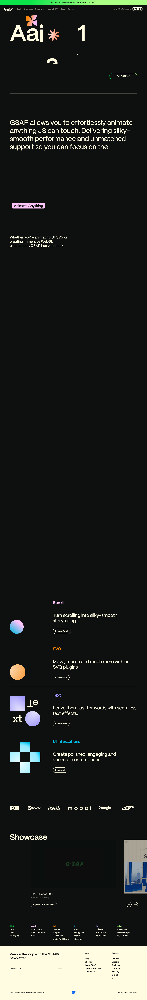

# Homepage | GSAP
> Animate Anything  ·  [gsap.com](https://gsap.com/)

**Vertical:** #vertical/docs-resource  ·  **Vibe:** #vibe/playful #vibe/technical  ·  **Topics:** #topic/engineering #topic/design  ·  **Mode:** #mode/dark

## What it is
Home page of GSAP (GreenSock), the long-standing professional JavaScript animation library, now supported by Webflow.

## What it shows
The pitch 'Animate Anything', then demo categories (Scroll, SVG, UI, Text, Other), the tools and plugins, and a Connect section.

## How it works
A 9,770px page that runs on GSAP itself (window.gsap is present). It has 6 videos, 103 SVGs and 8 images, with Google Tag Manager and Cloudflare analytics. Mobile collapses the nav into a 'Menu' button.

## How it's designed
Near-black #0e100f ground with cream text (--color-surface-white #fffce1) and a named, playful palette: shockingly-green #0ae448, shockingly-pink #f100cb, orangey #ff8709, lilac #9d95ff, blue #00bae2. Defined gradients include macha, orange-crush, lipstick, purple-haze and skyfall. Everything is set in Mori (400/600). The h1 is 32px at weight 400.

## Design data
- **Palette:** Black #0e100f, cream #fffce1, shocking green #0ae448, pink #f100cb, orange #ff8709, lilac #9d95ff
- **Palette tokens:** --color-just-black: #0e100f (var), --color-surface-white: #fffce1 (var), --color-shockingly-green: #0ae448 (var), --color-shockingly-pink: #f100cb (var), --color-orangey: #ff8709 (var), --color-lilac: #9d95ff (var), --color-blue: #00bae2 (var), body bg: rgb(14, 16, 15) (rendered), body text: rgb(255, 252, 225) (rendered)
- **Fonts:** Mori (400, 600)
- **Fonts loaded:** Mori 400, Mori 600
- **Tech stack:** GSAP, Google Tag Manager, Cloudflare Web Analytics, Webflow (sponsor)
- **Keywords:** dark, neon-accents, gradient-tokens, menu-button, video-demos, animation-library
- **Media mix:** img 8 · video 6 · svg 103
- **Page height:** 9770px (single-screen: False)
- **Responsive:** At 390px the nav collapses behind a 'Menu' button and the page shortens from 9,770 to 8,381px with no horizontal overflow.
- **Headings:** Animate Anything / GSAP / Scroll / SVG / UI / Text / Other / Connect
- **Weight:** None requests; hosts: www.googletagmanager.com, static.cloudflareinsights.com
- **Extracted:** 2026-10-17 · 1440x900 full-page screenshot + 390x844 DOM pass (no mobile screenshot); Playwright, logged_out: true

## Related sites
- [[animejs.com]] — shared: docs-resource, technical, engineering, design, dark
- [[componentry.dev]] — shared: docs-resource, technical, engineering, design, dark
- [[motion.dev]] — shared: docs-resource, technical, engineering, design, dark
- [[makingsoftware.com]] — shared: docs-resource, technical, engineering, design
- [[transitions.dev]] — shared: docs-resource, technical, engineering, design
- [[animations.dev]] — shared: docs-resource, engineering, design
