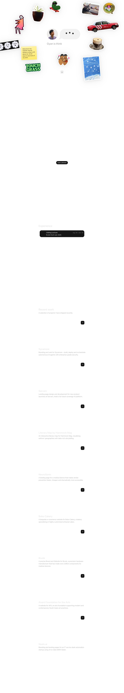

# Gyan Lakhwani | New Delhi based interaction designer with a decade of experience working with pixels, systems, and code.
> Gyan Lakhwani, Interaction Designer, New Delhi  ·  [gyanl.com](https://gyanl.com/)

**Vertical:** #vertical/portfolio  ·  **Vibe:** #vibe/playful #vibe/minimal  ·  **Topics:** #topic/design  ·  **Mode:** #mode/light

## What it is
Gyan Lakhwani's personal portfolio site — a New Delhi-based interaction designer with a decade of experience (per its own meta description).

## What it shows
A hero scattered with tappable illustrated stickers (a red Hong Kong taxi, a potted plant, a skateboarding caterpillar-thing, a cat photo, a "TOUCH GRASS" badge) around a chat-bubble avatar that idles through lines like "Gyan is snoozing"/"Gyan is thinking," a sticky note explaining you can tap the stickers, then an "Experience" timeline and a "Recent work" list of case studies (Synamore, Sarvam, Hammock Map's literary map, NeuroSonic, Boba Cakery, Bionik, Anveli Foundation for the Arts, Vibely.ai).

## How it works
Static Jekyll site (self-reported generator meta tag) hosted at gyanl.com, with Google Tag Manager for analytics and the Phosphor icon font pulled from unpkg. CSS custom properties expose a full light/dark theming system (`data-theme` attribute) plus a `--reveal-1..6` rainbow token set and hero/sticker animation timing variables, suggesting the sticker burst and chat-bubble idling are all driven by CSS custom-property transitions rather than a JS animation library.

## How it's designed
Toy-like and personal rather than corporate: hand-drawn/sticker-style imagery scattered with intentional randomness, a warm off-white ground, and a single muted maroon-red accent (hsl(348, 70%, 40%)) instead of a saturated brand color. Typography is entirely the system UI stack (-apple-system/Segoe UI/Roboto) — no custom webfont beyond the Phosphor icon set — which keeps the page fast and lets the sticker illustrations carry the personality.

## Design data
- **Palette:** Warm off-white ground #FFFFFF/#faf9f9, charcoal text #2A2A2A, one muted maroon-red accent hsl(348,70%,40%), plus a reserved rainbow token set (green/yellow/orange/red/purple/blue) for sticker-reveal accents.
- **Palette tokens:** --background-color: #FFFFFF (var), --slightly-warm-gray: #faf9f9 (var), --charcoal / --text-reg: rgb(42, 42, 42) (var), --accent-color: hsl(348, 70%, 40%) (var), --reveal-1..6: #61BB46 / #FDB827 / #F5821F / #E03A3E / #963D97 / #009DDC (var)
- **Fonts:** System fonts only (-apple-system, Segoe UI, Roboto stack) for both headings and body; Phosphor is the only actual webfont load, and it's an icon font.
- **Fonts loaded:** Phosphor (icon font only)
- **Tech stack:** Jekyll, Google Tag Manager, Phosphor Icons (unpkg)
- **Keywords:** sticker-board hero, chat-bubble micro-copy, CSS custom-property theming, case-study list, system-font portfolio
- **Media mix:** img 30 · svg 4
- **Page height:** 8011px (single-screen: False)
- **Responsive:** At 390x844 scrollHeight is 7351px (vs 8011px desktop) — the sticker hero and case-study thumbnails just resize down rather than restructuring, so the page stays roughly the same shape, only slightly more compact.
- **Headings:** Gyan Lakhwani, Interaction Designer, New Delhi / Experience / Recent work
- **Extracted:** 2026-09-22 · desktop 1440x900, mobile 390x844 (layout check only); logged_out: true

## Related sites
- [[designrebuilds.vercel.app]] — shared: portfolio, playful, minimal, design, light
- [[kmk0.com]] — shared: portfolio, playful, minimal, design, light
- [[mikes.cv]] — shared: portfolio, playful, minimal, design, light
- [[pengzhe.ng]] — shared: portfolio, playful, minimal, design, light
- [[asekachov.com]] — shared: portfolio, minimal, design, light
- [[christophlocher.com]] — shared: portfolio, minimal, design, light
