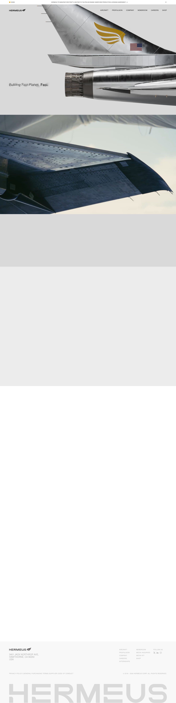

# Hermeus | Fast Planes, Fast.
> Building Fast Planes Fast.  ·  [hermeus.com](https://www.hermeus.com/)

**Vertical:** #vertical/startup-product  ·  **Vibe:** #vibe/luxury #vibe/technical  ·  **Topics:** #topic/engineering  ·  **Mode:** #mode/light

## What it is
The marketing site for Hermeus, a hypersonic-aircraft manufacturer (Meta description: "Reclaiming the lost art of rapid iterative prototyping to build fast and powerful aircraft on relevant timelines...").

## What it shows
A full-bleed hero of a jet's tail fin and afterburner nozzle glowing orange, with the blurred/sharpening tagline "Building Fast Planes Fast." over it, followed by a full-width photo of an aircraft wing against clouds, then sections headed "Mission" further down the page.

## How it works
The bookmarked clip is the hero's scroll-tied text effect: the tagline sits permanently defocused and racks in and out of sharp focus as you scroll past it, like a camera pulling focus rather than a simple fade. Built on Webflow (assets served from cdn.prod.website-files.com), with Google Fonts (ajax.googleapis.com) and a Cloudfront-hosted (d3e54v103j8qbb.cloudfront.net) asset pipeline alongside it.

## How it's designed
Aerospace-defense-contractor restraint: light gray ground (#ececec), a single amber accent (#f2a500) reserved for CTAs/hover states, and a condensed grotesque (Tex Gyre Heros) doing double duty as both display and body type — no separate display serif or script, just scale.

## Design data
- **Palette:** Light gray ground #ececec with near-black body text #454343 and one amber accent #f2a500; imagery (metal, orange engine glow) supplies the rest of the color.
- **Palette tokens:** --_palette---swatches--light-225 (body bg): #ececec (var), --_palette---swatches--dark-600 (body text): #454343 (var), --_palette---swatches--brand-amber (accent): #f2a500 (var), --_palette---swatches--dark-900: #000 (var), body background (rendered): rgb(236, 236, 236) (rendered), h1 color (rendered): rgb(69, 67, 67) (rendered)
- **Fonts:** Tex Gyre Heros (400 and 700 loaded) for everything; Inter is referenced in the stylesheet but never actually loaded/used.
- **Fonts loaded:** Texgyreheros 400, Texgyreheros 700
- **Tech stack:** Webflow, Google Fonts, Cloudflare/Cloudfront CDN
- **Keywords:** scroll-focus text effect, full-bleed hero photography, single-accent industrial palette, Webflow
- **Media mix:** img 10 · canvas 2 · video 1 · svg 30
- **Page height:** 5733px (single-screen: False)
- **Responsive:** At 390x844 scrollHeight drops to 3519px (from 5733px desktop) — the vw-clamped hero/section spacing that makes the desktop page feel cinematic simply compresses on mobile rather than the layout restructuring.
- **Headings:** Mission
- **Extracted:** 2026-09-22 · desktop 1440x900, mobile 390x844 (layout check only); logged_out: true

## Related sites
- [[getartcraft.com]] — shared: startup-product, technical, engineering, light
- [[printingpress.dev]] — shared: startup-product, technical, engineering, light
- [[todesktop.com]] — shared: startup-product, technical, engineering, light
- [[crustdata.com]] — shared: startup-product, technical, engineering
- [[daytona.io]] — shared: startup-product, technical, engineering
- [[hw.cafe]] — shared: startup-product, technical, engineering
