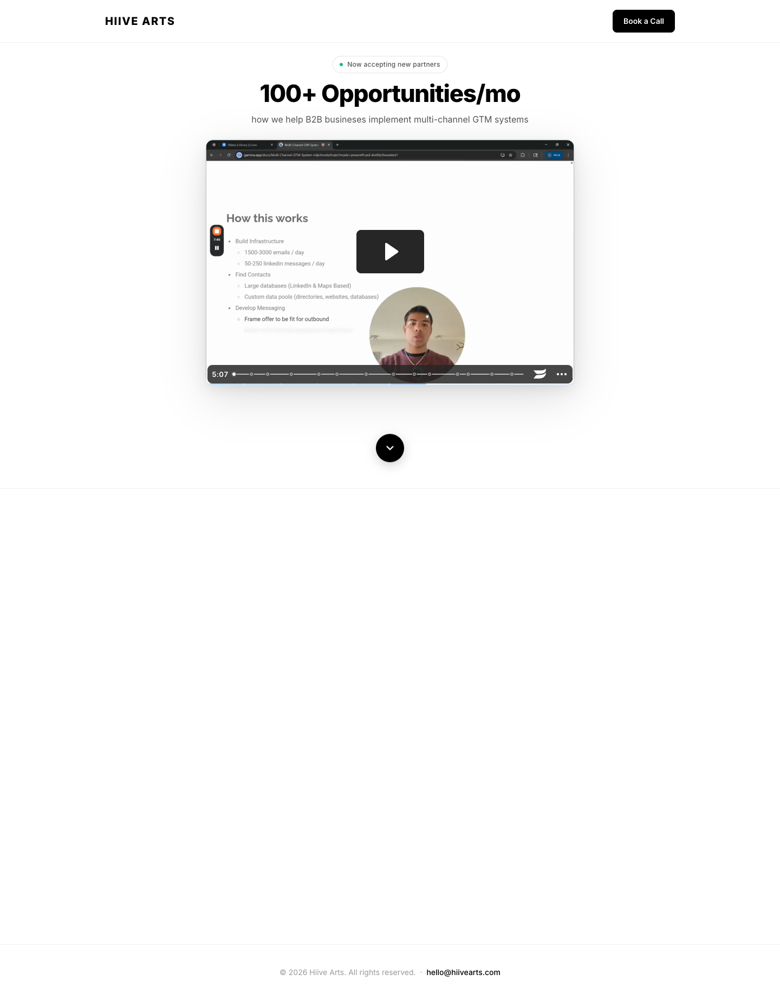

# Hiive Arts
> 100+ Opportunities/mo — how we help B2B businesses implement multi-channel GTM systems.  ·  [hiivearts.com](https://hiivearts.com/x)

## What it is
A stripped-down, single-screen landing page for Hiive Arts, a B2B go-to-market agency that builds multi-channel outbound systems and pitches '100+ opportunities per month' for its partners. The page exists to do one thing: get you to book a call.

## What it shows
A centered hero — 'HIIVE ARTS' wordmark at top-left, a black 'Book a Call' pill at top-right, a green-dot 'Now accepting new partners' status pill, an oversized '100+ Opportunities/mo' headline and a one-line subhead. The centerpiece is a large embedded Wistia video — a Loom-style screen recording titled 'How this works' that outlines Build Infrastructure (1500–3000 emails/day, 50–250 LinkedIn messages/day), Find Contacts and Develop Messaging, with a circular talking-head bubble in the corner. A round scroll-down chevron sits below; the footer is just a copyright line and an email.

## How it works
A pure single-CTA funnel: every path leads to the cal.com booking embed behind 'Book a Call.' The Wistia video carries the actual explanation, and the scroll chevron hints at content below the fold (largely empty in the capture). Sentry is wired in for client error monitoring.

## How it's designed
Aggressively minimal and high-contrast. A plain white ground holds near-black Inter typography — a heavy 44px/800 headline does the shouting — with a single black pill as the only chrome and a green status dot as the only color. Whitespace centers everything on the video, letting the bold number and the recording sell the service with zero decoration.

## Design data
- **Palette:** White ground (#fff) with black text and a black CTA pill (#000); a single green status dot — effectively monochrome.
- **Palette tokens:** body background: rgb(255, 255, 255) (rendered), body text: rgb(0, 0, 0) (rendered), h1: rgb(0, 0, 0) (rendered)
- **Fonts:** Inter across the board (weights 300–900, via Google Fonts); the embedded Wistia player ships its own bundled font (WistiaPlayerInter).
- **Fonts loaded:** Inter 400, Inter 500, Inter 600, Inter 800, WistiaPlayerInterNumbersSemiBold
- **Tech stack:** Wistia (video), cal.com (booking), Sentry, Google Fonts
- **Media mix:** svg 1 · iframe 1
- **Page height:** 1844px (single-screen: False)
- **Responsive:** At 390px the hero h1 scales down (44px → 27.3px); the layout is already a single centered column, so height is roughly unchanged (1844px → 1774px).
- **Headings:** 100+ Opportunities/mo
- **Links out:** [Book a Call](https://hiivearts.com/x/#cta) · [Email](mailto:hello@hiivearts.com)
- **Extracted:** 2026-06-06 · playwright-mcp @ 1440x900 + 390x844, logged_out: true

## Related sites
[[asekachov.com]] [[daviskeene.com]] [[designengineer.tools]] [[humanoid-index.com]] [[nicolasbustamante.com]] [[northgarden.com]]

## Tags
#category/reading #aesthetic/minimal #pattern/single-screen-landing #pattern/video-first #pattern/minimalist #pattern/monochrome #pattern/bold-number-hero #pattern/single-cta #pattern/wistia-embed #pattern/cal-booking #tech/wistia-video #tech/cal-com-booking #tech/sentry #tech/google-fonts #color/monochrome #color/cool #font/inter #font/wistiaplayerinternumberssemibold
