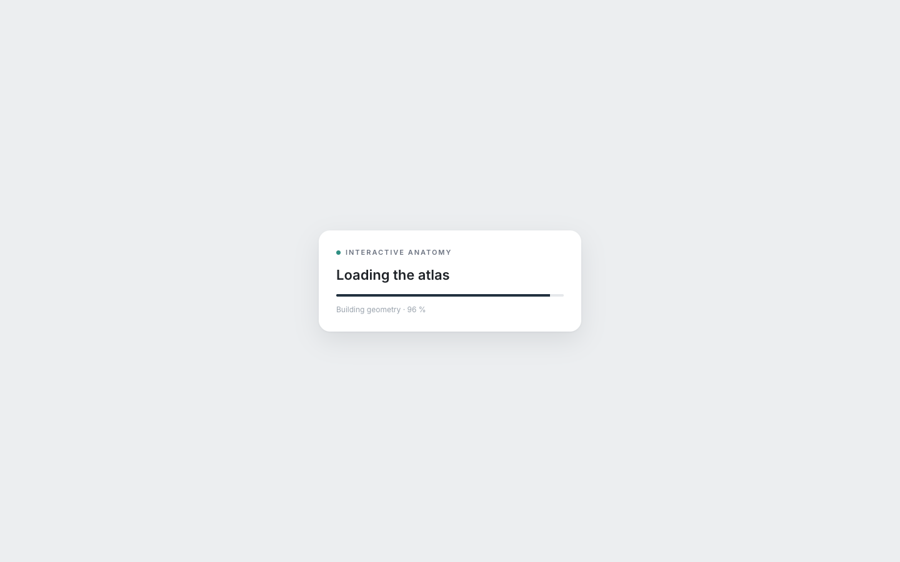

# Human Atlas — Interactive Anatomy
> An interactive 3D atlas of the adult human body: 2,234 modeled anatomical pieces, explorable by system and explodable into an inventory  ·  [humanatlas.quest](https://humanatlas.quest/)

**Vertical:** #vertical/tool-app  ·  **Vibe:** #vibe/minimal #vibe/technical  ·  **Topics:** #topic/health #topic/education  ·  **Mode:** #mode/light

## What it is
A single-page, single-screen 3D anatomy viewer (per its own meta description: "An interactive 3D atlas of the adult human body: 2,234 modeled anatomical pieces from BodyParts3D, explorable by system, explodable into an inventory, and searchable by structure"), built on the open BodyParts3D 4.0 adult male reference anatomy dataset (CC BY 4.0) and shipped as an open-source React/Three.js/shadcn project.

## What it shows
A left sidebar lists 15 toggleable anatomical systems (Skeleton 296, Muscles 402, Heart 23, Sensory organs 45, Arteries 639, Veins 404, Nervous system 139, Respiratory 119, etc.) each with a piece count and its own on/off switch, plus "All/Skeleton/Organs" quick filters. The center stage holds the 3D model itself — either assembled into a full standing figure or, via a bottom "Explode anatomy" percent slider, pulled apart into a flat inventory grid of every individual piece. Clicking any piece (skeletal bone, muscle, vessel) opens a right-hand detail card: system, a plain-language one-paragraph explainer of that structure's function, its FMA atlas reference ID, and an "Isolate structure" action. A top search box ("Find a structure") jumps straight to any of the 3,432 named anatomical concepts.

## How it works
Interaction is drag-to-orbit / pinch-to-zoom / tap-to-inspect on the single WebGL `<canvas>` element (the DOM probe found exactly one canvas and zero video/iframe elements). React is mounted (a `#root`/`#__next`-style root was detected) but no Nuxt/Next/Vue/Svelte globals were present, and the only script/stylesheet hosts are the site's own domain plus Google Fonts — no analytics or third-party embeds. The page is exactly one screen tall at both desktop and mobile (`scrollHeight` == `innerHeight` at 1440×900 and again at 390×844): all navigation happens inside the fixed canvas/panel layout rather than by scrolling.

## How it's designed
A restrained, clinical light UI built on CSS custom properties: `--bg: #eceef0`, `--bg-2: #e4e7ea`, `--card: #fff`, `--text: #1f2328`, `--text-2: #4b5563`, `--muted: #6b7280`, `--faint: #9aa3ad`, a navy accent pair (`--navy: #22313f`, `--navy-2: #2b3a4a`), and a single teal accent (`--teal: #2f8f83`) reserved for active/selected states, all on an 18px card radius with a soft drop shadow. Typography is Inter throughout (`document.fonts` confirms 400/500/600 actually loaded, 700 unloaded/unused) — the chrome is deliberately quiet (white cards, gray-scale panels) so the warm, red/beige-toned anatomical renders stay the only source of color on screen.

## Design data
- **Palette:** Cool light gray-blue ground (#eceef0) with white cards, near-black text (#1f2328), and a single teal accent (#2f8f83) reserved for active states; the anatomical 3D renders (warm reds/creams) are the only other color on the page.
- **Palette tokens:** --bg: #eceef0 (var), --bg-2: #e4e7ea (var), --card: #ffffff (var), --text: #1f2328 (var), --text-2: #4b5563 (var), --muted: #6b7280 (var), --faint: #9aa3ad (var), --navy: #22313f (var), --navy-2: #2b3a4a (var), --teal: #2f8f83 (var), body-background: rgb(236, 238, 240) (rendered), body-text: rgb(31, 35, 40) (rendered)
- **Fonts:** Inter (400/500/600 confirmed loaded via document.fonts; 700 loaded but unused) — no display/accent typeface, everything is set in the same sans.
- **Fonts loaded:** Inter 400, Inter 500, Inter 600
- **Tech stack:** React, WebGL canvas (single <canvas>; specific renderer not exposed via DOM globals), Google Fonts (Inter)
- **Keywords:** 3d-explorer, explode-view, layer-toggle-sidebar, structure-search, single-screen-app, webgl-canvas, open-source-data-viz
- **Media mix:** canvas 1 · svg 6
- **Page height:** 900px (single-screen: True)
- **Responsive:** At 390×844 the app stays exactly one screen tall (scrollHeight matches innerHeight, as on desktop) — the canvas/panel layout resizes to fit rather than reflowing into a scrolling page.
- **Headings:** Human Atlas 3D / Systems
- **Extracted:** 2026-09-22 · Playwright MCP, viewports 1440×900 (primary capture + DOM probe) and 390×844 (responsive check); logged_out: true.

## Related sites
- [[akira.sachi.dev]] — shared: tool-app, minimal, technical, light
- [[cig-index.vercel.app]] — shared: tool-app, minimal, health, light
- [[itshover.com]] — shared: tool-app, minimal, technical, light
- [[ditther.com]] — shared: tool-app, minimal, technical
- [[zendex.spyrosigma.in]] — shared: tool-app, minimal, technical
- [[beatspark.com]] — shared: minimal, technical, education
