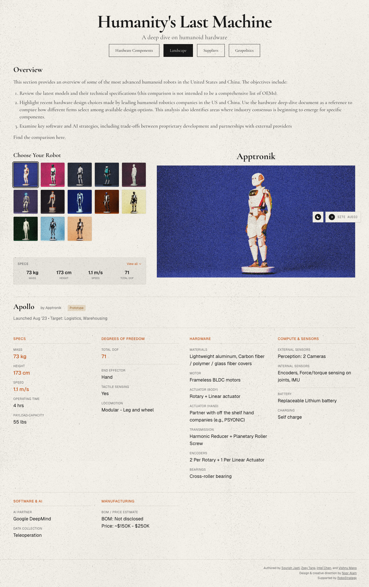

# Humanity's Last Machine
> A deep dive on humanoid robotics hardware and the technology shaping our future  ·  [humanityslastmachine.com](https://www.humanityslastmachine.com/humanoid-landscape)

**Vertical:** #vertical/docs-resource  ·  **Vibe:** #vibe/editorial #vibe/technical  ·  **Topics:** #topic/engineering  ·  **Mode:** #mode/light

## What it is
An editorial data page mapping the humanoid-robotics landscape — per its own meta description, "a deep dive on humanoid robotics hardware and the technology shaping our future" — letting readers browse robot models by manufacturer.

## What it shows
A "Choose Your Robot" thumbnail grid of ~13 humanoid robots in saturated color-blocked studio photography, a large noisy hero image of the selected robot (Apptronik's Apollo), a spec strip (73kg mass, 173cm height, 1.1 m/s speed, 71 total degrees of freedom), and an "Apollo by Apptronik" detail card noting its Aug '23 launch and logistics/warehousing target market.

## How it works
Server-rendered with no SPA framework globals detected; ships Google Tag Manager and Cloudflare Insights. Grain/noise texture on the hero photos appears to be a CSS/SVG filter overlay rather than canvas (0 canvas elements found).

## How it's designed
An editorial print-meets-tech mode: a warm off-white ground (#f5f2eb) with charcoal text (#1a1a1a) and a single burnt-orange highlight (#c4561a), pairing a display serif (Cormorant Garamond, weights 300–700) for headings against Geist Sans/Mono for UI labels and data — a magazine layout applied to a hardware-spec database.

## Design data
- **Palette:** Warm parchment background (#f5f2eb), charcoal text (#1a1a1a), burnt-orange accent (#c4561a), muted grey (#6b6b6b) for secondary copy
- **Palette tokens:** --background: #f5f2eb (var), --foreground: #1a1a1a (var), --highlight: #c4561a (var), --muted: #6b6b6b (var), --surface: #e8e5de (var)
- **Fonts:** Cormorant Garamond (display serif, 300-700) for headings; Geist Sans + Geist Mono for UI/labels
- **Fonts loaded:** Geist 400, Geist Mono 400, Cormorant Garamond 400/500/600/700
- **Tech stack:** Google Tag Manager, Cloudflare Insights, Cloudflare
- **Keywords:** editorial, data-viz, spec-sheet, serif-display
- **Media mix:** img 14 · svg 4
- **Page height:** 2291px (single-screen: False)
- **Responsive:** Page grows from 2291px to 3371px scroll height at 390px as the robot thumbnail grid and spec strip stack into a single column.
- **Headings:** Humanity's Last Machine / Overview / Apptronik
- **Extracted:** 2026-09-22 · 1440x900 desktop + 390x844 mobile pass, logged_out: true

## Related sites
- [[makingsoftware.com]] — shared: docs-resource, editorial, technical, engineering, light
- [[animations.dev]] — shared: docs-resource, editorial, engineering, light
- [[transitions.dev]] — shared: docs-resource, technical, engineering, light
- [[walkinglabs.github.io]] — shared: docs-resource, editorial, engineering, light
- [[printingpress.dev]] — shared: editorial, technical, engineering, light
- [[hw.cafe]] — shared: editorial, technical, engineering
