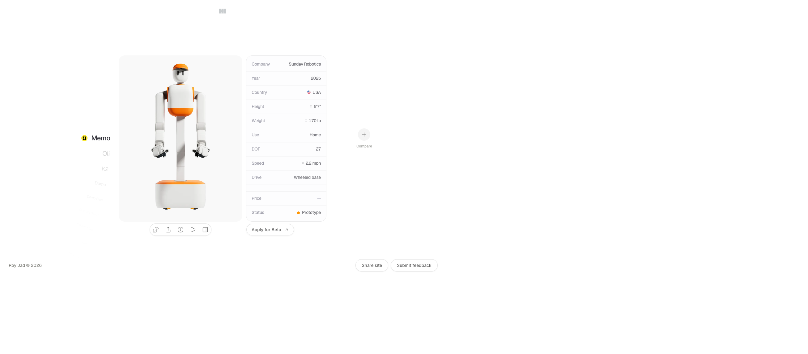

# Humanoid Index — a comprehensive visual index of humanoid robots
> A comprehensive visual index of humanoid robots.  ·  [humanoid-index.com](https://humanoid-index.com/)

**Vertical:** #vertical/directory-gallery  ·  **Vibe:** #vibe/minimal #vibe/technical  ·  **Topics:** #topic/engineering  ·  **Mode:** #mode/light

## What it is
Humanoid Index — 'a comprehensive visual index of humanoid robots.' It's the 'visual index of humanoid robots' from Jonas's list: a catalogue comparing the current generation of humanoid robots.

## What it shows
A gallery/index of humanoid robots — Memo, Oli, K2, Domo / Domo Plus, Tesla Optimus Gen 2, Boston Dynamics' Electric Atlas, 1X Neo, Figure 02, Sanctuary Phoenix, Apptronik Apollo, Unitree G1 / H1, Astribot S1, Tiangong and Menteebot — each with a photo and a spec blurb ('Memo is built for everyday housework, from tidying surfaces to moving…'), plus a Compare tool.

## How it works
A Next.js app (Geist typeface via next/font, next-font fallbacks and hashed static assets) self-hosted with Plausible analytics. It's media-forward — 32 robot images, 26 svg icons and 2 canvases (spec/compare visuals) — and runs a little taller than one screen (1150px).

## How it's designed
Restrained, spec-sheet minimalism built on a proper neutral design system read from :root: a white canvas (body rgb(255,255,255)) with a full grayscale ramp (--color-neutral-50 #fafafa → --color-neutral-900 #171717), four whisper-tinted surfaces (warm #fafaf8, cool #f8fafa, cream #faf9f8, blush #faf8f9) and a near-black accent (--color-accent #171717); body text is neutral-700 rgb(64,64,64). Type is Geist Sans (variable 100–900) with tight negative tracking (down to -0.04em) — clean, technical, Vercel-adjacent.

## Design data
- **Palette:** White with a full neutral-gray ramp (#fafafa → #171717) and four whisper-tinted surfaces (warm/cool/cream/blush); a near-black #171717 accent — monochrome so the robot photography pops.
- **Palette tokens:** --color-accent: #171717 (var), --color-surface-warm: #fafaf8 (var), --color-text-primary: #262626 (neutral-800) (var), body background: rgb(255, 255, 255) (rendered), body color: rgb(64, 64, 64) (rendered)
- **Fonts:** Geist Sans (variable 100–900) throughout — no serif — with tight negative tracking tokens.
- **Fonts loaded:** Geist Sans 100-900 (variable)
- **Tech stack:** Next.js (Geist / next-font), Plausible
- **Keywords:** index, directory, robotics, minimalist, monochrome, geist, nextjs, design-system, spec-sheet, comparison
- **Media mix:** img 32 · canvas 2 · svg 26
- **Page height:** 1150px (single-screen: False)
- **Responsive:** At 390x844 it deliberately replaces the whole index with a 'Mobile experience coming soon — open on desktop for the full thing' gate (offering a 'Send to my computer' option) rather than reflowing.
- **Extracted:** 2026-07-05 · Playwright MCP, 1440x900 + 390x844 mobile pass, logged_out: true

## Related sites
- [[designengineer.tools]] — shared: directory-gallery, minimal, technical, engineering, light
- [[21st.dev]] — shared: directory-gallery, minimal, engineering, light
- [[akira.sachi.dev]] — shared: minimal, technical, engineering, light
- [[getartcraft.com]] — shared: minimal, technical, engineering, light
- [[itshover.com]] — shared: minimal, technical, engineering, light
- [[siddz.com]] — shared: minimal, technical, engineering, light
