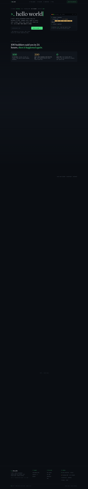

# Hello World Cafe — New York's First 24/7 Cafe for Builders
> >_ hello world  ·  [hw.cafe](https://hw.cafe/)

**Vertical:** #vertical/startup-product  ·  **Vibe:** #vibe/technical #vibe/editorial  ·  **Topics:** #topic/engineering #topic/food-drink  ·  **Mode:** #mode/dark

## What it is
The launch/waitlist site for Hello World Cafe (hw.cafe), pitched in the meta as "A 24/7, mostly-automated coffee shop for builders in NYC. Gigabit wifi, power at every seat, proper chairs, and a door that doesn't close." Its h1 is the literal terminal prompt ">_ hello world".

## What it shows
A terminal-themed one-pager: a fake zsh status bar ("hwc.boot — zsh — 80x24", "$ ./status --founding", an ASCII progress bar showing founding_200 "all claimed"), then narrative sections from the h2s — "100 builders said yes in 24 hours. then it happened again." (the_signal), "the founding 200." (a member wall), "everything you need. nothing you don't." (amenities), "save your spot in line." (join), and "questions, answered." (faq). Contact is daniel@hw.cafe with X (@hw_cafe_nyc) and a github org.

## How it works
Long single-scroll landing (~7,950px) with an anchor nav styled as file paths (// the_signal, // the_200, // amenities, // faq) jumping to in-page sections; the core CTA is "join the waitlist / save my spot". It carries a wallet-connect layer (RainbowKit CSS variables present), hinting at a token/membership or web3-gated reservation, though the founding 200 are already claimed and the funnel is now the waitlist. Self-hosted — every script and stylesheet is served from hw.cafe itself, with no third-party analytics detected.

## How it's designed
Full developer-terminal aesthetic done with taste: an almost-black #0a0d12 background, JetBrains Mono as the body typeface, and a phosphor-green accent (#4ade80) for the primary buttons and status glyphs, with amber/gold (#e8b765 / #d8a93e) as secondary signal colors. The twist is the oversized Fraunces serif display (h1 at 92px, light weight 300) playing against the monospace UI — code-meets-editorial. A tight CSS-variable design system (--bg/--panel/--line/--ink/--body/--dim ladder) keeps the dark palette layered and intentional.

## Design data
- **Palette:** Near-black canvas (#0a0d12) with phosphor-green accent (#4ade80) and amber/gold secondaries (#e8b765 / #d8a93e); off-white ink (#eef2f6), muted blue-grey body text (rgb(174,185,197))
- **Palette tokens:** --bg: #0a0d12 (var), --panel: #10151c (var), --green: #4ade80 (var), --amber: #e8b765 (var), --gold: #d8a93e (var), --ink: #eef2f6 (var), --body: #aeb9c5 (var), button-bg: rgb(74, 222, 128) (rendered), h1-color: rgb(238, 242, 246) (rendered)
- **Fonts:** JetBrains Mono (monospace) for body/UI; Fraunces (serif) for oversized display headings
- **Fonts loaded:** JetBrains Mono 400/500/700, Fraunces 300/400
- **Tech stack:** self-hosted (all assets from hw.cafe), RainbowKit/wallet-connect, Lightning CSS, no third-party analytics detected
- **Keywords:** terminal-aesthetic, monospace-ui, ascii-art, single-page-landing, anchor-nav, waitlist-funnel, dark-theme, serif-display-contrast, web3-walletconnect, self-hosted
- **Media mix:** img 8 · svg 12
- **Page height:** 7955px (single-screen: False)
- **Responsive:** At 390x844 the layout reflows to a tall single column (scrollHeight ~13,700px) and the Fraunces display h1 scales from 92px down to 52px; the file-path anchor nav stays inline rather than collapsing to a burger.
- **Headings:** >_ hello world / 100 builders said yes in 24 hours. then it happened again. / the founding 200. / everything you need. nothing you don't. / save your spot in line. / questions, answered.
- **Links out:** [twitter / x](https://x.com/hw_cafe_nyc) · [github](https://github.com/hw-cafe) · [daniel@hw.cafe](mailto:daniel@hw.cafe)
- **Weight:** None requests; hosts: hw.cafe
- **Extracted:** 2026-06-06 · Playwright MCP, 1440x900 + 390x844 mobile pass, logged_out: true

## Related sites
- [[printingpress.dev]] — shared: startup-product, technical, editorial, engineering
- [[crustdata.com]] — shared: startup-product, technical, engineering, dark
- [[daytona.io]] — shared: startup-product, technical, engineering, dark
- [[langchain.com]] — shared: startup-product, technical, engineering, dark
- [[lenis.dev]] — shared: startup-product, technical, engineering, dark
- [[cofounder.co]] — shared: startup-product, technical, editorial
