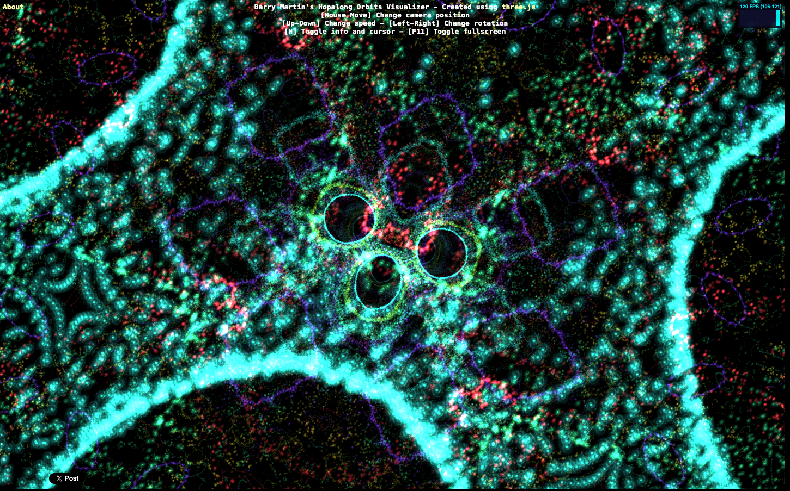

# Barry Martin's Hopalong Orbits Visualizer - WebGL Experiment
> A real-time, fly-through WebGL visualizer of Barry Martin's Hopalong strange attractor, rendered as a glowing galaxy of particles at 120fps.  ·  [iacopoapps.appspot.com](https://iacopoapps.appspot.com/hopalongwebgl/)

**Vertical:** #vertical/experiment-art  ·  **Vibe:** #vibe/experimental #vibe/technical  ·  **Topics:** #topic/art  ·  **Mode:** #mode/dark

## What it is
A single-purpose WebGL art toy by Iacopo Sassarini that plots Barry Martin's "Hopalong" iterated-map strange attractor as a live 3D particle field you fly through. Built with Three.js, it runs full-screen at a steady 120 FPS.

## What it shows
A black void filled with hundreds of thousands of luminous points: bright cyan/teal filaments and shells sweep across the frame in cell-like organic lobes, speckled with red, green and violet particles, with a cluster of circular orbit rings glowing at the centre. A small monospace overlay (top) shows the FPS counter and the title plus the control legend — [Mouse Move] change camera position, [Up-Down] change speed, [Left-Right] change rotation, [H] toggle info and cursor, [F11] fullscreen — with an "About" link top-left and a Twitter share button bottom-left.

## How it works
window.THREE is present — the attractor is computed and drawn as a Three.js point cloud, animated continuously as the camera drifts through it; mouse and arrow keys steer position, speed and rotation in real time. There are no CSS variables or webfonts; the UI is a thin monospace HUD over the canvas. Social/analytics widgets are bolted on (Google Analytics, Google Tag Manager, a Facebook connect script, and the Twitter platform widget). The page is effectively one full screen (scrollHeight ≈ 903).

## How it's designed
Classic dark-mode demoscene aesthetic: pure black background, 13px monospace HUD text, and *all* color delivered by the additive-blended particles themselves — electric cyan dominant, with red/green/magenta accents reading like a nebula or a microscope slide. The chrome is intentionally minimal and utilitarian so the generative geometry is the entire experience.

## Design data
- **Palette:** Pure black background (rgb(0,0,0)) with a monospace HUD; the imagery is additive glowing particles — dominant electric cyan/teal with red, green and violet accents
- **Palette tokens:** body-bg: rgb(0, 0, 0) (rendered), body-color: rgb(0, 0, 0) (rendered)
- **Fonts:** System monospace only (13px) — no webfont payload loaded (document.fonts empty)
- **Fonts loaded:** system only (no webfont)
- **Tech stack:** Three.js (window.THREE — WebGL point cloud), Google Analytics + Google Tag Manager, Facebook connect (social widget), Twitter platform widget, hosted on Google App Engine (appspot.com)
- **Keywords:** webgl, threejs, strange-attractor, particle-system, generative, real-time-3d, fly-through, dark-mode, demoscene, mesmerizing
- **Media mix:** canvas 4 · iframe 4
- **Page height:** 903px (single-screen: True)
- **Responsive:** At 390x844 the WebGL canvas reflows to the 390px viewport width with no horizontal overflow and the monospace HUD/legend stays in place — fully fluid, no distinct mobile layout.
- **Weight:** None requests; hosts: iacopoapps.appspot.com, connect.facebook.net, ssl.google-analytics.com, www.googletagmanager.com, platform.twitter.com
- **Extracted:** 2026-06-06 · Playwright MCP, 1440x900 + 390x844 mobile pass, logged_out: true

## Related sites
- [[zzz.zoomquilt.org]] — shared: experiment-art, experimental, art, dark
- [[backgrounds.supply]] — shared: experimental, art, dark
- [[bird.onethreenine.net]] — shared: experiment-art, art
- [[crustdata.com]] — shared: experimental, technical, dark
- [[davekrugman.com]] — shared: technical, art, dark
- [[ditther.com]] — shared: technical, art, dark
