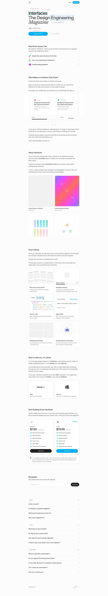

# Interfaces › Design Engineering Magazine
> Interfaces  ·  [interfaces.dev](https://interfaces.dev/)

**Vertical:** #vertical/publication-newsletter  ·  **Vibe:** #vibe/editorial #vibe/minimal  ·  **Topics:** #topic/design #topic/engineering  ·  **Mode:** #mode/light

## What it is
A design engineering magazine — its own meta describes it as 'a design engineering magazine about building great interfaces that covers topics such as animation, typography, layout and color.' It is the showcased subject of Jakub Krehel's tweet, where the animated app icon is the brand mark.

## What it shows
A long editorial homepage that opens on the single-word wordmark 'Interfaces' and scrolls through pitch sections — 'What Makes an Interface Feel Great?', 'About Interfaces' and 'How It Works' — illustrated with inline SVG diagrams (62 svg elements) rather than photography.

## How it works
A tall (~7,900px) single-page scroll. No client-side framework global is exposed (no Nuxt/Next/Vue/Svelte/React markers) and every script and stylesheet is served from interfaces.dev itself, pointing to a static/SSG build; the OG image is hosted on Vercel blob storage.

## How it's designed
Near-white paper (body background rgb(252,252,252)) with near-black ink, set in Inter Variable (the only loaded sans, 100–900) for both the 60px/weight-500 h1 and the body. A deep stack of accent webfonts is wired up through CSS variables — Libre Baskerville, Berkeley Mono, Redaction, Heldane and Openrunde — though only Inter Variable, Libre Baskerville and Berkeley Mono had actually loaded on first paint. Buttons are white-on-ink pills (14px). Quiet, typographic, editorial.

## Design data
- **Palette:** Off-white paper (#fcfcfc) with near-black ink and white pill buttons
- **Palette tokens:** body-bg: rgb(252, 252, 252) (rendered), ink (body/h1 color): lab(12.304 0 0) ≈ near-black (rendered), button-bg: lab(100 0 0) = white (rendered)
- **Fonts:** Inter Variable (body + headings); Libre Baskerville and Berkeley Mono as loaded accent families
- **Fonts loaded:** Inter Variable 100-900, Libre Baskerville 400, Berkeley Mono 400
- **Tech stack:** Static/SSG (no client framework global), Vercel (blob storage)
- **Keywords:** editorial, long-scroll, typographic, svg-illustration, design-engineering, magazine
- **Media mix:** img 11 · svg 62
- **Page height:** 7931px (single-screen: False)
- **Responsive:** At 390x844 the layout stacks into a single column and the page grows taller (scrollHeight 7931 → 11331); the 60px h1 size is unchanged.
- **Headings:** Interfaces / What Makes an Interface Feel Great? / About Interfaces / How It Works
- **Extracted:** 2026-06-06 · Playwright MCP, 1440x900 + 390x844, logged_out: true

## Related sites
- [[21st.dev]] — shared: editorial, minimal, design, engineering, light
- [[animations.dev]] — shared: editorial, minimal, design, engineering, light
- [[jib.design]] — shared: editorial, minimal, design, engineering, light
- [[sensory-ui.com]] — shared: editorial, minimal, design, engineering, light
- [[claude.com]] — shared: publication-newsletter, editorial, engineering, light
- [[geniusmargins.com]] — shared: publication-newsletter, editorial, minimal, light
