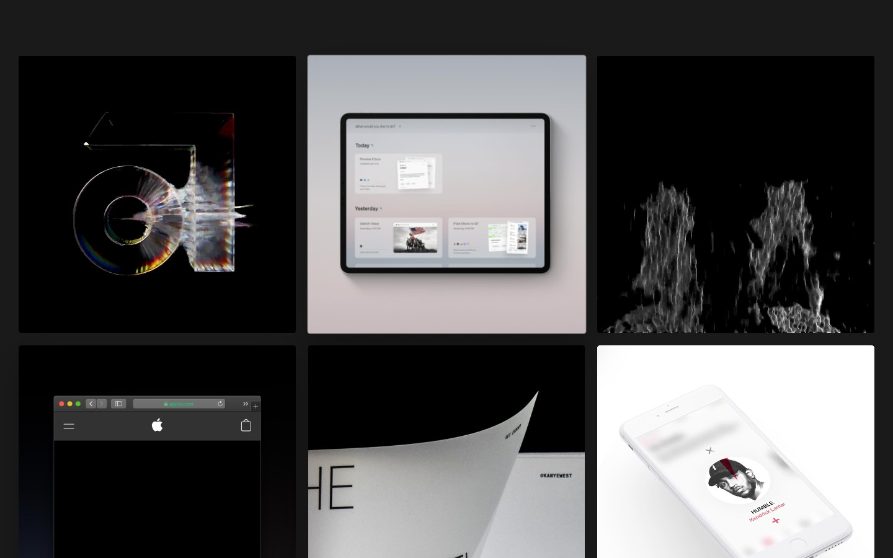

# Jason Yuan Design — a dark, media-rich design portfolio
> Jason designs interfaces: the metaphors that humanize them, and the systems that scale them.  ·  [jasonyuan.design](https://jasonyuan.design/)

**Vertical:** #vertical/portfolio  ·  **Vibe:** #vibe/experimental #vibe/minimal  ·  **Topics:** #topic/design  ·  **Mode:** #mode/dark

## What it is
The portfolio of Jason Yuan, the designer behind the Dot demo in this tweet. Its bio reads: 'Jason designs interfaces: the metaphors that humanize them, and the systems that scale them. His work ranges from choreographing kinetic type for Klim Type Foundry, to prototyping operating systems, like MercuryOS. He studied Theatre at Northwestern University and Graphic Design at RISD before working at Sony Music and Apple. Most recently he cofounded MakeSpace, a new way to be together online.' This is the natural 'you know where to find me' hub for his reflective/recruiting post.

## What it shows
A full-bleed grid of large project tiles (mostly Vimeo-hosted video) on near-black: a glassy chrome 'JY' monogram, a MakeSpace/OS-style iPad UI on a pink-grey gradient, a smoky 'HA' type piece ('I Have No Enemies'), an Apple.com browser mockup, a 'THE' poster (The Society of the Spectacle feat. Kanye West), and a Kendrick Lamar 'HUMBLE' phone UI. Project list (h2s): I Have No Enemies, Nox, Posters, The Society of the Spectacle (feat. Kanye West), Apple Music, Count the Clock, Something Wicked, Caonima Campaign, Fear, Treblemakers: Uncharted, Undertones: Spit It Out, Pentatonix, Sony Music: Summer Series, Maelstrom Sans Campaign, Apple, Mercury OS, The Future Mono 0.2.

## How it works
A React site (a React root is present) served from a Gatsby-style CDN (d33wubrfki0l68.cloudfront.net) with project videos embedded via Vimeo (player.vimeo.com). Media-heavy and gallery-first: 47 , 9 <video>, 1 <iframe>, 0 svg/canvas across a 3,956px page. There is no meta description, og:image or canonical.

## How it's designed
Gallery-first on a warm near-black canvas that lets the work carry all the colour. getComputedStyle reports body background rgb(26,26,27) (#1a1a1b) with base text rgb(0,0,0), though content sits on dark tiles and full-bleed imagery. Type: the body font-family is 'Suisse Intl' (a Swiss neo-grotesque) and that is the face that paints; 'NB Akademie Std' is declared at 300/400/500/600 but document.fonts reports it unloaded. No :root custom properties are exposed and there is no <h1> (project titles are <h2>) — the design leans entirely on full-bleed motion and generous negative space.

## Design data
- **Palette:** Warm near-black canvas (#1a1a1b) letting full-bleed project imagery/video supply the colour; minimal chrome, no exposed accent token.
- **Palette tokens:** body background: rgb(26, 26, 27) (rendered), body text: rgb(0, 0, 0) (rendered)
- **Fonts:** Suisse Intl (neo-grotesque — the loaded, painting face); NB Akademie Std (300/400/500/600) declared but reporting unloaded.
- **Fonts loaded:** Suisse Intl 400
- **Tech stack:** React (Gatsby-style build, Cloudfront CDN), Vimeo (project video)
- **Keywords:** portfolio, dark, near-black, gallery-grid, full-bleed, video, vimeo, gatsby, suisse-intl, motion, case-studies
- **Media mix:** img 47 · video 9 · iframe 1
- **Page height:** 3956px (single-screen: False)
- **Responsive:** At 390x844 the desktop multi-column tile grid collapses to a single full-width column of project tiles (page ~3,206px); it stays image/video-led with no separate mobile nav chrome.
- **Headings:** I Have No Enemies / Nox / Posters / The Society of the Spectacle (feat. Kanye West) / Apple Music / Count the Clock / Something Wicked / Caonima Campaign / Fear / Treblemakers: Uncharted / Undertones: Spit It Out / Pentatonix / Sony Music: Summer Series / Maelstrom Sans Campaign / Apple / Mercury OS / The Future Mono 0.2
- **Extracted:** 2026-07-08 · Playwright MCP, 1440x900 hero viewport only (JPEG) — the fullPage capture of this animated, video-heavy page repeatedly hit the screenshot timeout, so only the above-the-fold hero grid was captured — plus a 390x844 mobile probe; logged_out: true

## Related sites
- [[gaspardhedde.fr]] — shared: portfolio, experimental, minimal, design
- [[mapzilla.co.uk]] — shared: portfolio, experimental, minimal, design
- [[lab01.dev]] — shared: portfolio, minimal, design, dark
- [[tyronec.com]] — shared: portfolio, minimal, design, dark
- [[asekachov.com]] — shared: portfolio, minimal, design
- [[backgrounds.supply]] — shared: experimental, minimal, design, dark
