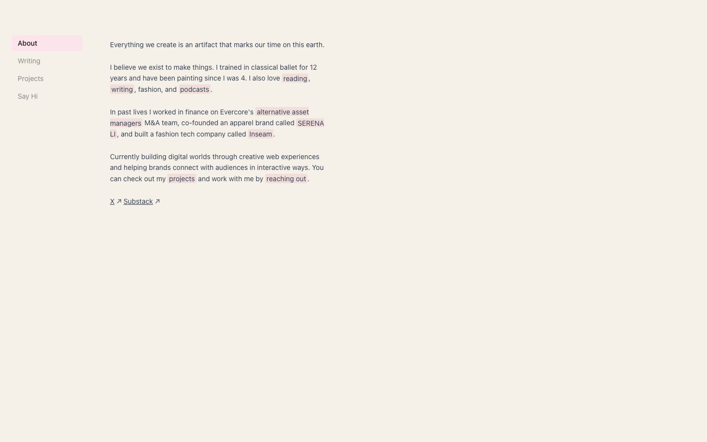

# Jess Yin — hey there
>   ·  [jessyin.world](https://jessyin.world)

**Vertical:** #vertical/portfolio  ·  **Vibe:** #vibe/playful #vibe/organic-warm  ·  **Topics:** —  ·  **Mode:** #mode/light

## What it is
The personal site of Jess Yin (ex-finance, apparel founder, now building creative web experiences), explicitly styled as a macOS Finder window. It's an about/portfolio hub that frames her life and work inside a familiar desktop-file metaphor.

## What it shows
A warm cream canvas with a left sidebar of 'files' (About, Writing, Projects, Say Hi) — the active one highlighted in soft pink — and a reading pane to the right. The About pane is a friendly first-person bio with key phrases (reading, writing, podcasts, SERENA LI, Inseam) highlighted like selected text, closing with X / Substack / TikTok links.

## How it works
Navigation mimics a Finder window: click an item in the left sidebar to swap the content pane, rather than loading new pages or scrolling a long document. The viewport is fixed (no page scroll); a single <canvas> adds a subtle ambient touch. Inline highlighted keywords double as links into projects and contact.

## How it's designed
Soft, tactile, personal: a warm cream ground (#f5f0e8) with rose-pink highlights (#fce4ec / #e8b4bc) and dark grey text, set in the system font for an honest, OS-native feel. The Finder metaphor is the whole concept — sidebar + pane, selection highlights, desktop calm — making a simple bio feel like poking around someone's computer.

## Design data
- **Palette:** Warm cream ground (#f5f0e8), rose-pink highlights (#fce4ec / #e8b4bc), dark grey text (#333), muted grey secondary (#888).
- **Fonts:** system UI (-apple-system / system-ui)
- **Keywords:** desktop-metaphor, finder-window, personal-homepage, sidebar-nav, no-scroll, warm-minimal, text-selection-highlight
- **Extracted:** 2026-06-04 · playwright-mcp @ 1440x900

## Related sites
- [[jessa.art]] — shared: portfolio, playful, organic-warm, light
- [[sneakers.charmiekapoor.com]] — shared: portfolio, playful, organic-warm, light
- [[spencer.place]] — shared: portfolio, playful, organic-warm
- [[chusmargallo.space]] — shared: portfolio, playful, light
- [[designrebuilds.vercel.app]] — shared: portfolio, playful, light
- [[gyanl.com]] — shared: portfolio, playful, light
