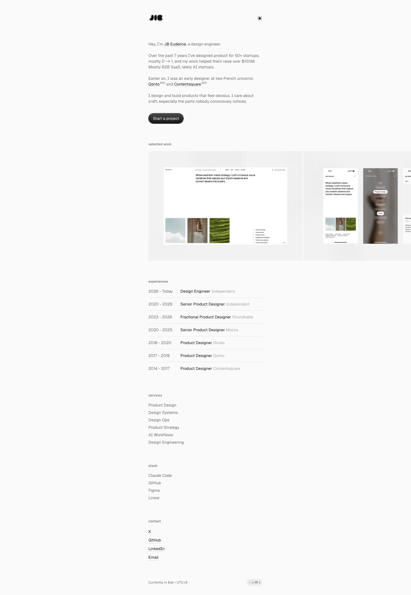

# JB Eudeline — Design Engineer
> Hey, I'm JB Eudeline, a design engineer.  ·  [jib.design](https://jib.design/)

**Vertical:** #vertical/portfolio  ·  **Vibe:** #vibe/minimal #vibe/editorial  ·  **Topics:** #topic/design #topic/engineering  ·  **Mode:** #mode/light

## What it is
The personal portfolio of JB Eudeline ("Jib"), a design engineer who designs and builds product for startups, framed by the bookmarking tweet as "my little corner on the internet" after 7 years of procrastination.

## What it shows
A single-page site: a hero bio ("Hey, I'm JB Eudeline, a design engineer... I help founders ship products that feel effortless"), a client-logo strip ("they trusted me"), a two-up "selected work" case-study gallery of desktop and mobile app screenshots, an experience timeline, services, stack, and a contact section.

## How it works
Built on Next.js (Geist Sans/Mono via next/font, no exposed framework globals but Geist font tokens and a Vercel-style design-token CSS-var system are the tell). 18 images, 8 canvases and 2 videos are present on the page — likely subtle canvas-driven hover/background effects in the case-study cards rather than a hero animation.

## How it's designed
Quiet, editorial-minimal: a warm off-white background (rgb(250,250,250)) with near-black text (lab(0 0 0 / 0.92)), Geist Sans for UI type and Geist Mono for labels/code accents. The card system uses an extensive black/white/grey/red/amber/green/blue alpha-ramp token set (--primitive-black-1 through -12, etc.) for consistent elevation and hover states, plus a full spacing/radius/duration token scale — the hallmarks of a design engineer's own component system rather than an off-the-shelf template.

## Design data
- **Palette:** Off-white background, near-black text, restrained greyscale UI with red/amber/green/blue accent ramps reserved for state (not seen live on this pass)
- **Palette tokens:** background: rgb(250, 250, 250) (rendered), body-color: lab(0 0 0 / 0.92) (rendered), --primitive-red-500: #f02f38 (var), --primitive-amber-500: #ec9500 (var), --primitive-green-500: #00bb53 (var), --primitive-blue-500: #0096f5 (var)
- **Fonts:** Geist Sans (headings/body) + Geist Mono (labels), both self-hosted via next/font — no third-party font CDN
- **Fonts loaded:** geistSans 400-900, geistMono 400-900
- **Tech stack:** Next.js, Geist font
- **Keywords:** portfolio, case-study-grid, design-tokens, minimal
- **Media mix:** img 18 · canvas 8 · video 2 · svg 1
- **Page height:** 2080px (single-screen: False)
- **Responsive:** Single-column stack at 390px; scrollHeight grows from 2080px to 2585px as the case-study grid and timeline reflow to one column.
- **Headings:** JB Eudeline / they trusted me / selected work / experiences / services / stack / contact
- **Extracted:** 2026-09-22 · 1440x900 desktop + 390x844 mobile pass, logged_out: true

## Related sites
- [[asekachov.com]] — shared: portfolio, minimal, editorial, design, light
- [[christophlocher.com]] — shared: portfolio, minimal, editorial, design, light
- [[daviskeene.com]] — shared: portfolio, minimal, editorial, engineering, light
- [[designrebuilds.vercel.app]] — shared: portfolio, minimal, design, engineering, light
- [[joonasvirtanen.com]] — shared: portfolio, minimal, editorial, design, light
- [[kmk0.com]] — shared: portfolio, minimal, design, engineering, light
