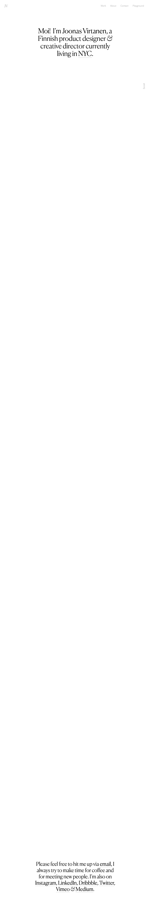

# Joonas Virtanen - Portfolio
> Portfolio of a Finnish experience designer & creative director currently living in NYC.  ·  [joonasvirtanen.com](https://www.joonasvirtanen.com/)

**Vertical:** #vertical/portfolio  ·  **Vibe:** #vibe/minimal #vibe/editorial  ·  **Topics:** #topic/design  ·  **Mode:** #mode/light

## What it is
The personal portfolio of Joonas Virtanen, a Finnish product designer & creative director living in NYC (h1: 'Moi! I'm Joonas Virtanen, a Finnish product designer & creative director currently living in NYC.'). The tweet showcases a generative weather toy — a site that 'picks the closest Rothko for how the weather feels outside your window' — and its t.co link resolves to this domain, so the homepage is the captured destination; the Rothko piece itself isn't surfaced as a separate nav link (a 'Playground' section holds his side projects).

## What it shows
A near-empty, mostly-white editorial homepage where a single centered serif paragraph introduces him, followed by a long list of case studies (Wealthsimple rebrand, an instant-payments app, a Sundance documentary action hub, a 'sight simulator', blind street-art project, fwd.us) that load as autoplaying project videos on scroll, and a closing 'say hi' block linking out to Instagram, LinkedIn, Dribbble, Twitter, Vimeo and Medium.

## How it works
A long single scroll (~8,723px) built in Webflow; the work grid is video-led (7 inline <video> plus 5 iframes) with project clips served from a DigitalOcean Spaces CDN and assets from Webflow's website-files CDN. No analytics host is exposed. Content is anchored (#work, #about, #contact) off a thin top nav.

## How it's designed
Quiet, type-first gallery aesthetic: a white ground (rgb(255,255,255)) with near-black text (rgb(18,18,18)) and an enormous amount of negative space, so the centered Canela serif hero (65px) carries the whole page. A single firebrick red (--firebrick #c72e2e) is the only declared accent. Body copy is set in Post Grotesk; the declared family list also names PP Neue Montreal and Romie, but only Canela and Post Grotesk Light actually load as webfonts.

## Design data
- **Palette:** White ground (rgb(255,255,255)) with near-black text (rgb(18,18,18)); a single firebrick-red accent (--firebrick #c72e2e), otherwise monochrome and whitespace-led.
- **Palette tokens:** body background (rendered): rgb(255,255,255) (rendered), body text (rendered): rgb(18,18,18) (rendered), --firebrick: #c72e2e (var)
- **Fonts:** Canela (serif display, the centered hero) + Post Grotesk (body sans); PP Neue Montreal and Romie are declared but unused — only Canela 300 and Post Grotesk Light 300 actually load.
- **Fonts loaded:** Canela 300, Post Grotesk Light 300
- **Tech stack:** Webflow, DigitalOcean Spaces (video CDN), no analytics detected
- **Keywords:** portfolio, light-mode, editorial, serif-display, whitespace, video-led, webflow, single-page-scroll
- **Media mix:** img 9 · video 7 · iframe 5
- **Page height:** 8723px (single-screen: False)
- **Responsive:** At 390x844 the top nav collapses to a Webflow burger (the inline nav is display:none and the .w-nav-button shows), the hero h1 drops from 65px to 35px, and scrollHeight tightens to ~6,777px.
- **Headings:** Moi!  I’m Joonas Virtanen, a Finnish product designer & creative director currently living in NYC.
- **Links out:** [Playground (side projects)](https://www.joonasvirtanen.com/playground) · [Instagram](http://instagram.com/joonasv) · [Dribbble](https://dribbble.com/joonasvirtanen)
- **Extracted:** 2026-06-05 · playwright-mcp @ 1440x900 (fullPage) + mobile 390x844, logged_out: true

## Related sites
- [[asekachov.com]] — shared: portfolio, minimal, editorial, design, light
- [[christophlocher.com]] — shared: portfolio, minimal, editorial, design, light
- [[daryl.cv]] — shared: portfolio, minimal, design, light
- [[daviskeene.com]] — shared: portfolio, minimal, editorial, light
- [[designrebuilds.vercel.app]] — shared: portfolio, minimal, design, light
- [[gaspardhedde.fr]] — shared: portfolio, minimal, design, light
