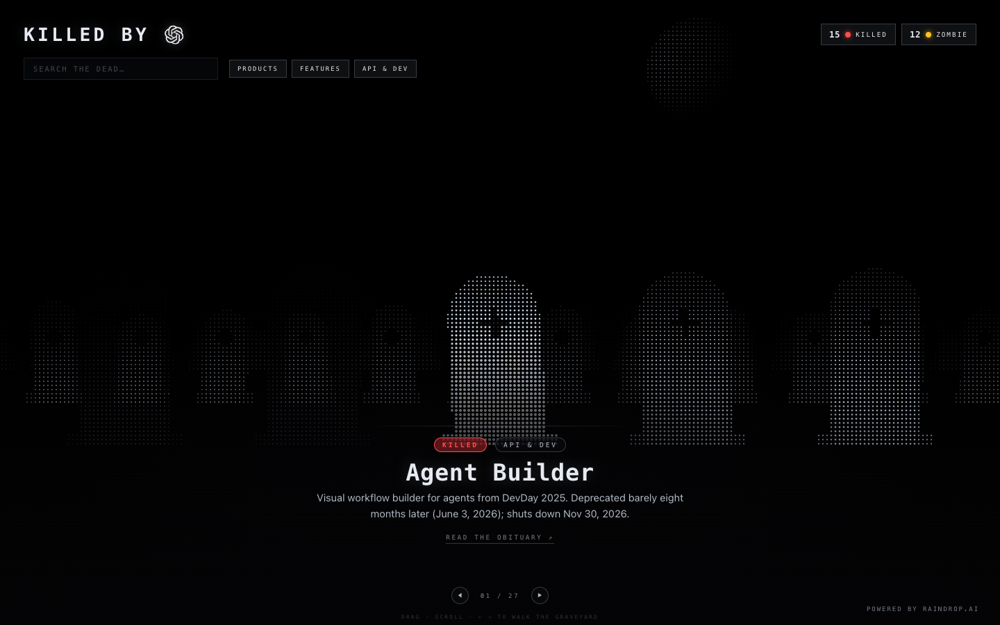

# Killed by OpenAI — a dot-matrix 'graveyard' tracking every OpenAI product, feature and API (alive / killed / zombie)
> A graveyard tracking every OpenAI product, feature and API — alive, killed, or zombie (shipped but left to rot).  ·  [killedbyopenai.com](https://killedbyopenai.com/)

**Vertical:** #vertical/directory-gallery  ·  **Vibe:** #vibe/technical  ·  **Topics:** #topic/ai  ·  **Mode:** #mode/dark

## What it is
'Killed by OpenAI' — a single-screen web toy/directory in the 'killedbyGoogle' tradition that, in its own words, is 'a graveyard tracking the lifecycle of every OpenAI product, feature and API — what is still alive, what has been killed or deprecated, and what has shipped but been left to rot (zombie).' It is the project Ben Hylak announced ('introducing killedbyopenai dot com … a digital graveyard for everything openai has killed'); the footer credits 'POWERED BY RAINDROP.AI', his AI-observability startup, whose careers page the tweet's actual t.co link points to.

## What it shows
A near-black stage with a horizontal carousel (drag / scroll ←→ to 'walk the graveyard', paged '01 / 27') of animated dot-matrix / halftone 'tombstones', each morphing the OpenAI mark into a headstone. The top bar has a 'KILLED BY [OpenAI logo]' wordmark, a 'SEARCH THE DEAD…' field and PRODUCTS / FEATURES / API & DEV filters; the top-right shows status counters ('15 ● KILLED' in red, '12 ● ZOMBIE' in amber). Each entry carries a status pill (KILLED / ZOMBIE) plus a category tag, a monospace title, a one-line cause-of-death and a 'READ THE OBITUARY →' link. Entries include Agent Builder, Sora, GPT-4o, Canvas, AI Text Classifier, GPTs, Atlas Browser, Deep Research, GPT Store, ChatGPT Plugins, Operator, Realtime API and more.

## How it works
A fully self-hosted single-page app — every <script> and stylesheet is served from killedbyopenai.com itself, with no third-party analytics or CDN hosts. The tombstones are drawn on a single <canvas> (the only <canvas>; there are 0  and just 1 <svg>) and animated in place; document.documentElement.scrollHeight equals innerHeight (900px), so it is one vertical screen with horizontal paging rather than a long scroll. No client-framework global is exposed, but the dynamic /opengraph-image (og:image = /opengraph-image?<hash>) and /icon.svg metadata routes are Next.js App Router conventions, so it is most likely Next.js.

## How it's designed
A terminal/obituary aesthetic in monospace on near-black, with the palette declared explicitly in :root. Surfaces are --bg #050507 and --bg-2 #08080b; text runs --ink #e7eaf0 / --ink-soft #b3b9c4 / --muted #767c89 / --faint #41454f over hairline borders (--line rgba(150,162,184,0.14)); and three status colours carry all the meaning — --killed #ff4d4d (red), --zombie #ffc21f (amber) and --alive #3fe08a (green) — plus a soft --glow. getComputedStyle confirms body renders at rgb(5,5,7) with rgb(231,234,240) text. Type is system-only: --mono (ui-monospace / SF Mono / JetBrains Mono / Cascadia Code…) for nearly everything — the 'KILLED BY' h1 renders in that mono stack at 26.4px — with --sans (system-ui) as backup; document.fonts is empty, so there is no webfont payload at all.

## Design data
- **Palette:** Near-black surfaces (--bg #050507 / --bg-2 #08080b) with off-white ink (--ink #e7eaf0); three status accents do the signalling — killed red #ff4d4d, zombie amber #ffc21f, alive green #3fe08a.
- **Palette tokens:** --bg: #050507 (var), --bg-2: #08080b (var), --ink: #e7eaf0 (var), --ink-soft: #b3b9c4 (var), --muted: #767c89 (var), --killed: #ff4d4d (var), --zombie: #ffc21f (var), --alive: #3fe08a (var), html/body background: rgb(5, 5, 7) (rendered), body text: rgb(231, 234, 240) (rendered)
- **Fonts:** System-only, no webfont payload — a monospace stack (ui-monospace / SF Mono / JetBrains Mono, via --mono) for headings and body, with system-ui (--sans) as fallback (document.fonts is empty).
- **Fonts loaded:** system only (no webfont)
- **Tech stack:** Next.js (App Router — inferred from /opengraph-image + /icon.svg metadata routes; no framework global exposed), Canvas 2D, self-hosted (no third-party analytics/CDN)
- **Keywords:** dark, monospace, terminal, dot-matrix, halftone, canvas, generative, single-screen, horizontal-carousel, directory, graveyard, status-tokens, system-font
- **Media mix:** canvas 1 · svg 1
- **Page height:** 900px (single-screen: True)
- **Responsive:** At 390x844 it stays a single vertical screen (scrollHeight 844) with the same horizontal-carousel layout; the 'KILLED BY' wordmark shrinks (26.4px → 16.8px) and the search field / filter chips compress to fit.
- **Headings:** KILLED BY / Agent Builder / Evals platform / ChatGPT Pulse / Sora / Sora Mobile App (Social) / ChatGPT Plugins / Self-serve fine-tuning / Videos API (Sora 2) / Operator / GPT-4o / Canvas / 'Sky' voice / Computer-use model / Edits API (/v1/edits) / AI Text Classifier / ChatGPT Voice (Advanced Voice Mode) / Responses API / ChatGPT search / Realtime API / Atlas Browser / Standard Voice Mode / Deep Research / Scheduled Tasks / GPT Store
- **Links out:** [Powered by Raindrop.ai](https://raindrop.ai/)
- **Extracted:** 2026-07-05 · Playwright MCP, 1440x900 fullPage + 390x844 mobile probe; logged_out: true

## Related sites
- [[motionsites.ai]] — shared: directory-gallery, technical, ai, dark
- [[sceneai.art]] — shared: directory-gallery, technical, ai, dark
- [[21st.dev]] — shared: directory-gallery, ai
- [[are.na]] — shared: directory-gallery, ai
- [[ashpreetbedi.com]] — shared: technical, ai, dark
- [[coolsites.ai]] — shared: directory-gallery, ai
