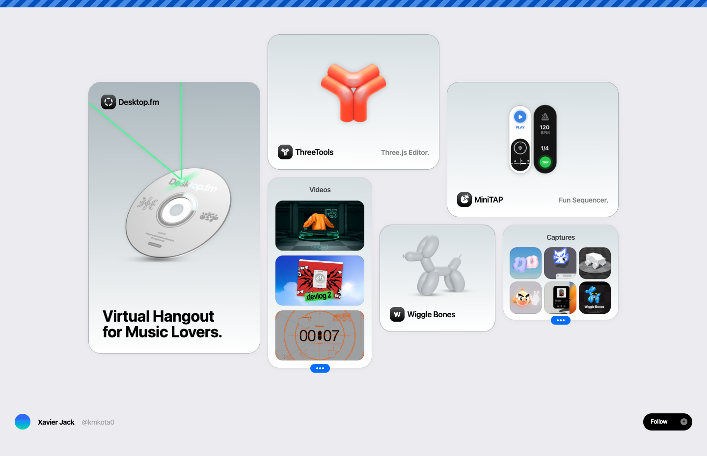

# Xavier (Jack) – kmk0 – @KMkota0
> Making websites is my passion. Here's a quick view to what I am working on and links to relevant projects.  ·  [kmk0.com](https://kmk0.com/)

**Vertical:** #vertical/portfolio  ·  **Vibe:** #vibe/playful #vibe/minimal  ·  **Topics:** #topic/engineering #topic/design  ·  **Mode:** #mode/light

## What it is
The personal portfolio of Xavier (Jack) / @KMkota0 — author of the motion-graphics tweet and maker of mo¹. The site is a playful index of the web apps and experiments he is building.

## What it shows
A bento grid of project cards: Desktop.fm ('Virtual Hangout for Music Lovers', with a spinning CD/disc render), ThreeTools (a Three.js editor, orange Y-logo), MiniTAP (a 'Fun Sequencer' styled like a fitness band), Wiggle Bones (a glossy balloon-dog 3D render), a 'Videos' card with three thumbnails, and a 'Captures' icon grid. A blue diagonal-stripe banner caps the top; the footer shows 'Xavier Jack @kmkota0' with a Follow button.

## How it works
A single-screen bento layout (no scroll at desktop; scrollHeight == 900) where each card is an outbound link with an 'Open external link' affordance to the live project (three.tools, minitap.io, desktop.fm, wiggle.three.tools) plus social links (Twitter, YouTube, TikTok, Instagram).

## How it's designed
Friendly, OS-widget aesthetic: a light grey ground with rounded, frosted/elevated cards, a blue diagonal-stripe header, and a single blue accent (#3b84e3, with a faded #3b84e388 variant). Glossy 3D product renders are the visual hero. Built on Nuxt with Tailwind utility classes, and it ships no webfont — type is the Tailwind system-sans stack.

## Design data
- **Palette:** Light grey/white ground, black text, blue accent (#3b84e3) carried by the striped banner and links.
- **Palette tokens:** --accent: #3b84e3 (var), --accent-faded: #3b84e388 (var), --tw-ring-color: rgba(59,130,246,.5) (var), body text (rendered): rgb(0,0,0) (rendered)
- **Fonts:** System sans only (Tailwind ui-sans-serif / system-ui stack) — no webfont payload.
- **Fonts loaded:** system only (no webfont)
- **Tech stack:** Nuxt / Vue, Tailwind CSS, Plausible Analytics
- **Keywords:** bento-grid, single-screen, portfolio, product-cards, 3d-render, frosted-cards, system-fonts, outbound-index, playful
- **Media mix:** img 77 · svg 21
- **Page height:** 900px (single-screen: True)
- **Responsive:** At 390x844 the bento cards stack into a single column; scrollHeight grows to ~2,251px.
- **Headings:** Xavier Jack / Virtual Hangout for Music Lovers. / Captures / Videos
- **Links out:** [Desktop.fm](http://desktop.fm/) · [ThreeTools](http://three.tools/) · [MiniTAP](http://minitap.io/) · [Wiggle Bones](https://wiggle.three.tools/) · [Twitter](https://x.com/KMkota0) · [YouTube](https://www.youtube.com/@KMkota0)
- **Extracted:** 2026-06-05 · playwright-mcp @ 1440x900 (fullPage) + mobile 390x844

## Related sites
- [[designrebuilds.vercel.app]] — shared: portfolio, playful, minimal, engineering, design, light
- [[gyanl.com]] — shared: portfolio, playful, minimal, design, light
- [[jib.design]] — shared: portfolio, minimal, engineering, design, light
- [[mikes.cv]] — shared: portfolio, playful, minimal, design, light
- [[pengzhe.ng]] — shared: portfolio, playful, minimal, design, light
- [[drawably.dev]] — shared: playful, minimal, engineering, design, light
