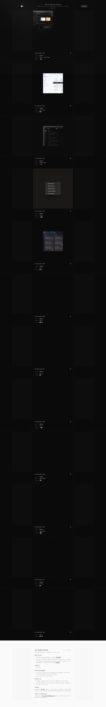

# Lab01 - Sebastiano Guerriero's portfolio
> Lab01 by Sebastiano Guerriero — a portfolio/lab of live front-end UI experiments (derived from the h1; the page ships no meta description).  ·  [lab01.dev](https://lab01.dev/)

**Vertical:** #vertical/portfolio  ·  **Vibe:** #vibe/minimal #vibe/technical  ·  **Topics:** #topic/design #topic/engineering  ·  **Mode:** #mode/dark

## What it is
Sebastiano Guerriero's experiments lab and the home of the tweet's demo. The h1 reads 'Lab01 by Sebastiano Guerriero'; the page ships no meta description. It is a running index of numbered front-end UI experiments (the drag-to-collapse sidebar is one of them).

## What it shows
A dark, terminal-flavoured single page listing 'UI Experiment #01' through '#12' (plus a 'The Founder Package' section), each mounted as a live embedded demo via <iframe> (9 iframes), with a few inline SVG marks (15) and images (3).

## How it works
A static, framework-less site served from lab01.dev (no __NEXT_DATA__/React/Nuxt/Svelte globals present), instrumented lightly with Umami (cloud.umami.is) and Cloudflare Web Analytics. Each experiment is isolated in its own iframe so the interactions run independently.

## How it's designed
A monochrome dark 'lab' aesthetic driven by a single monospace typeface. getComputedStyle reports a near-black body background rgb(10,10,10) with off-white text (white at 80% opacity), and the whole page — h1 included — set in the variable 'Geist Mono' (100–900). Interactive buttons are dark-grey chips rgb(38,38,38). No :root colour tokens are published; the palette is essentially black / off-white / grey.

## Design data
- **Palette:** Near-black canvas rgb(10,10,10) with off-white text (white @ 80%) and dark-grey button chips rgb(38,38,38) — a strict monochrome lab look.
- **Palette tokens:** body background: rgb(10, 10, 10) (rendered), body text: rgba(255, 255, 255, 0.8) (rendered), button background: rgb(38, 38, 38) (rendered)
- **Fonts:** One typeface everywhere: the variable monospace 'Geist Mono' (100–900), including headings.
- **Fonts loaded:** Geist Mono (variable 100-900)
- **Tech stack:** Static site (no meta-framework global), Umami analytics, Cloudflare (Web Analytics + CDN)
- **Keywords:** experiments-lab, portfolio, dark, monospace, geist-mono, iframe-demos, ui-experiments, minimal
- **Media mix:** img 3 · svg 15 · iframe 9
- **Page height:** 9568px (single-screen: False)
- **Responsive:** At 390x844 there is no burger nav (the layout is a minimal single column); the experiment stack reflows to a centered column (24px / 342px / 24px gutters) and the page shortens from 9,568 to 7,397px with no horizontal overflow.
- **Headings:** Lab01 by Sebastiano Guerriero / UI Experiment #01 / UI Experiment #02 / UI Experiment #03 / UI Experiment #04 / UI Experiment #05 / UI Experiment #06 / UI Experiment #07 / UI Experiment #08 / UI Experiment #09 / UI Experiment #10 / UI Experiment #11 / UI Experiment #12 / The Founder Package
- **Weight:** None requests; hosts: lab01.dev, cloud.umami.is, static.cloudflareinsights.com
- **Extracted:** 2026-07-08 · Playwright MCP, 1440x900 fullPage + 390x844 mobile probe; logged_out: true.

## Related sites
- [[khairallah.xyz]] — shared: portfolio, minimal, technical, engineering, dark
- [[designrebuilds.vercel.app]] — shared: portfolio, minimal, design, engineering
- [[kmk0.com]] — shared: portfolio, minimal, design, engineering
- [[siddz.com]] — shared: portfolio, minimal, technical, engineering
- [[spyrosigma.in]] — shared: portfolio, minimal, technical, engineering
- [[designengineer.tools]] — shared: minimal, technical, design, engineering
