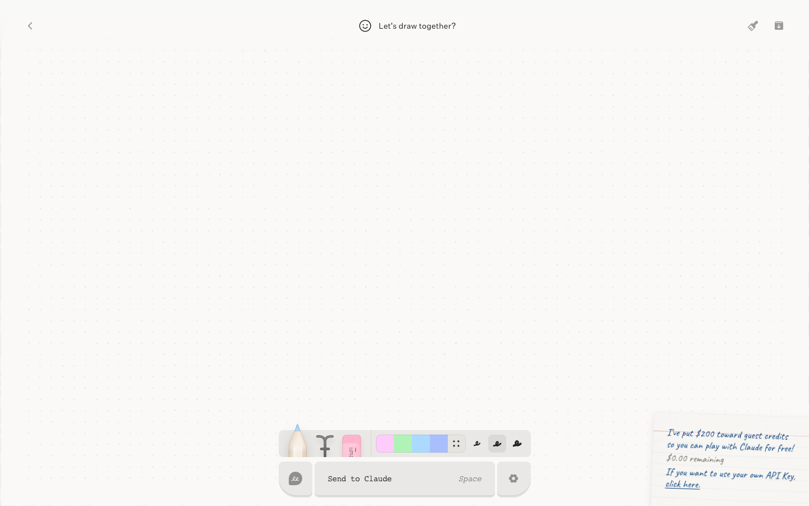

# draw — let's draw together (send your sketch to Claude)
> Interactive drawing experiments and demos.  ·  [lelezhang.design](https://lelezhang.design/draw)

**Vertical:** #vertical/tool-app  ·  **Vibe:** #vibe/playful #vibe/organic-warm  ·  **Topics:** #topic/ai #topic/art  ·  **Mode:** #mode/light

## What it is
'draw' — an interactive drawing playground on designer Lele Zhang's personal site where you sketch on screen and 'Send to Claude' to collaborate with AI. It's the 'finger paint on screen' from Jonas's list (surfaced via a quote of @itsjessyin, resolved to lelezhang.design/draw).

## What it shows
A calm, paper-like drawing board with a floating glass toolbar: you sketch freehand and hit 'Send to Claude' to have the model riff on your drawing ('Let's draw together?'). Guest Claude credits were provided — now '$0.00 remaining' — with a bring-your-own-API-key option.

## How it works
A self-hosted static build (no client-framework global exposed) with an SVG/DOM drawing surface (0 canvas, 13 svg icons, 8 img) and an extensive '--draw-*' CSS custom-property design system (glassmorphic panels, ink/surface tokens). Type is served via Adobe Typekit + Google Fonts, and it calls the Anthropic/Claude API to interpret drawings. Single-screen (900px).

## How it's designed
Soft, papery, glassmorphic. From :root tokens the page is warm off-white (--draw-bg-page #efeeec, surface rgb 250,249,247) with slate-blue ink (body rgb(47,53,87) = --slate #2f3557), a single blue accent (--draw-blue #0069d3) and translucent frosted panels (--glass-bg #c6c7d24d). Type pairs untitledSans (a clean grotesque for UI) with Caveat (a handwriting script) — the handwriting carrying the friendly 'let's draw' voice.

## Design data
- **Palette:** Warm off-white paper (#efeeec / rgb 250,249,247) with slate-blue ink (#2f3557), a single blue accent (#0069d3) and frosted-glass panels (#c6c7d24d).
- **Palette tokens:** --slate: #2f3557 (var), --draw-bg-page: #efeeec (var), --draw-blue: #0069d3 (var), --glass-bg: #c6c7d24d (var), body color: rgb(47, 53, 87) (rendered), body background: rgb(251, 251, 252) (rendered)
- **Fonts:** untitledSans (UI grotesque) with Caveat (handwriting script) for the playful voice.
- **Fonts loaded:** untitledSans 400, Caveat 400
- **Tech stack:** Static site (no framework global), Adobe Typekit, Google Fonts, Anthropic Claude API
- **Keywords:** drawing-tool, ai-collab, claude-api, glassmorphism, paper, slate-blue, handwriting-font, playful, design-system
- **Media mix:** img 8 · svg 13
- **Page height:** 900px (single-screen: True)
- **Responsive:** At 390x844 it stays a single screen; the floating toolbar sheds a few controls (13 → 10 svg icons) to fit the narrow viewport.
- **Extracted:** 2026-07-05 · Playwright MCP, 1440x900 + 390x844 mobile pass, logged_out: true

## Related sites
- [[clipart.studio]] — shared: tool-app, playful, organic-warm, art, light
- [[appdrop.com]] — shared: tool-app, playful, organic-warm, light
- [[cafe.endofday.studio]] — shared: tool-app, playful, organic-warm
- [[coolsites.ai]] — shared: playful, organic-warm, ai, light
- [[nehasharma.dev]] — shared: playful, organic-warm, ai, light
- [[cig-index.vercel.app]] — shared: tool-app, playful, light
