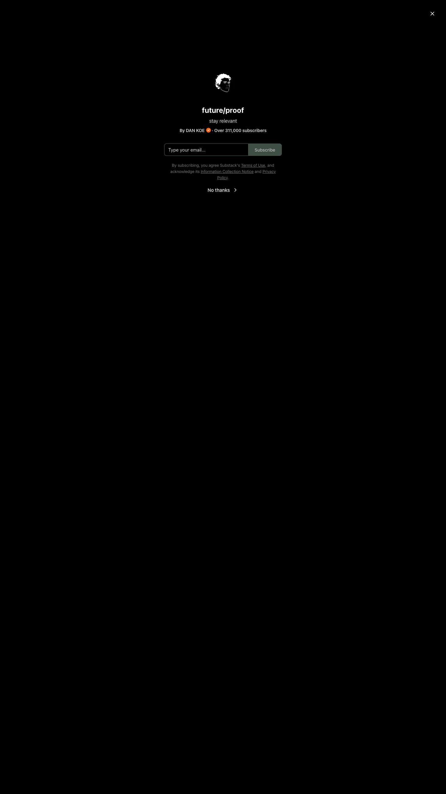

# future/proof | DAN KOE | Substack
> stay relevant  ·  [letters.thedankoe.com](https://letters.thedankoe.com/)

**Vertical:** #vertical/publication-newsletter  ·  **Vibe:** #vibe/editorial #vibe/minimal  ·  **Topics:** #topic/writing  ·  **Mode:** #mode/dark

## What it is
The custom-domain landing page for "future/proof", Dan Koe's Substack newsletter (h1 "future/proof", subtitle "stay relevant") — a personal-development / creator-economy publication with over 311,000 subscribers per the on-page count.

## What it shows
On load the page is gated by Substack's full-screen subscribe modal: the publication's stylized line-art portrait avatar, the title, the "stay relevant" tagline, the "By DAN KOE · Over 311,000 subscribers" credit, an email capture with a green Subscribe button, and a "No thanks" dismiss. Behind it the home feed leads with the post "Purpose & Profit – A Guide To Discovering Your Life's Work".

## How it works
Standard Substack publication template on a custom domain: an email-first conversion gate intercepts the visit, dismissible via "No thanks" to reach the chronological post list. Subscribe/read flows are Substack-hosted; analytics run through Sentry, Datadog RUM and GTM.

## How it's designed
A dark theme (true-black #000000 web background via Substack theme vars) with a muted sage-green accent/pop color (#54675e) on the Subscribe CTA — a restrained, editorial palette rather than Substack's default orange. Typography is the classic Substack pairing: Spectral serif for body/reading and SF Pro Display / system sans for the UI and the 24px bold h1. Minimal imagery beyond the avatar; the focus is the word and the email box.

## Design data
- **Palette:** True-black canvas (#000000) with sage-green accent (#54675e) on the Subscribe CTA; white headings, grey reading text
- **Palette tokens:** --web_bg_color: #000000 (var), --color_theme_accent: #54675e (var), --color_theme_bg_pop: #54675e (var), body-text: rgb(54, 55, 55) (rendered), h1-color: rgb(255, 255, 255) (rendered)
- **Fonts:** Spectral (serif) for reading body; SF Pro Display / system sans for UI + h1
- **Fonts loaded:** Spectral 400 (loaded); Inter + SF Pro Display declared via system stack
- **Tech stack:** Substack, Sentry, Datadog RUM, Google Tag Manager, Cloudflare
- **Keywords:** substack, newsletter, email-gate, subscribe-modal, dark-theme, serif-reading, creator-economy, custom-domain
- **Media mix:** img 21 · svg 78 · iframe 2
- **Page height:** 2562px (single-screen: False)
- **Responsive:** At 390x844 it stays single-column (Substack's responsive template); scrollHeight grows modestly to ~2,790px and the subscribe gate fills the small screen.
- **Headings:** future/proof / Purpose & Profit – A Guide To Discovering Your Life's Work
- **Weight:** None requests; hosts: substackcdn.com, browser.sentry-cdn.com, datadoghq-browser-agent.com, googletagmanager.com
- **Extracted:** 2026-06-06 · Playwright MCP, 1440x900 + 390x844 mobile pass, logged_out: true

## Related sites
- [[geniusmargins.com]] — shared: publication-newsletter, editorial, minimal, writing
- [[interfaces.dev]] — shared: publication-newsletter, editorial, minimal
- [[anyblockers.com]] — shared: editorial, minimal, writing
- [[bigplayers.co]] — shared: publication-newsletter, minimal, dark
- [[outlandermag.com]] — shared: publication-newsletter, editorial, dark
- [[rvivek.com]] — shared: editorial, minimal, writing
