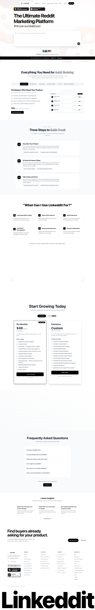

# Reddit Lead Generation Tool — Find Leads on Reddit With AI | Linkeddit
> The Ultimate Reddit Marketing Platform  ·  [linkeddit.com](https://linkeddit.com/)

## What it is
The marketing site for Linkeddit, an AI Reddit-marketing / lead-generation platform that monitors any subreddit 24/7 to surface high-intent buyers and then drafts and publishes content — billed as a Product Hunt #1 Product of the Day. It is the second builder-product link in the Om Patel tweet; a Reddit tool, not the Google-Maps scraper the tweet describes.

## What it shows
A long landing page: a 'FIND20' promo bar, a hero 'The Ultimate Reddit Marketing Platform' with an animated 'Craft / Draft a viral thread...' prompt and a '10,000+ businesses trust us' line, a seven-tool platform grid (Lead Gen, Reddit CMS, Keywords, Content Writer, MCP, Chrome Extension...), 'Three Steps to Reddit Growth', a 'What Can I Use Linkeddit For?' use-case block, 'Loved by Founders & Teams' testimonials, $49 pricing, an FAQ and a 'Latest Insights' blog strip.

## How it works
A Tailwind + daisyUI site using shadcn-style HSL/oklch theme tokens (--background, --card, --primary, --p, --s) with Instrument Serif loaded as a display face (Fontshare + Google Fonts hosts), Plausible + Google Tag Manager analytics and Rewardful affiliate. ~9.2k px on desktop, screenshot-driven (24 images, 79 SVGs).

## How it's designed
A clean light theme: white background, near-black ink (rgb(10,10,10)), a blue-violet primary (--p oklch(49% 0.31 276)) and a hot-pink secondary (--s oklch(70% 0.33 343)); Instrument Serif lends an editorial accent over an otherwise system-sans UI. Note from the probe: the H1 itself renders in 16px system sans — the large display copy is assembled from separately styled spans rather than the H1 element.

## Design data
- **Palette:** White canvas, near-black text, blue-violet primary with a hot-pink secondary accent.
- **Palette tokens:** body.bg: rgb(255, 255, 255) (rendered), body.color: rgb(10, 10, 10) (rendered), --p: 49.12% 0.3096 275.75 (var), --s: 69.71% 0.329 342.55 (var), --background: 0 0% 100% (var)
- **Fonts:** Instrument Serif (display accent) loaded; body/UI in a system-sans stack; Fontshare + Google Fonts hosts.
- **Fonts loaded:** Instrument Serif 400
- **Tech stack:** Tailwind + daisyUI, Instrument Serif (Fontshare/Google), Plausible, Google Tag Manager, Rewardful
- **Media mix:** img 24 · svg 79
- **Page height:** 9213px (single-screen: False)
- **Responsive:** At 390x844 it stays a single column (~11.4k px) with no horizontal overflow; no hamburger detected.
- **Headings:** The Ultimate Reddit Marketing Platform / Everything You Need for Reddit Marketing / Three Steps to Reddit Growth / What Can I Use Linkeddit For? / Loved by Founders & Teams / Start Growing Today / Find buyers already asking for your product. / Frequently Asked Questions / Latest Insights
- **Links out:** [Features](https://linkeddit.com/#features) · [Pricing](https://linkeddit.com/#pricing) · [Case Studies](https://linkeddit.com/case-studies) · [Sign Up](https://linkeddit.com/signup)
- **Extracted:** 2026-06-06 · Playwright MCP, 1440x900 + 390x844, logged_out: true

## Related sites
[[bigideasdb.com]] [[jenni.ai]] [[midu.dev]] [[todesktop.com]] [[ashpreetbedi.com]] [[colf.dev]]

## Tags
#category/uncategorized #aesthetic/developer-product #aesthetic/light #pattern/reddit-marketing #pattern/saas-landing #pattern/daisyui #pattern/tailwind #pattern/light-theme #pattern/animated-prompt-hero #pattern/product-hunt #pattern/long-scroll-landing #tech/tailwind-daisyui #tech/instrument-serif-fontshare-google #tech/plausible #tech/google-tag-manager #tech/rewardful #color/light #color/cool #font/instrument-serif
