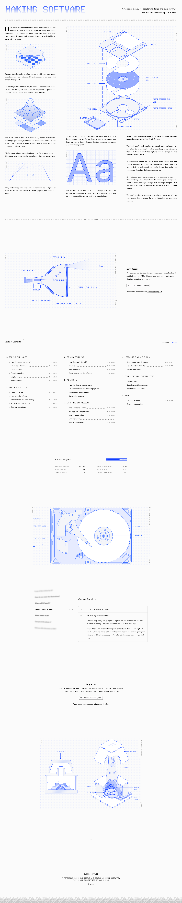

# Making Software
> A reference manual for people who design and build software.  ·  [makingsoftware.com](https://www.makingsoftware.com/)

## What it is
Dan Hollick's book / reference manual, the subject of the tweet. The semantic h1 is 'Making Software' and the meta description reads 'A reference manual for people who design and build software.' — a 70k-word, illustration-heavy explainer of the systems behind software (rendering, colour, type, graphics), sold in early access with a 'Get Early Access ($99)' CTA.

## What it shows
A bright, near-white reading environment (body background #fbfbfb) whose visual identity is carried almost entirely by inline vector illustration — the probe counts 46 <svg> and zero raster  — the same meticulous engineering-diagram style shown in the promo video (exploded floppy disks, labelled part call-outs) rendered as scalable SVG rather than images.

## How it works
A React application; the generated Open Graph route (opengraph-image.jpg with a build hash) and absent __NEXT_DATA__ point to Next.js App Router, layered over a Tailwind CSS v4 token system (the :root exposes Tailwind's full --color-*, --text-*, --container-* scale plus a bespoke --color-cobalt-* ramp). Everything is self-hosted: the only script and stylesheet host the probe found is makingsoftware.com — no third-party analytics or CDN.

## How it's designed
A crisp editorial-technical look. getComputedStyle reports a body background rgb(251,251,251) (#fbfbfb, the --background token) with black text (--foreground #171717), and a signature electric cobalt-blue accent defined as --color-cobalt-500 oklch(57.66% .2443 267.62). Type is a deliberate two-face system: reading/serif copy in 'ABC Arizona' (font-family 'arizona', loaded 400 / 500 / 700 + italic, with an EB Garamond fallback) and a pixel / dot-matrix face 'Departure Mono' (loaded 500) for UI labels, buttons and the display headings — the exact typeface that animates through the promo video.

## Design data
- **Palette:** Near-white canvas (#fbfbfb) with black text (#171717) and one vivid electric-cobalt accent (--color-cobalt-500, oklch 57.66% .2443 267.62); illustrations supply the rest of the colour.
- **Palette tokens:** --background: #fbfbfb (var), --foreground: #171717 (var), --color-cobalt-500: oklch(57.66% .2443 267.62) (var), body background: rgb(251, 251, 251) (rendered), body text: rgb(0, 0, 0) (rendered)
- **Fonts:** 'ABC Arizona' (font-family arizona; loaded 400/500/700 + italic, EB Garamond fallback) for reading copy, paired with the pixel monospace 'Departure Mono' (loaded 500) for UI, buttons and display headings.
- **Fonts loaded:** ABC Arizona 400, ABC Arizona 500, ABC Arizona 700, ABC Arizona 400 italic, Departure Mono 500
- **Tech stack:** React / Next.js App Router (generated opengraph-image route; __NEXT_DATA__ not exposed), Tailwind CSS v4 (token layer), Self-hosted (no third-party analytics or CDN script hosts detected)
- **Media mix:** svg 46
- **Page height:** 7122px (single-screen: False)
- **Responsive:** At 390x844 the layout reflows to a single column and the page grows from 7,122 to 9,258px with no horizontal overflow; no burger menu appears (the top nav stays inline).
- **Headings:** Making Software
- **Weight:** None requests; hosts: www.makingsoftware.com
- **Extracted:** 2026-07-08 · Playwright MCP, 1440x900 fullPage + 390x844 mobile probe; logged_out: true.

## Related sites
[[21st.dev]] [[animations.dev]] [[christophlocher.com]] [[cofounder.co]] [[hofai.io]] [[hw.cafe]]

## Tags
#category/reading #aesthetic/light #aesthetic/playful #pattern/reference-manual #pattern/book #pattern/light #pattern/illustration-heavy #pattern/inline-svg #pattern/cobalt-accent #pattern/pixel-mono #pattern/departure-mono #pattern/abc-arizona #pattern/tailwind-v4 #pattern/self-hosted #tech/react-next-js-app-router-generated-opengraph-image-route-next-data-not-exposed #tech/tailwind-css-v4-token-layer #tech/self-hosted-no-third-party-analytics-or-cdn-script-hosts-detected #color/light #font/abc-arizona #font/abc-arizona-400-italic #font/departure-mono
