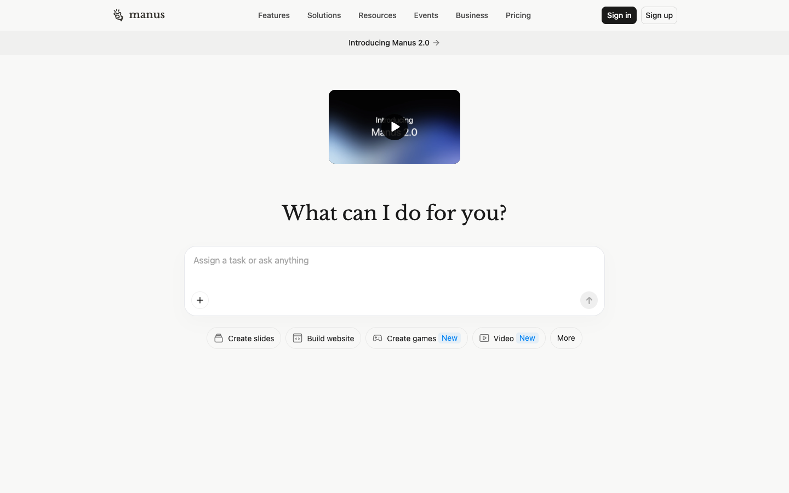

# Manus: Hands On AI
> What can I do for you?  ·  [manus.im](https://manus.im/)

**Vertical:** #vertical/startup-product  ·  **Vibe:** #vibe/minimal #vibe/editorial  ·  **Topics:** #topic/ai #topic/productivity  ·  **Mode:** #mode/light

## What it is
Home page of Manus, a general-purpose AI agent product described as 'the action engine that goes beyond answers to execute tasks, automate workflows, and extend your human reach'.

## What it shows
A single-screen entry point: the h1 'What can I do for you?' sits over a task prompt box, with a second heading 'Less structure, more intelligence.' further in.

## How it works
A Next.js app that behaves like a product shell rather than a marketing page: the page is exactly one viewport (900px) tall at desktop, with 4 iframes (Stripe and Google sign-in hosts appear in the scripts) and analytics through Google Tag Manager, Plausible and DoubleClick.

## How it's designed
White ground (rgb(255,255,255)) with near-black text rgb(26,26,26) and a near-black primary button rgb(26,26,25). The h1 is set in Libre Baskerville at 36px, a serif against a system sans UI (-apple-system stack), which gives it a quiet editorial feel. No brand colour is defined in the stylesheet beyond a progress-bar blue (#0081f2).

## Design data
- **Palette:** White ground, near-black text, one serif headline face
- **Palette tokens:** body bg: rgb(255, 255, 255) (rendered), body color: rgb(26, 26, 26) (rendered), primary button bg: rgb(26, 26, 25) (rendered), --bprogress-color: #0081f2 (var)
- **Fonts:** Libre Baskerville 400 (h1), system sans UI
- **Fonts loaded:** Libre Baskerville 400
- **Tech stack:** Next.js, Google Tag Manager, Plausible, Stripe
- **Keywords:** serif h1, prompt box, single screen, agent product, ink-black button
- **Media mix:** img 1 · svg 25 · iframe 4
- **Page height:** 900px (single-screen: True)
- **Responsive:** At 390px the h1 shrinks from 36px to 28px and the page stays a single screen (900px to 844px) with no horizontal overflow.
- **Headings:** What can I do for you? / Less structure, more intelligence.
- **Extracted:** 2026-10-17 · Playwright 1440x900 full-page + DOM probe; 390x844 text probe; logged_out: true

## Related sites
- [[apps.ankiweb.net]] — shared: startup-product, minimal, productivity, light
- [[backdoorai.app]] — shared: startup-product, minimal, ai, light
- [[contralabs.com]] — shared: startup-product, editorial, ai, light
- [[creao.ai]] — shared: startup-product, editorial, ai, light
- [[gatheros.co]] — shared: startup-product, minimal, productivity, light
- [[printingpress.dev]] — shared: startup-product, editorial, ai, light
