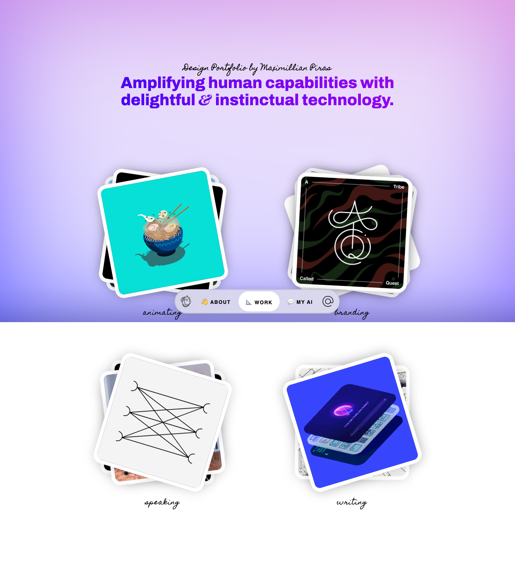

# Maximillian Piras, Design Portfolio
> Amplifying human capabilities with delightful & instinctual technology.  ·  [maximin.design](https://www.maximin.design/)

**Vertical:** #vertical/portfolio  ·  **Vibe:** #vibe/playful  ·  **Topics:** #topic/design  ·  **Mode:** #mode/light

## What it is
The design portfolio of Maximillian Piras (@MVXMXM) — per its meta, 'product design for tech startups (user experience & user interfaces) focused on AI, branding, animation, & illustration.' MVXMXM.com resolves to this site.

## What it shows
A gradient hero — 'Design Portfolio by Maximillian Piras / Amplifying human capabilities with delightful & instinctual technology' — above a set of tilted, drop-shadowed project cards organised by category (animating, ABOUT, WORK, MY AI, teaching / speaking / writing). Cards mix illustration with embedded video demos (7 video elements). The h1 reads 'Maximillian AI'.

## How it works
A static site (no framework global, and notably zero external script hosts — fully self-contained) with a vertical scroll (~1,640px). Project cards are tilted in perspective and arranged around a category switcher; an 'ABOUT' link and a 'VIEW SOURCE ON GITHUB' link are the main outbound paths.

## How it's designed
A vivid purple-to-indigo gradient hero sits over a white body; project cards are white with soft drop shadows, rotated in 3D perspective so the deck feels physical. Type pairs Archivo (loaded at 900 for the heavy 40px display h1) with Playfair Display SC for serif accents and Homemade Apple for a handwritten script flourish. Playful, tactile, illustration-forward.

## Design data
- **Palette:** Purple/indigo gradient hero on white, with black text
- **Palette tokens:** body/h1 color: rgb(0, 0, 0) (rendered), hero gradient: purple→indigo (rendered, see screenshot) (rendered)
- **Fonts:** Archivo (display, 900) with Playfair Display SC serif and Homemade Apple script accents
- **Fonts loaded:** Archivo 100-900, Homemade Apple 400, Playfair Display SC 700
- **Tech stack:** Static/Vanilla (no framework global), fully self-hosted (no external script hosts)
- **Keywords:** portfolio, 3d-tilt-cards, gradient-hero, video-demos, playful, illustration
- **Media mix:** img 18 · video 7 · svg 5
- **Page height:** 1640px (single-screen: False)
- **Responsive:** At 390x844 the tilted project cards stack into a single column and the page grows taller (scrollHeight 1640 → 2700); the 40px h1 size is unchanged.
- **Headings:** Maximillian AI
- **Links out:** [ABOUT](https://www.maximin.design/about.html) · [View source on GitHub](https://github.com/MVXMXM/mxmlln)
- **Extracted:** 2026-06-06 · Playwright MCP, 1440x900 + 390x844, logged_out: true. MVXMXM.com redirects here. The 'Antilibrary' reading list from the tweet is a work-in-progress shown only in the video, not yet linked from this portfolio.

## Related sites
- [[chusmargallo.space]] — shared: portfolio, playful, design, light
- [[designrebuilds.vercel.app]] — shared: portfolio, playful, design, light
- [[jessa.art]] — shared: portfolio, playful, design, light
- [[kmk0.com]] — shared: portfolio, playful, design, light
- [[asekachov.com]] — shared: portfolio, design, light
- [[christophlocher.com]] — shared: portfolio, design, light
