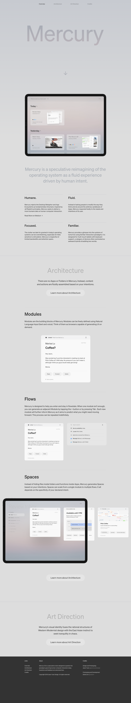

# Mercury — a speculative reimagining of the OS as a fluid, modeless experience
> Mercury is a speculative reimagining of the operating system as a fluid experience driven by human intent.  ·  [mercuryos.com](https://www.mercuryos.com/)

## What it is
Jason Yuan's landmark 2019 concept project 'Mercury OS', explicitly named in the tweet as one of his 'early' works. Its on-page pitch: 'Mercury is a speculative reimagining of the operating system as a fluid experience driven by human intent.' (The meta description phrases the same idea with typos: 'a reimaging of the operating system as a fluid modeless experience drive by human intent.') Nav: Overview / Architecture / Art Direction / Credits.

## What it shows
A long editorial case study on a soft light-grey stage: a giant faint 'Mercury' wordmark hero, an iPad mockup of the modeless UI, the tagline, then four principle columns — Humane / Fluid / Focused / Familiar ('Mercury rejects the Desktop Metaphor and App Ecosystems as fundamentally inhumane… inspired by Jef Raskin's principles'). Sections follow on Architecture ('There are no Apps or Folders in Mercury. Instead, content and actions are fluidly assembled based on your intentions'), Modules, Flows, Spaces (iPad triptychs on gentle gradients), and an Art Direction statement ('Mercury's visual identity fuses the rational structures of Western Modernist design with the East Asian instinct to seek tranquility in chaos').

## How it works
A React site (a React root is present) served from mercuryos.com with fonts delivered by Adobe Typekit (use.typekit.net). Media-light: 7 , 1 <video>, 0 canvas/svg/iframe, over a 7,679px scroll.

## How it's designed
Restrained Swiss-modernist greyscale. getComputedStyle reports the html background as rgb(221,221,221) (#dddddd) with charcoal rgb(51,51,51) (#333) text — a near-monochrome stage where colour appears only inside the product mockups. Type: the loaded, painting face is 'Söhne' (400 and 500, both loaded per document.fonts); 'neue-haas-grotesk-display' and 'neue-haas-grotesk-text' are declared across many weights via Typekit but report unloaded. No :root custom properties are exposed and there is no <h1> (section titles are <h2>: Architecture, Art Direction).

## Design data
- **Palette:** Soft light-grey stage (#dddddd) with charcoal text (#333) — near-monochrome greyscale; colour comes only from the product-mockup imagery.
- **Palette tokens:** html background: rgb(221, 221, 221) (rendered), body text: rgb(51, 51, 51) (rendered)
- **Fonts:** Söhne (400/500 — the loaded, painting faces); Neue Haas Grotesk Display & Text declared via Adobe Typekit but reporting unloaded.
- **Fonts loaded:** Söhne 400, Söhne 500
- **Tech stack:** React, Adobe Fonts / Typekit
- **Media mix:** img 7 · video 1
- **Page height:** 7679px (single-screen: False)
- **Responsive:** At 390x844 the top nav stays a simple inline text list (Overview / Architecture / Art Direction / Credits) and the four-column principle rows and wide iPad triptychs reflow/compress to a single column (measured page ~5,515px).
- **Headings:** Architecture / Art Direction
- **Extracted:** 2026-07-08 · Playwright MCP, 1440x900 fullPage + 390x844 mobile probe; logged_out: true

## Related sites
[[ankit-rai.com]] [[asekachov.com]] [[interfaces.dev]] [[offthewall.studio]] [[rvivek.com]] [[vanschneider.com]]

## Tags
#category/uncategorized #aesthetic/minimal #aesthetic/editorial #pattern/concept #pattern/operating-system #pattern/case-study #pattern/swiss-modernist #pattern/greyscale #pattern/editorial #pattern/long-scroll #pattern/product-mockups #pattern/speculative-design #pattern/typekit #tech/react #tech/adobe-fonts-typekit #color/monochrome #font/s-hne
