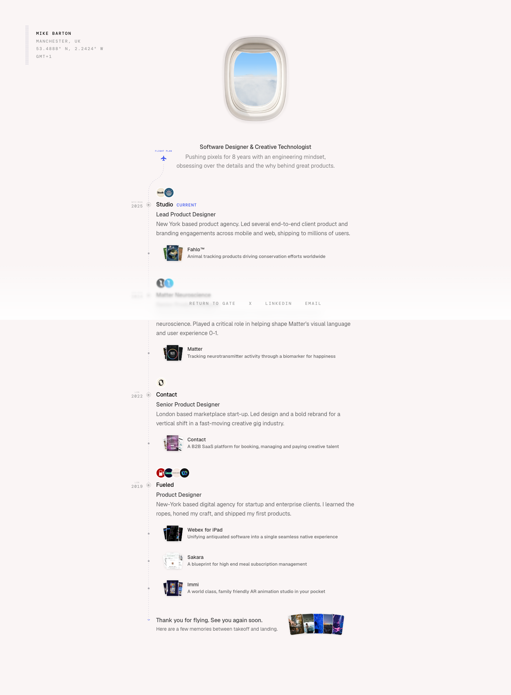

# Mike Barton
> Software Designer & Creative Technologist  ·  [mikes.cv](https://www.mikes.cv/)

**Vertical:** #vertical/portfolio  ·  **Vibe:** #vibe/playful #vibe/minimal  ·  **Topics:** #topic/design  ·  **Mode:** #mode/light

## What it is
Mike Barton's personal CV/portfolio site, built entirely around an airline boarding-pass conceit: the flight metaphor covers the entry gate, the resume timeline (labeled "Flight Plan"), and the dark-mode toggle.

## What it shows
An entry screen renders a photorealistic boarding pass for "MIKE BARTON, Software Designer" next to an old ticket-validator device reading "READY," prompting you to swipe the pass to enter (or hit Skip). Past the gate, an airplane window sits above the pitch line "Software Designer & Creative Technologist / Pushing pixels for 8 years with an engineering mindset, obsessing over the details and the why behind great products," then a dotted flight-path timeline lists his roles (Studio, Matter Neuroscience, Contact, Fueled) each with small project thumbnails, and the page signs off with "Thank you for flying. See you again soon."

## How it works
The bookmarked clip shows the window's roller shade being dragged shut by hand — as it closes over the cloud view, the entire page's color scheme crossfades from a light cream ground to a dark charcoal one, i.e. the plane window IS the dark-mode switch. React-rendered (`data-v-app` absent, no Nuxt/Next globals, but a React root is present) and entirely self-hosted with no third-party scripts or analytics detected.

## How it's designed
Restrained, editorial CV layout: a single ~40rem measure column, small caps mono labels ("FLIGHT PLAN," "NYC>MAN 2025") standing in for date stamps, and a muted cream/charcoal duotone rather than a busy palette. Custom typeface pairing ("MB Sans" for text, "MB Mono" for labels, an "MB LCD" face reserved for the ticket-validator readout) keeps the aviation bit feeling designed rather than gimmicky.

## Design data
- **Palette:** Cream light mode (#faf5f5) / charcoal dark mode (#191817), ink text #17160f, a single green accent #1e9e52, plus an unused blue token (#3a53ed) likely reserved for links.
- **Palette tokens:** --veil-light: #faf5f5 (var), --veil-dark: #191817 (var), --ink: #17160f (var), --faint: #8c8b82 (var), --accent: #1e9e52 (var), --folio-blue: #3a53ed (var), body background (rendered): rgb(250, 245, 245) (rendered), body text (rendered): rgb(23, 22, 15) (rendered)
- **Fonts:** Custom "MB Sans" (400/500) and "MB Mono" (400/500) webfonts, both self-hosted and loaded; an "MB LCD" display face reserved for the boarding-pass validator screen.
- **Fonts loaded:** MB Sans 400, MB Sans 500, MB Mono 500
- **Tech stack:** React, self-hosted (no CDN/analytics scripts detected)
- **Keywords:** scroll-triggered theme toggle, boarding-pass gate, timeline resume, custom typeface, duotone light/dark
- **Media mix:** img 35 · canvas 2 · svg 3
- **Page height:** 1956px (single-screen: False)
- **Responsive:** At 390x844 the same single centered column just narrows (scrollHeight grows from 1956px to 2446px); no separate mobile nav since the desktop layout never had one to begin with.
- **Extracted:** 2026-09-22 · desktop 1440x900, mobile 390x844 (layout check only); logged_out: true

## Related sites
- [[designrebuilds.vercel.app]] — shared: portfolio, playful, minimal, design, light
- [[gyanl.com]] — shared: portfolio, playful, minimal, design, light
- [[kmk0.com]] — shared: portfolio, playful, minimal, design, light
- [[pengzhe.ng]] — shared: portfolio, playful, minimal, design, light
- [[asekachov.com]] — shared: portfolio, minimal, design, light
- [[christophlocher.com]] — shared: portfolio, minimal, design, light
