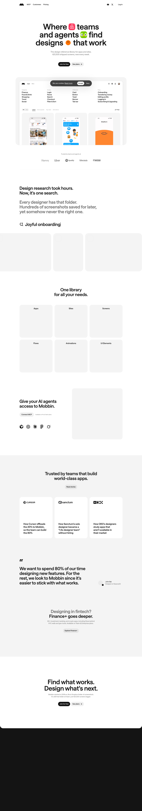

# Mobbin — UI & UX design inspiration for mobile & web apps
> Where teams and agents find designs that work  ·  [mobbin.com](https://mobbin.com/)

**Vertical:** #vertical/directory-gallery  ·  **Vibe:** #vibe/minimal #vibe/corporate-clean  ·  **Topics:** #topic/design #topic/ai  ·  **Mode:** #mode/light

## What it is
A searchable library of 621,500+ mobile and web app screenshots and flows used for UI/UX research, now also exposed to AI agents through an MCP server.

## What it shows
An 80px h1 ('Where teams and agents find designs that work'), a 'One library for all your needs' section, a 'Give your AI agents access to Mobbin' MCP pitch, and a customer-logo band ('Trusted by teams that build world-class apps').

## How it works
CTAs are 'Join for free' and 'Open Mobbin' (/discover), with Log in, Pricing, Customers and MCP in the nav. The marketing page is a ~8155px scroll with one video and 295 images of app screens.

## How it's designed
Near-black ink (rgb(20,20,20)) on white, set entirely in the saans family at weights 100-900; the h1 is broken across six short lines for rhythm. Color comes from the app screenshots themselves. Only one custom property matched a color pattern (--blog-page-background), so styling appears utility-class driven rather than token driven.

## Design data
- **Palette:** White ground, near-black #141414 ink; screenshots supply all color
- **Palette tokens:** html background: rgb(255, 255, 255) (rendered), body color: rgb(20, 20, 20) (rendered), h1 color: rgb(20, 20, 20) (rendered)
- **Fonts:** saans (variable, 100-900) throughout
- **Fonts loaded:** saans 100-900
- **Tech stack:** Sanity (image CDN), Google Tag Manager
- **Keywords:** screenshot-library, stacked-headline, logo-wall, mcp-integration, freemium-cta
- **Media mix:** img 295 · video 1 · svg 34
- **Page height:** 8155px (single-screen: False)
- **Responsive:** At 390px the h1 drops from 80px to 40px, the header collapses to a menu button with one visible link, no horizontal overflow, and page height goes from 8155px to 9313px.
- **Headings:** Where teams and agents find designs that work / One library for all your needs. / Give your AI agents access to Mobbin. / Trusted by teams that build world-class apps.
- **Links out:** [Join for free](https://mobbin.com/signup) · [MCP](https://mobbin.com/mcp) · [Pricing](https://mobbin.com/pricing)
- **Weight:** None requests; hosts: mobbin.com, www.googletagmanager.com
- **Extracted:** 2026-10-17 · Playwright MCP, fullPage 1440x900 + 390x844 mobile text pass, DOM probe; logged_out: true

## Related sites
- [[21st.dev]] — shared: directory-gallery, minimal, design, ai, light
- [[nicelydone.club]] — shared: directory-gallery, minimal, corporate-clean, design, light
- [[motionsites.ai]] — shared: directory-gallery, corporate-clean, design, ai
- [[are.na]] — shared: directory-gallery, minimal, ai, light
- [[coolsites.ai]] — shared: directory-gallery, design, ai, light
- [[designengineer.tools]] — shared: directory-gallery, minimal, design, light
