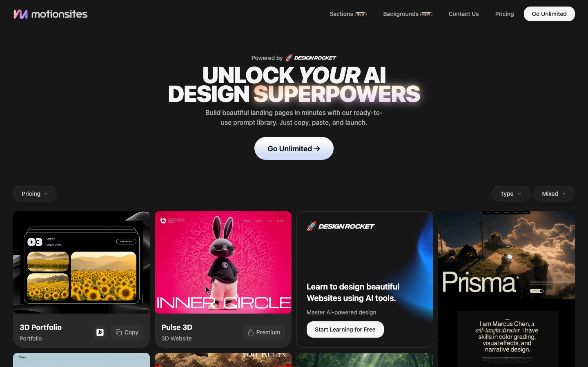

# MotionSites — Premium Hero Prompts
> Your Design AI Superpowers In One Click.  ·  [motionsites.ai](https://motionsites.ai/)

**Vertical:** #vertical/directory-gallery  ·  **Vibe:** #vibe/corporate-clean #vibe/technical  ·  **Topics:** #topic/design #topic/ai  ·  **Mode:** #mode/dark

## What it is
A marketplace/library of ready-to-paste “premium hero prompts” for AI website builders — the pitch is literally “Unlock your AI Design Superpowers” and “Your Design AI Superpowers In One Click.” You browse a gallery of polished hero-section designs, copy the prompt behind one, paste it into your AI tool, and get an award-winning-looking landing page. It's run by DesignRocket (“Powered by DesignRocket”) as the prompt-pack arm of that design-education brand.

## What it shows
A dark landing page with a big animated headline (“Unlock your AI Design Superpowers”) over a “Go Unlimited” CTA, then an enormous filterable gallery of hero-section templates — cards like “3D Portfolio,” “Pulse 3D,” “Design Rocket,” “Inner Circle,” “Prisma” — each a rich preview thumbnail with Copy / Premium badges and Type/Mixed filter chips. The page is extremely media-dense (333 , 167 <svg>, 2 <video>) and very long (scrollHeight ~17.6k px) because it lazy-loads the full catalog.

## How it works
Top nav splits the catalog into Sections / Backgrounds plus Contact and Pricing, with a Type/Mixed filter row above the grid to narrow templates. Each card exposes a Copy action (grab the prompt) gated by free vs Premium, and the whole thing pushes toward “Go Unlimited” (a paywall managed via ParityDeals geo-pricing). A Meta Pixel tracks conversions. It's a single long scroll — the gallery streams in as you go — with hover states on the cards and CTAs.

## How it's designed
A dark, product-y SaaS look: near-black ground (rendered body bg rgb 23,23,23) with off-white text (rgb 245,245,245) and a single vivid blue brand color (--primary hsl 230 100% 55%) for rings/CTAs, on a generous 1rem corner radius. It's a React app built on the shadcn/Radix token system (the :root carries the full --background/--card/--primary/--sidebar HSL set, and Radix portal ids appear in the DOM) and was produced with Lovable / gpt-engineer (its OG image lives under gpt-engineer-file-uploads). Notably the heavy display headline renders in the system UI sans stack — a Google Fonts stylesheet is linked but document.fonts reports nothing loaded on the sampled nodes — so the drama comes from scale (56px/900) and motion, not a webfont. The card thumbnails carry the visual weight.

## Design data
- **Palette:** Near-black ground (rgb 23/23/23), off-white text (rgb 245/245/245), single vivid blue brand accent (--primary hsl 230 100% 55%); 1rem radius.
- **Palette tokens:** --background: hsl(0 0% 9%) (var), --foreground: hsl(0 0% 96%) (var), --primary: hsl(230 100% 55%) (var), --radius: 1rem (var), body-bg: rgb(23, 23, 23) (rendered), body-text: rgb(245, 245, 245) (rendered)
- **Fonts:** System UI sans on the sampled text (Google Fonts linked but no webfont loaded on these nodes); display drama is size+weight (56px/900), not a typeface.
- **Fonts loaded:** system only (no webfont)
- **Tech stack:** React, shadcn / Radix UI, Lovable (gpt-engineer), ParityDeals (geo pricing), Meta Pixel, jsDelivr
- **Keywords:** dark-saas, template-gallery, prompt-marketplace, copy-to-clipboard, freemium-paywall, filter-chips, animated-headline, lazy-loaded-grid, shadcn-radix, geo-pricing
- **Media mix:** img 333 · video 2 · svg 167
- **Page height:** 17608px (single-screen: False)
- **Responsive:** At 390x844 the desktop nav collapses behind a hamburger, the headline shrinks from 56px to 32px, and the template grid reflows from multi-column to a single ~342px column (page becomes very tall as cards stack).
- **Headings:** Unlock your AI Design Superpowers / Develop Your AI Design Skills That Stand Out.
- **Links out:** [Powered by Design Rocket](https://designrocket.io/) · [Explore the Full Library](https://designrocket.io/?utm_source=motionsites&utm_medium=site&utm_campaign=promo)
- **Extracted:** 2026-06-06 · playwright-mcp @ 1440x900 (+ 390x844 mobile), viewport screenshot (fullPage timed out on continuous motion), logged_out: true

## Related sites
- [[sceneai.art]] — shared: directory-gallery, technical, design, ai, dark
- [[mobbin.com]] — shared: directory-gallery, corporate-clean, design, ai
- [[stitch.withgoogle.com]] — shared: corporate-clean, technical, design, ai, dark
- [[killedbyopenai.com]] — shared: directory-gallery, technical, ai, dark
- [[21st.dev]] — shared: directory-gallery, design, ai
- [[canivibecodeit.com]] — shared: directory-gallery, technical, ai
