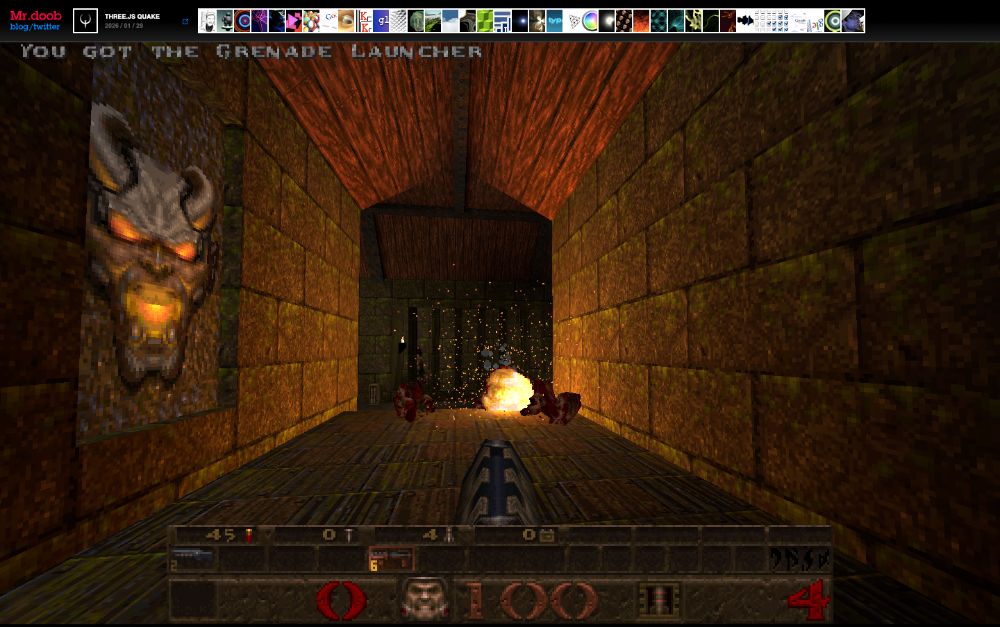

# Mr.doob | Three.js Quake
> The personal homepage and running experiment-archive of Ricardo Cabello (Mr.doob), creator of Three.js — the newest demo plays live, the rest are one click away.  ·  [mrdoob.com](https://mrdoob.com/)

## What it is
mrdoob.com, the homepage of Ricardo Cabello — "Mr.doob," the creator of Three.js. It is less a portfolio than a living archive of WebGL/creative-coding experiments stretching back to 2010, with the most recent one (here "Three.js Quake", 2026/01/29) embedded and running as the hero.

## What it shows
On load the entire viewport is taken over by a playable Three.js port of Quake — a torch-lit dungeon corridor with a stone gargoyle, a floating fireball, and the classic Quake HUD reading 100 health and a grenade-launcher pickup message. A single thin strip of 40 tiny thumbnail icons runs along the very top of the page; each is a link to another experiment in the catalogue (SHARED CANVAS, THREE.JS SKETCHES, SPIN PAINTER, DATAWORLD, GLSL SANDBOX, 3 DREAMS OF BLACK, CLOUDS, VOXELS, and on back to 2010), and the body keeps the full dated index as plain text.

## How it works
The shell is dead-simple hand-written HTML: a black <body>, default blue links, no framework, no CSS variables, no webfonts. The featured demo is loaded in a single full-bleed <iframe> so the homepage itself stays a few KB; the 40 catalogue entries are just  thumbnails linking out. The only third-party script is web3dsurvey.com (a WebGL capability-survey beacon). It renders as one full screen (scrollHeight ≈ innerHeight, no scroll).

## How it's designed
Deliberately raw and archival — the design *is* the absence of design, letting the running demo be the entire show. Pure black canvas, system Helvetica/Arial for the few labels, browser-default blue (rgb(0,0,238)) hyperlinks, and a single hairline thumbnail rail as the only chrome. It reads like a 2010-era creative-coder index page kept deliberately unchanged: the work speaks, the page gets out of the way.

## Design data
- **Palette:** Black page (rgb(0,0,0)) with browser-default blue links (rgb(0,0,238)); all color comes from the embedded WebGL demo itself (Quake's amber torchlight and stone browns)
- **Palette tokens:** body-bg: rgb(0, 0, 0) (rendered), body-color: rgb(0, 0, 0) (rendered), link: rgb(0, 0, 238) (rendered)
- **Fonts:** System fonts only — Helvetica/Arial sans-serif for body, no webfont payload loaded (document.fonts empty)
- **Fonts loaded:** system only (no webfont)
- **Tech stack:** Hand-written static HTML (no framework — no Next/Nuxt/React/Vue detected), Three.js demos embedded via <iframe>, web3dsurvey.com (WebGL capability survey beacon), self-hosted thumbnails on mrdoob.com
- **Media mix:** img 40 · iframe 1
- **Page height:** 900px (single-screen: True)
- **Responsive:** At 390x844 the embedded demo iframe simply reflows to fill the 390px width with no horizontal overflow; the thumbnail strip and full-screen single-page layout are preserved (no separate mobile design).
- **Weight:** None requests; hosts: mrdoob.com, web3dsurvey.com
- **Extracted:** 2026-06-06 · Playwright MCP, 1440x900 + 390x844 mobile pass, logged_out: true

## Related sites
[[arneshbanerjee.github.io]] [[iacopoapps.appspot.com]] [[are.na]] [[everynoise.com]] [[gaspardhedde.fr]] [[jessa.art]]

## Tags
#category/favorites #aesthetic/editorial #aesthetic/experimental #aesthetic/minimal #pattern/creative-coding-archive #pattern/webgl #pattern/threejs #pattern/iframe-hero #pattern/raw-html #pattern/thumbnail-index #pattern/black-background #pattern/no-framework #pattern/minimal-chrome #pattern/developer-homepage #tech/hand-written-static-html-no-framework-no-next-nuxt-react-vue-detected #tech/three-js-demos-embedded-via-iframe #tech/web3dsurvey-com-webgl-capability-survey-beacon #tech/self-hosted-thumbnails-on-mrdoob-com #color/warm #color/cool #font/system-fonts
