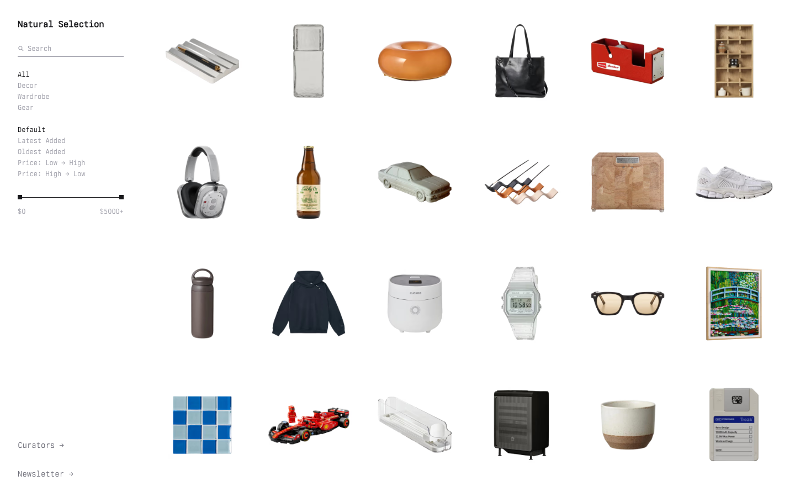

# Natural Selection
> A curated gallery of favorite products.  ·  [naturalselection.so](https://www.naturalselection.so/)

**Vertical:** #vertical/directory-gallery  ·  **Vibe:** #vibe/minimal  ·  **Topics:** —  ·  **Mode:** #mode/light

## What it is
A personal product-curation gallery — one person's list of favorite physical objects (decor, wardrobe, gear) presented like a minimalist e-commerce catalog, per its own meta description "A curated gallery of favorite products."

## What it shows
A dense uniform grid (94 images) of isolated product photos — a pen tray, a glass carafe, a tape dispenser, an air purifier, headphones, a rice cooker, sunglasses, sneakers — with a left sidebar offering category filters (Decor, Wardrobe, Gear), a price slider ($0–$5000+), and sort controls, under the single heading "Items we appreciate."

## How it works
No exposed SPA framework globals; Cloudflare Insights analytics script present. Layout is driven by CSS custom properties (--grid-cols: 6, --grid-gap: 36px, --row-ratio: .5) that a media query collapses to --grid-cols: 3 on mobile — a CSS-variable-driven responsive grid rather than a JS masonry library.

## How it's designed
Stark white-background e-commerce aesthetic (background #fff, foreground #171717) with no framing chrome around the products — just a numeric grid, letting the photography do the work. Body copy loads a self-hosted monospace display face (berkeleyMono) while Geist, Geist Mono, Inter, and ppNeue are declared but unloaded, suggesting they're reserved for hover/detail states not triggered on this pass.

## Design data
- **Palette:** Pure white background, near-black (#171717) text/UI — a stripped e-commerce palette with no accent color
- **Palette tokens:** --background: #fff (var), --foreground: #171717 (var)
- **Fonts:** Berkeley Mono (loaded, primary display); Geist, Geist Mono, Inter, ppNeue declared but unloaded on the grid view
- **Fonts loaded:** Berkeley Mono 400
- **Tech stack:** Cloudflare Insights, Cloudflare
- **Keywords:** product-grid, minimal, catalog, monospace
- **Media mix:** img 94 · svg 3
- **Page height:** 900px (single-screen: True)
- **Responsive:** Grid collapses from 6 columns to 3 columns at 390px (--grid-cols var switches 6→3) with no other layout change.
- **Headings:** Items we appreciate
- **Extracted:** 2026-09-22 · 1440x900 desktop + 390x844 mobile pass, logged_out: true

## Related sites
- [[21st.dev]] — shared: directory-gallery, minimal, light
- [[are.na]] — shared: directory-gallery, minimal, light
- [[ciggies.app]] — shared: directory-gallery, minimal, light
- [[designengineer.tools]] — shared: directory-gallery, minimal, light
- [[designtools.fyi]] — shared: directory-gallery, minimal, light
- [[humanoid-index.com]] — shared: directory-gallery, minimal, light
