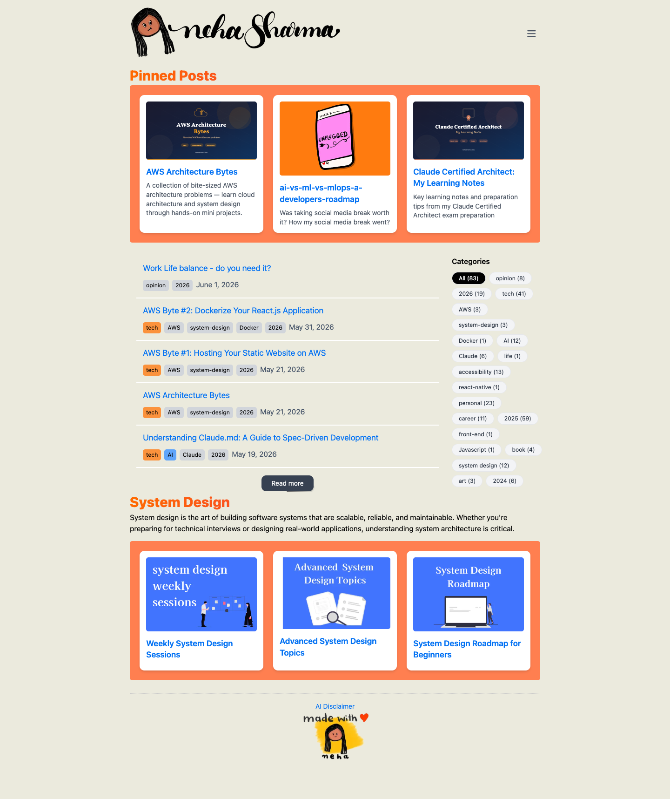

# Neha Sharma - Software Engineer | Tech Blog on React, System Design & AI
> Software engineer sharing insights on React, Next.js, System Design, AI, and Accessibility — technical blogs, tutorials, and book recommendations.  ·  [nehasharma.dev](https://nehasharma.dev)

**Vertical:** #vertical/personal-blog  ·  **Vibe:** #vibe/organic-warm #vibe/playful  ·  **Topics:** #topic/engineering #topic/ai  ·  **Mode:** #mode/light

## What it is
The personal site and tech blog of Neha Sharma, a software engineer. It's a content hub, not a portfolio brag-sheet — the whole page is built around her writing on React, Next.js, System Design, AI/MLOps, AWS and Accessibility, plus a running 'Weekly System Design Sessions' series.

## What it shows
A landing feed framed by a hand-drawn 'neha sharma' script wordmark up top. Three pinned-post cards sit in colored panels (an 'AWS Architecture Bytes' collection, an 'AI vs ML vs MLOps: A Developer's Roadmap', and 'Claude Certified Architect: My Learning Notes'), followed by a chronological post list with tag chips and dates, a 'Categories' tag-cloud sidebar, and a 'System Design' section of three more cards (Weekly Sessions, Advanced Topics, a Roadmap for Beginners). It closes on a playful 'made with ❤️' footer with a little avatar.

## How it works
A straightforward Next.js blog: the pinned cards and list rows link out to individual posts, the category chips act as filters, and a 'Read more' button extends the feed. Hovered post rows surface their summary text. Navigation is a single scrolling column with a top-right menu toggle.

## How it's designed
Warm and homemade rather than corporate. A cream paper ground (rgb(235,234,221)) carries black body copy set in the plain system sans stack (-apple-system / Segoe / Roboto), so the personality comes entirely from the cursive hand-drawn wordmark and the candy-colored card panels (coral/orange and soft pinks per the --pink-400 #ffd2f7 / --pink-200 #ffe0e0 tokens) with rounded corners and soft drop shadows. Links use the default Next.js blue (#0070f3). Built on Next.js + Tailwind, with a Mansalva script webfont declared (CSS var --Mansalva) for the wordmark though document.fonts reported nothing loaded at probe time.

## Design data
- **Palette:** Cream paper ground (rgb(235,234,221)) with black text; pastel card panels — soft pink (--pink-400 #ffd2f7, --pink-200 #ffe0e0) plus coral/orange accents; Next.js blue links (#0070f3).
- **Palette tokens:** --pink-400: #ffd2f7 (var), --pink-200: #ffe0e0 (var), --gray-100: #eee (var), body background: rgb(235, 234, 221) (rendered), body text: rgb(0, 0, 0) (rendered), link: rgb(0, 112, 243) (rendered)
- **Fonts:** Body/headings ride the system sans stack (-apple-system, Segoe UI, Roboto); a Mansalva script webfont is declared for the hand-drawn wordmark (no webfont reported loaded at probe time).
- **Fonts loaded:** system only (no webfont)
- **Tech stack:** Next.js/React, Tailwind CSS, Google Tag Manager, Google Fonts
- **Keywords:** personal-blog, tech-blog, pinned-post-cards, tag-cloud-sidebar, hand-drawn-wordmark, warm-pastel-cards, system-fonts, content-feed
- **Media mix:** img 7 · svg 1
- **Page height:** 1716px (single-screen: False)
- **Responsive:** At 390px the multi-column layout collapses to a single stacked column — the pinned-card row and category sidebar reflow vertically and the page nearly doubles in height (1716px → 3740px).
- **Headings:** Pinned Posts / System Design / AWS Architecture Bytes / ai-vs-ml-vs-mlops-a-developers-roadmap / Claude Certified Architect: My Learning Notes / Work Life balance - do you need it? / AWS Byte #2: Dockerize Your React.js Application / AWS Byte #1: Hosting Your Static Website on AWS / Understanding Claude.md: A Guide to Spec-Driven Development / Categories / Weekly System Design Sessions / Advanced System Design Topics / System Design Roadmap for Beginners
- **Extracted:** 2026-06-06 · playwright-mcp @ 1440x900 + 390x844, logged_out: true

## Related sites
- [[ashpreetbedi.com]] — shared: personal-blog, organic-warm, engineering, ai
- [[amanml.com]] — shared: personal-blog, engineering, ai, light
- [[emilkowal.ski]] — shared: personal-blog, engineering, ai, light
- [[coolsites.ai]] — shared: organic-warm, playful, ai, light
- [[lelezhang.design]] — shared: organic-warm, playful, ai, light
- [[photon.codes]] — shared: playful, engineering, ai, light
