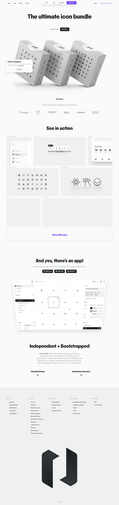

# Nucleo – The Ultimate Icon Bundle
> Explore the Nucleo icons, 40000+ icons for UIs, presentations, and print projects. Download instantly or use them via our web and native apps.  ·  [nucleoapp.com](https://nucleoapp.com/)

**Vertical:** #vertical/ecommerce  ·  **Vibe:** #vibe/minimal #vibe/corporate-clean  ·  **Topics:** #topic/design  ·  **Mode:** #mode/light

## What it is
Nucleo, Sebastiano Guerriero's icon product (linked alongside the Lab01 demo). The h1 is 'The ultimate icon bundle' and the meta description reads 'Explore the Nucleo icons, 40000+ icons for UIs, presentations, and print projects. Download instantly or use them via our web and native apps.'

## What it shows
A polished light product landing page — hero, a 'See in action' demo, an 'And yes, there's an app!' section and an 'Independent + Bootstrapped' note — with 27  and 27 inline <svg> (the icons themselves) over a ~6,600px scroll.

## How it works
A static site served from nucleoapp.com with jQuery present (no React/Next/Vue global), Google Fonts, and light instrumentation via Umami (cloud.umami.is) and Cloudflare Web Analytics. It publishes an unusually complete design-token system as :root custom properties.

## How it's designed
A refined near-white product system built on an explicit token scale. getComputedStyle reports a body background rgb(250,250,250) with slate-grey body text rgb(63,67,70) and near-black headings rgb(27,32,35); the h1 renders at 76px in 'PPNikkeiMaru' (the --font-heading token), while body copy is variable 'Inter' (--font-body). The primary CTA is a white pill (button bg rgb(255,255,255), text rgb(27,32,35)). The :root exposes a full design system — fluid spacing (--space-4xs … --space-4xl via clamp()), a type scale (--text-2xs … --text-5xl), layered shadow tokens built on HSL black/white channels, radius tokens and named easing curves (--ease-out-back cubic-bezier(0.34,1.56,0.64,1)).

## Design data
- **Palette:** Near-white canvas (#fafafa / rgb 250,250,250) with slate-grey body text (rgb 63,67,70), near-black headings (rgb 27,32,35) and white pill CTAs.
- **Palette tokens:** body background: rgb(250, 250, 250) (rendered), body text: rgb(63, 67, 70) (rendered), h1 / heading: rgb(27, 32, 35) (rendered), primary button bg: rgb(255, 255, 255) (rendered), --font-heading: PPNikkeiMaru (var), --font-body: Inter (var)
- **Fonts:** Variable 'Inter' (100–900) for UI/body via --font-body, paired with 'PPNikkeiMaru' (loaded 600) for headings via --font-heading.
- **Fonts loaded:** Inter (variable 100-900), PPNikkeiMaru 600
- **Tech stack:** Static site + jQuery, Umami analytics, Cloudflare (Web Analytics + CDN), Google Fonts
- **Keywords:** product-landing, icon-library, light, design-system, design-tokens, inter, ppnikkeimaru, jquery, bootstrapped
- **Media mix:** img 27 · svg 27
- **Page height:** 6581px (single-screen: False)
- **Responsive:** At 390x844 the PPNikkeiMaru h1 scales from 76px to 48px (clamp) and the sections stack taller (6,581 -> 7,783px) with no horizontal overflow.
- **Headings:** The ultimate icon bundle / See in action / And yes, there's an app! / Independent + Bootstrapped
- **Weight:** None requests; hosts: nucleoapp.com, fonts.googleapis.com, cloud.umami.is, static.cloudflareinsights.com
- **Extracted:** 2026-07-08 · Playwright MCP, 1440x900 fullPage + 390x844 mobile probe; logged_out: true.

## Related sites
- [[templatoria.com]] — shared: ecommerce, minimal, design, light
- [[backgrounds.supply]] — shared: ecommerce, minimal, design
- [[drafts9.com]] — shared: minimal, corporate-clean, design, light
- [[gatheros.co]] — shared: minimal, corporate-clean, design, light
- [[mobbin.com]] — shared: minimal, corporate-clean, design, light
- [[nicelydone.club]] — shared: minimal, corporate-clean, design, light
