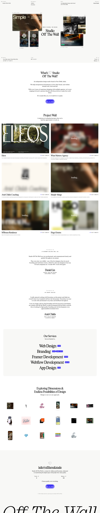

# Studio Off The Wall
>   ·  [offthewall.studio](https://offthewall.studio)

**Vertical:** #vertical/studio-agency  ·  **Vibe:** #vibe/editorial #vibe/minimal  ·  **Topics:** #topic/design  ·  **Mode:** #mode/light

## What it is
The portfolio site of Studio Off The Wall, an independent New Delhi design studio (led by Daniel Lin) that helps brands with how their identity and website 'work, look and feel.' It positions the studio through a curated, magazine-like showcase of project work.

## What it shows
A dense editorial grid on white: stacked project modules ('Simple - things', case-study thumbnails, video stills) around a large serif statement 'Studio Off The Wall' and the tagline 'BORN BY DESIGN, FOR DESIGN'. A labelled header (Studio / Designers: Ashley, Soumitra / What / Get in Touch) and a footer strip with location ('New Delhi, India / World Wide Web') and a live time.

## How it works
A long vertical scroll (~7,360px) through a magazine-style layout of project tiles mixing images and ~10 inline videos. Everything is link-driven (no buttons) — modules open project work; the header and footer carry studio info and contact. It reads like flipping through a printed design annual.

## How it's designed
Institutional/archival editorial: crisp white background, a large display serif ('Lastik Free') for statements alongside Times for running text, and a deliberately old-web touch — default blue (#0000ee) hyperlinks — that signals a knowing, type-led sensibility. Strict grid, small labels, lots of metadata; the design language is 'design studio as publication.'

## Design data
- **Palette:** White (#fff) and off-white (#f8f8f6) with black text, classic blue links (#0000ee); color comes from project imagery.
- **Fonts:** Lastik Free (display serif), Times (body)
- **Keywords:** editorial, institutional, magazine-grid, studio-portfolio, display-serif, long-scroll, retro-blue-links, metadata-labels
- **Extracted:** 2026-06-04 · playwright-mcp @ 1440x900

## Related sites
- [[drafts9.com]] — shared: studio-agency, minimal, design, light
- [[northgarden.com]] — shared: studio-agency, minimal, design, light
- [[ravalabs.com]] — shared: studio-agency, minimal, design, light
- [[rotimi.design]] — shared: studio-agency, minimal, design, light
- [[21st.dev]] — shared: editorial, minimal, design, light
- [[animations.dev]] — shared: editorial, minimal, design, light
