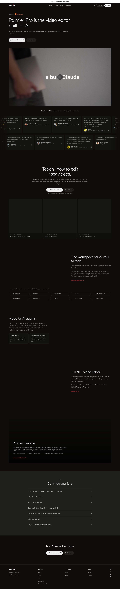

# Palmier Pro | The video editor built for AI
> Palmier Pro is the video editor built for AI.  ·  [palmier.io](https://www.palmier.io/)

**Vertical:** #vertical/startup-product  ·  **Vibe:** #vibe/corporate-clean #vibe/technical  ·  **Topics:** #topic/ai #topic/film-video  ·  **Mode:** #mode/dark

## What it is
Marketing site for Palmier Pro, a non-linear video editor designed to be driven by AI agents such as Claude, Codex and Cursor. palmier.io redirects to www.palmier.io.

## What it shows
Hero pitch, 'Teach Claude, Codex, Cursor, or your agent how to edit your videos', a single workspace for AI tools, a full NLE feature section, the Palmier Service, an FAQ and a closing download CTA.

## How it works
A 7,055px page with 2 videos, 52 images and 43 SVGs. Only first-party assets plus the Fontshare API for Satoshi are loaded. Geist and Geist Mono suggest a Next.js-style stack, but the probe found no framework global, so that is not confirmed.

## How it's designed
Warm near-black #0d0c0a with light grey text #ececec, muted #b3b3b3, surfaces #161614 / #1e1e1c, hairline borders (#ffffff12) and a single red accent #e63535. Type is Satoshi for body and headlines (the h1 is 60px at weight 400), Geist Mono for detail and Instrument Serif available for editorial flourishes.

## Design data
- **Palette:** Warm black #0d0c0a, light grey #ececec, red #e63535
- **Palette tokens:** --background: #0d0c0a (var), --foreground: #ececec (var), --muted: #b3b3b3 (var), --accent: #e63535 (var), --surface: #161614 (var), --surface-elevated: #1e1e1c (var), body bg: rgb(13, 12, 10) (rendered)
- **Fonts:** Satoshi (300-900), Geist, Geist Mono, Instrument Serif
- **Fonts loaded:** Satoshi 300-900, Geist 100-900, Geist Mono 100-900, Instrument Serif 400
- **Tech stack:** Fontshare
- **Keywords:** dark, red-accent, hairline-borders, product-demo, ai-agents, video-editor
- **Media mix:** img 52 · video 2 · svg 43
- **Page height:** 7055px (single-screen: False)
- **Responsive:** At 390px the nav collapses to a menu button (2 links remain visible) and the page shortens from 7,055 to 6,841px with no horizontal overflow.
- **Headings:** Palmier Pro is the video editor
built for AI. / Teach Claude, Codex, Cursor, or your agent how to edit your videos. / One workspace for all your AI tools. / Made for AI agents. / Full NLE video editor. / Palmier Service / Common questions / Try Palmier Pro now.
- **Weight:** None requests; hosts: api.fontshare.com
- **Extracted:** 2026-10-17 · 1440x900 full-page screenshot + 390x844 DOM pass (no mobile screenshot); Playwright, logged_out: true

## Related sites
- [[daytona.io]] — shared: startup-product, corporate-clean, technical, ai, dark
- [[langchain.com]] — shared: startup-product, corporate-clean, technical, ai, dark
- [[cavalry.studio]] — shared: startup-product, corporate-clean, film-video, dark
- [[crustdata.com]] — shared: startup-product, technical, ai, dark
- [[cofounder.co]] — shared: startup-product, technical, ai
- [[creao.ai]] — shared: startup-product, corporate-clean, ai
