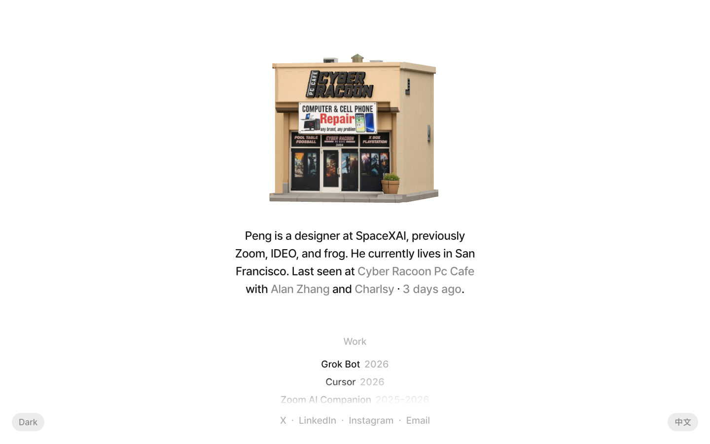

# Peng Zheng
> Product designer's personal site — every real-world check-in rendered as a 3D clay-style miniature storefront  ·  [pengzhe.ng](https://www.pengzhe.ng/)

**Vertical:** #vertical/portfolio  ·  **Vibe:** #vibe/minimal #vibe/playful  ·  **Topics:** #topic/design #topic/travel-places  ·  **Mode:** #mode/light

## What it is
The personal homepage of Peng Zheng, a product designer (per the on-page bio: "a designer at SpaceXAI, previously Zoom, IDEO, and frog", confirmed by the meta description "Peng Zheng is a product designer obsessed with the intrinsic beauty of crafts and fluid interactions between human and interfaces"). Rather than a conventional portfolio, the page's centerpiece is a running log of real-world places he's checked into, each one rendered as a tiny 3D clay-style building generated from a single photo of the storefront.

## What it shows
A hero building — a warm, backlit 3D miniature of the most recent check-in (a 'Cyber Racoon Pc Cafe' storefront at capture time) — sits above a one-line caption naming who he was with and how long ago, each name and the place linking out (Google Maps for the venue, Instagram/X for companions). Below that, a horizontal carousel holds dozens more of these generated miniatures going back months (Marshall St Parking Garage, Eria Marina, Holmes Amphitheatre, ADAN CAFE, Apple Cinemas Van Ness IMAX, Sushi Sato, Twin Peaks, The Sea Ranch, California Academy of Sciences, and more), each dated and credited. A separate "Work" section lists his design credits (Grok Bot, Cursor, Zoom AI Companion, Zoom Workplace, Zoom design system, Zoom on TV, Zoom Rooms) as a simple linked list, and the footer holds X/LinkedIn/Instagram/Email links plus a light/dark toggle and a Chinese-language version.

## How it works
The check-in carousel is built from 25 `` elements (all clay-render photos, no `<canvas>`/`<svg>`/`<video>` on the page — the 3D look is pre-rendered imagery, not a live WebGL scene) with a "Show all check-ins" expand control and per-card "View the [place] check-in" buttons. No SPA framework globals were detected (`__NUXT__`, `__NEXT_DATA__`, a Vue `data-v-app` root, `__sveltekit`, and a `#root`/`#__next` React mount were all absent), and the only third-party script host is Google Tag Manager — this reads as a hand-built static site rather than a framework app. The DOM simultaneously carries both English ("Work") and Chinese ("作品") copies of headings, toggled by the `/cn` locale route rather than client-side i18n.

## How it's designed
Quiet, editorial-adjacent chrome built entirely on custom CSS variables: `--color-text: #1a1a1a`, `--color-secondary: #8a8a8a`, `--color-faint: #b3b3b3`, `--color-border: #ececec`, `--color-bg: #fff`, and a single custom typeface token `--font-sans: "Sunghyun Sans", -apple-system, BlinkMacSystemFont, "Segoe UI", Helvetica, Arial, sans-serif`. `document.fonts` confirms the webfont actually loads ("Sunghyun Sans" 400/500, plus a "Sunghyun Sans JP Balanced" 500 variant for CJK glyphs). All the visual richness comes from the photographic 3D miniatures themselves rather than from UI chrome — the surrounding page is flat white, near-black text, and no accent color at all (button and link colors both resolve to the same `rgb(26, 26, 26)` as body text). The page is content-driven rather than fixed-height: `scrollHeight` runs to ~1132px against a 900px viewport, well past a single screen.

## Design data
- **Palette:** White ground (#fff), near-black text (#1a1a1a), mid-gray secondary (#8a8a8a), faint gray (#b3b3b3), hairline border (#ececec) — no accent color; all warmth comes from the photographic clay-render miniatures, not the UI.
- **Palette tokens:** --color-text: #1a1a1a (var), --color-secondary: #8a8a8a (var), --color-faint: #b3b3b3 (var), --color-border: #ececec (var), --color-bg: #fff (var), body-background: rgb(255, 255, 255) (rendered), body-text: rgb(26, 26, 26) (rendered)
- **Fonts:** Sunghyun Sans (400/500) with a Sunghyun Sans JP Balanced 500 variant for Chinese text — both confirmed loaded via `document.fonts`, referenced through a single `--font-sans` CSS variable.
- **Fonts loaded:** Sunghyun Sans 400, Sunghyun Sans 500, Sunghyun Sans JP Balanced 500
- **Tech stack:** Static/custom-built (no SPA framework detected), Google Tag Manager
- **Keywords:** check-in-log, 3d-miniatures, photo-to-3d-generation, clay-render, personal-homepage, css-custom-properties, bilingual-en-zh, static-site
- **Media mix:** img 25
- **Page height:** 1132px (single-screen: False)
- **Responsive:** At 390×844 the page stays a fluid single column with almost the same content height (scrollHeight 1148px vs 1132px on desktop) — no nav collapse or section hiding was needed since there was no multi-column layout to begin with.
- **Headings:** Work / 作品
- **Links out:** [X](https://x.com/pengzheng_) · [LinkedIn](https://www.linkedin.com/in/pengzheng1) · [Instagram](https://www.instagram.com/peng.zheng_/) · [Email](mailto:hi@pengzhe.ng) · [Cursor (work credit)](https://cursor.com) · [Grok Bot (work credit)](https://x.ai/bot)
- **Extracted:** 2026-09-22 · Playwright MCP, viewports 1440×900 (primary capture + DOM probe) and 390×844 (responsive check); logged_out: true (no auth required — public personal site).

## Related sites
- [[designrebuilds.vercel.app]] — shared: portfolio, minimal, playful, design, light
- [[gyanl.com]] — shared: portfolio, minimal, playful, design, light
- [[kmk0.com]] — shared: portfolio, minimal, playful, design, light
- [[mikes.cv]] — shared: portfolio, minimal, playful, design, light
- [[asekachov.com]] — shared: portfolio, minimal, design, light
- [[christophlocher.com]] — shared: portfolio, minimal, design, light
