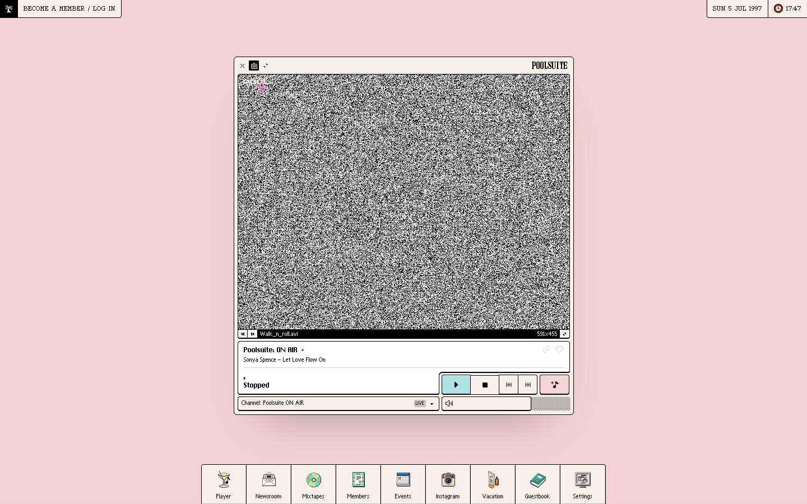

# Now Playing on Poolsuite ☼: Poolsuite ON AIR
> The ultra-summer internet radio station, playing an infinity pool of summer sounds 24/7. Swimwear optional. Formerly Poolside FM.  ·  [poolsuite.net](https://poolsuite.net/)

**Vertical:** #vertical/experiment-art  ·  **Vibe:** #vibe/retro #vibe/playful  ·  **Topics:** #topic/music  ·  **Mode:** #mode/light

## What it is
Poolsuite (formerly Poolside FM) is an 'ultra-summer' internet radio station wrapped in a faux vintage-computer desktop. There's no <h1> — the conceit is the interface itself: a pastel retro operating system you 'boot into' to listen to a 24/7 stream of summer/yacht-rock sounds, with the meta description bragging 'an infinity pool of summer sounds 24/7. Swimwear optional.' The audience is the nostalgia-web / vaporwave crowd and the brand has since spun into a lifestyle label (Vacation, Inc. sunscreen, membership perks).

## What it shows
A single, fixed, non-scrolling screen (exactly 900px tall, no body scroll) styled as a 1990s desktop dated 'SAT 6 JUN 1997'. Centered is a media player window — 'Poolsuite: ON AIR' currently spinning 'Po-one - Steady Glide' — surrounded by draggable app windows and desktop icons: Newsroom, Guestbook, Mixtapes, Members, Events, Vacation Inc, Member Perks, Profile, Settings, 'Submit a track', 'Become a member', plus a little 'HayesJarvis.mpeg' video thumbnail and an Instagram panel.

## How it works
A Vue single-page app (the root carries data-v-app) rendering a windowed desktop metaphor on one fixed screen. Audio/video is handled through an embedded YouTube IFrame-API player (the page's single iframe, script host www.youtube.com). Plausible handles privacy-friendly analytics and a Facebook pixel (connect.facebook.net) covers marketing; the page also bundles a WalletConnect / Web3Modal stack (hundreds of --apkt-* / --w3m-* CSS tokens) for its members/crypto-tinged features.

## How it's designed
Full pixel-art nostalgia. The loaded faces are bitmap/retro display fonts — Pixolde (400 & 700) does most of the work, alongside ChiKareGo2, Ishmeria and Everyday — so every label looks like old system chrome (the global default stack is otherwise ui-sans-serif). The palette is declared in CSS vars as soft poolside pastels: --primary #f7d5d5 (rose), --secondary #faf1e8 (cream), --tertiary #faf5c6 (pale lemon), --button #f6d6d5 and a mint --secondary-button #afe5dd; rendered, the html sits on cream rgb(249,239,228) and the body on rose rgb(246,213,213). It's image-dense (125 imgs, 33 inline SVGs) to sell the skeuomorphic desktop.

## Design data
- **Palette:** Poolside pastels — rose #f7d5d5, cream #faf1e8, pale-lemon #faf5c6, mint #afe5dd — on cream/rose grounds (html rgb(249,239,228), body rgb(246,213,213)).
- **Palette tokens:** --primary: #f7d5d5 (var), --secondary: #faf1e8 (var), --tertiary: #faf5c6 (var), --button: #f6d6d5 (var), --secondary-button: #afe5dd (var), html-bg: rgb(249, 239, 228) (rendered), body-bg: rgb(246, 213, 213) (rendered)
- **Fonts:** Pixel/bitmap display faces — Pixolde (400 & 700) plus ChiKareGo2, Ishmeria and Everyday — self-hosted from poolsuite.net.
- **Fonts loaded:** Pixolde 400, Pixolde 700, ChiKareGo2 400, Ishmeria 400, Everyday 400
- **Tech stack:** Vue, YouTube IFrame API, Plausible, Facebook Pixel, WalletConnect / Web3Modal
- **Keywords:** web-radio, retro-desktop-os, vaporwave, pixel-fonts, single-screen, skeuomorphic, summer-aesthetic, vue
- **Media mix:** img 125 · svg 33 · iframe 1
- **Page height:** 900px (single-screen: True)
- **Responsive:** At 390px it stays a single fixed screen (844px, no scroll), reflowing to a mobile player UI showing the live channel ('Poolsuite: ON AIR'), the current track and a Player / Newsroom / Mixtapes / Members / Events tab bar.
- **Headings:** Poolsuite / Po-one - Steady Glide / Submit a track / Become a member / Vacation, Inc / About / Member Perks / Profile / Settings / Guestbook / Newsroom / Instagram / Mixtapes
- **Extracted:** 2026-06-06 · playwright-mcp @ 1440x900 + 390x844 mobile; logged_out: true

## Related sites
- [[typatone.com]] — shared: experiment-art, playful, music, light
- [[ytch.tv]] — shared: experiment-art, retro, playful
- [[chusmargallo.space]] — shared: retro, playful, light
- [[zzz.zoomquilt.org]] — shared: experiment-art, retro
