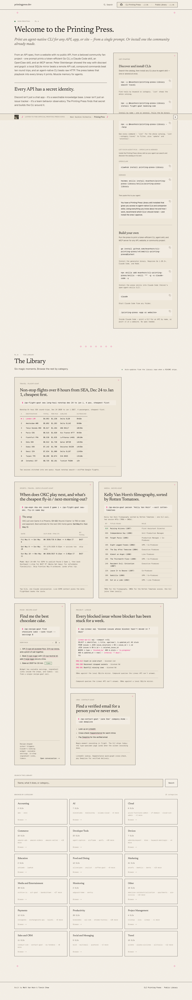

# Printing Press — agent-native CLIs from a single prompt
> Welcome to the Printing Press. Print an agent-native CLI for any API, app, or site — from a single prompt.  ·  [printingpress.dev](https://printingpress.dev/)

**Vertical:** #vertical/startup-product  ·  **Vibe:** #vibe/editorial #vibe/organic-warm #vibe/technical  ·  **Topics:** #topic/engineering #topic/ai  ·  **Mode:** #mode/light

## What it is
Printing Press (printingpress.dev) is the landing page for an open-source project by Matt Van Horn (@mvanhorn) and Trevin Chow (@trevin). The pitch, per its meta: “From an API spec, a website with no public API, or a community fan project — one command prints a Go CLI, a Claude Code skill, an OpenClaw skill, and an MCP server. Muscle memory for agents.” It fronts two GitHub repos — cli-printing-press (PressCLI, ★2.9k) and printing-press-library (Public Library, ★1.4k) — and is the subject of Garry Tan's tweet (“My OpenClaw/Hermes Agent setup just got way smarter”).

## What it shows
A warm cream page (rendered/var background rgb 244,239,230) led by a Newsreader serif h1 at 60px in near-black ink (rgb 27,24,22): “Welcome to the Printing Press. Print an agent-native CLI for any API, app, or site — from a single prompt. Or install one the community already made.” Two section heads carry the concept: “Every API has a secret identity.” and “The Library.” It's deliberately text/diagram-forward — just 1 img and 30 svg — and even links a live claude.ai/share conversation as a worked example.

## How it works
A compact single-scroll explainer (~7487px) that routes to the two GitHub repos and a public Library of community-made CLIs, plus an “Open conversation →” link to a Claude transcript. It's self-hosted with no third-party analytics scripts detected — a lean, developer-audience page.

## How it's designed
An editorial, literary “printing press” aesthetic on warm cream #f4efe6 (var --color-ink-black #1b1816, --color-ink-mute #5a524a for body). The type pairing is the whole idea: Newsreader serif for headlines (60px h1) against Geist sans for body and Geist Mono for the CLI/code snippets — print-meets-terminal. It's a Tailwind v4 build (lab() tokens, lightningcss; purple/pink accent ramps via --color-purple-500/--color-pink-500 and a green --color-ink-green #1f6b3a). The /opengraph-image and /icon.svg metadata routes point to a Next.js app-router setup on Vercel (no __NEXT_DATA__ exposed, so inferred).

## Design data
- **Palette:** Warm cream #f4efe6 (var bg rgb 244/239/230) with near-black ink (rendered rgb 27/24/22, var --color-ink-black #1b1816) and muted-brown body (--color-ink-mute #5a524a); purple/pink token ramps plus a green --color-ink-green #1f6b3a.
- **Palette tokens:** body-bg: rgb(244, 239, 230) (rendered), --color-ink-black: #1b1816 (var), --color-ink-mute: #5a524a (var), --color-ink-green: #1f6b3a (var), h1-color: rgb(27, 24, 22) (rendered), --color-purple-500: lab(52.0183% 66.11 -78.2316) (var), --color-pink-500: lab(56.9303% 76.8162 -8.07021) (var)
- **Fonts:** Newsreader serif for headlines (h1 60px), Geist sans for body, Geist Mono for CLI/code (all loaded).
- **Fonts loaded:** Newsreader 400, Geist 400, Geist Mono 400
- **Tech stack:** Next.js (App Router), Tailwind v4, Vercel
- **Keywords:** product-landing, developer-tool, open-source, warm-cream, editorial-serif, serif-mono-pairing, single-scroll, agents, mcp, tailwind-v4
- **Media mix:** img 1 · svg 30
- **Page height:** 7487px (single-screen: False)
- **Responsive:** At 390x844 the serif h1 drops 60px→32px and the page reflows to a single column (scrollHeight 7487→13578); no hamburger — the nav stays minimal.
- **Headings:** Welcome to the Printing Press.Print an agent-native CLI for any API, app, or site — from a single prompt. Or install one the community already made. / Every API has a secret identity. / The Library
- **Links out:** [PressCLI · cli-printing-press (★2.9k)](https://github.com/mvanhorn/cli-printing-press) · [Public Library · printing-press-library (★1.4k)](https://github.com/mvanhorn/printing-press-library) · [Open conversation (Claude share)](https://claude.ai/share/c7c79da5-abcf-444c-b54d-80dfb31c2fe6) · [Matt Van Horn](https://x.com/mvanhorn) · [Trevin Chow](https://x.com/trevin)
- **Extracted:** 2026-06-06 · playwright-mcp @ 1440x900 (+ 390x844 mobile), logged_out: true

## Related sites
- [[cofounder.co]] — shared: startup-product, editorial, organic-warm, technical, ai
- [[sinceerly.com]] — shared: startup-product, editorial, organic-warm, ai, light
- [[crustdata.com]] — shared: startup-product, technical, engineering, ai
- [[daytona.io]] — shared: startup-product, technical, engineering, ai
- [[hw.cafe]] — shared: startup-product, editorial, technical, engineering
- [[langchain.com]] — shared: startup-product, technical, engineering, ai
