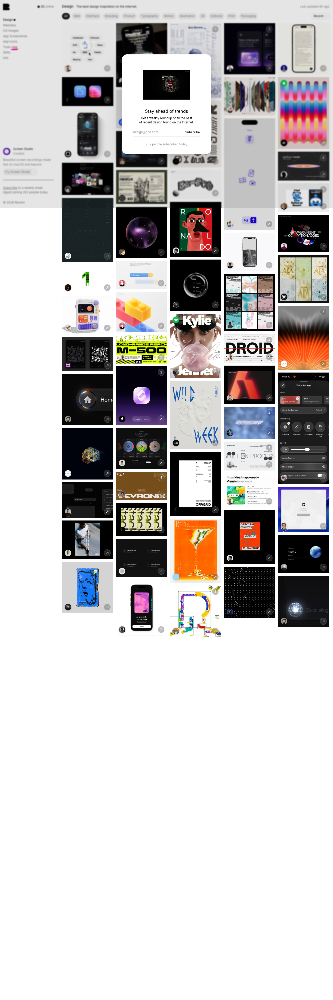

# Recent — Design Inspiration
> The best design inspiration on the Internet.  ·  [recent.design](https://recent.design/)

**Vertical:** #vertical/directory-gallery  ·  **Vibe:** #vibe/minimal  ·  **Topics:** #topic/design  ·  **Mode:** #mode/light

## What it is
Recent (recent.design) is Daryl Ginn's daily-updated design-inspiration gallery — 'the best design inspiration on the Internet' — spanning Websites, OG Images, App Screenshots, App Icons, plus newer Tools and Skills collections. It's the subject of the bookmarked tweet celebrating how fast it's growing.

## What it shows
A live gallery topped by a '30 online' presence counter and a 'Last updated 9h ago' freshness stamp. There's a category filter row (All, Web, Interface, Branding, Product, Typography, Motion, Illustration, 3D, Editorial, Print…), a top nav of collection types (Design, Websites, OG Images, App Screenshots, App Icons, Tools, Skills, Info), a promoted tool card (Raycast — 'A faster command center for launching work and tools — Get 10% off'), and a 'Subscribe to the Recent digest / Stay ahead of trends' weekly-email CTA ('joining 262 people today').

## How it works
A dense client-rendered gallery — 141 img, 42 video, 66 svg — self-hosted on recent.design. Notably it runs on Daryl's own analytics product, visitors.now (cdn.visitors.now), plus Cloudflare Insights. No Next/Nuxt/Svelte root was exposed; the styling is a large Tailwind-v4 token system (OKLCH color scales, superellipse 'squircle' corner-shape tokens, dedicated app-icon radius tokens).

## How it's designed
A neutral, content-first shell that lets the thumbnails supply all the color. From the DOM the background is white (rgb(255,255,255)) with a near-black foreground token --color-foreground #202020 (body color oklch(0.205 0 0)). The type system is Inter (variable 100–900, the only loaded webfont) for everything, with Departure Mono declared as the mono/decimal face for the counters and metadata. An extensive OKLCH accent palette (red/orange/amber/yellow/green/sky/blue/purple/pink scales) is reserved for tag chips, and squircle corner-shapes (superellipse 1.25–1.8) plus app-icon radius tokens shape the cards.

## Design data
- **Palette:** White canvas with #202020 near-black foreground; a full OKLCH accent system (red/amber/green/sky/blue/purple/pink) reserved for tag chips — the gallery thumbnails provide the actual color.
- **Palette tokens:** --color-foreground: #202020 (var), --surface: #fcfcfc (var), --color-focus: oklch(68.5% .179 260) (var), --orange: oklch(58% .24 46) (var), --blue: oklch(57% .235 260) (var), body color: oklch(0.205 0 0) (rendered), body background: rgb(255, 255, 255) (rendered)
- **Fonts:** Inter Variable (100–900) for all text — the only loaded webfont — with Departure Mono for numeric/metadata (counters, timestamps).
- **Fonts loaded:** Inter 100-900 (variable)
- **Tech stack:** Tailwind CSS v4, visitors.now (analytics), Cloudflare
- **Keywords:** design-gallery, directory, tailwind-v4, oklch, squircle, masonry, live-counter, inter, mono-accent
- **Media mix:** img 141 · video 42 · svg 66
- **Page height:** 4318px (single-screen: False)
- **Responsive:** At 390x844 the masonry gallery collapses to 2 columns, a hamburger menu appears, and the lazy-loaded grid grows to ~21,200px.
- **Headings:** Design / Subscribe to the Recent digest / Stay ahead of trends
- **Extracted:** 2026-07-05 · Playwright MCP, 1440x900 + 390x844 mobile pass, logged_out: true

## Related sites
- [[21st.dev]] — shared: directory-gallery, minimal, design, light
- [[designengineer.tools]] — shared: directory-gallery, minimal, design, light
- [[designtools.fyi]] — shared: directory-gallery, minimal, design, light
- [[maxibestof.one]] — shared: directory-gallery, minimal, design, light
- [[nicelydone.club]] — shared: directory-gallery, minimal, design, light
- [[type.lol]] — shared: directory-gallery, minimal, design, light
