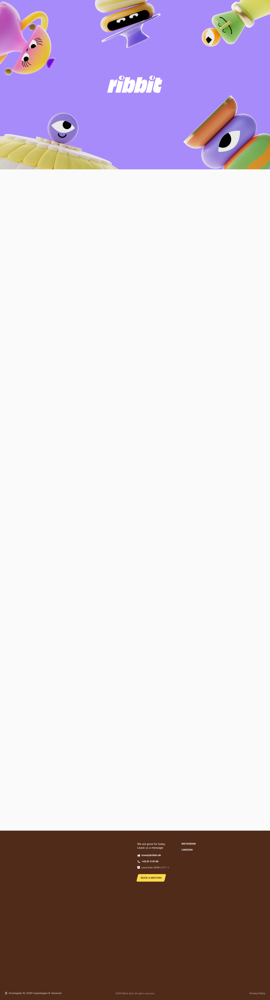

# Ribbit
> Ribbit is a creative motion agency based in Copenhagen founded to create memorable and engaging animations and motion graphics.  ·  [ribbit.dk](https://ribbit.dk/)

**Vertical:** #vertical/studio-agency  ·  **Vibe:** #vibe/playful #vibe/experimental  ·  **Topics:** #topic/design #topic/film-video  ·  **Mode:** #mode/light

## What it is
The studio site of Ribbit, a 'Curious Fullservice Motion Agency' based in Copenhagen (h1: 'Ribbit is a creative motion agency based in Copenhagen'). The tweet flags it as 'how you create a truly mesmerizing digital experience' — the site itself is the motion showreel.

## What it shows
A playful hero where bouncy, googly-eyed 3D claymation characters orbit a fat rounded 'ribbit' wordmark, then a featured-project reel (Toiomi, Birdie, 'Hi energy'), a services rundown ('From Idea to Done.' — explainer videos, animated identities) and a step-by-step process block (Script & References, Technical, Deadline & Format, Voiceover & Music) ending in a 'Book a meeting' contact card.

## How it works
A single ~5,314px scroll where the 'mesmerizing' effect comes from scroll- and hover-driven 3D character animation played back as long image sequences — 758  elements act as animation frames rather than photos, alongside one hero <video>. It's a hand-built vanilla site (no JS framework global), content managed in Prismic (og image on images.prismic.io) with Google Tag Manager for analytics; a rich set of cubic-bezier easing tokens (--sine, --quart-in-out, --expo, --back…) drives the motion.

## How it's designed
Bold, toylike and tactile: an off-white ground (--lightgrey #FAFAFA, rendered rgb(250,250,250)) with dark-ink body text (--darkink #2F2F2F) so the saturated 3D characters and a candy palette of purples, greens, yellows and oranges (--lightpurple #A88BFA, --midpurple #5B21B6, --yellow #FFD948, --orange #FF9C00, --lightgreen #95C154) carry the personality. The display face is FKT Echo at a massive 240px for the headline, with FKGroteskNeue for everything else, and a dark-brown footer anchors the page.

## Design data
- **Palette:** Off-white ground (#FAFAFA) with dark-ink text (#2F2F2F); a candy accent set of purples/greens/yellows/oranges (#A88BFA, #5B21B6, #FFD948, #FF9C00, #95C154) supplied by the 3D characters, over a dark-brown footer.
- **Palette tokens:** --lightgrey (body bg): #FAFAFA (var), --darkink (body text): #2F2F2F (var), --lightpurple: #A88BFA (var), --midpurple: #5B21B6 (var), --yellow: #FFD948 (var), --orange: #FF9C00 (var), --lightgreen: #95C154 (var)
- **Fonts:** FKT Echo (huge 240px display headline) + FKGroteskNeue (regular/medium/bold body) — all self-hosted and loaded.
- **Fonts loaded:** FKGroteskNeue 400, FKGroteskNeue 500, FKGroteskNeue 700, FKT Echo (display)
- **Tech stack:** vanilla (no JS framework), Prismic (CMS), Google Tag Manager
- **Keywords:** motion-agency, 3d-characters, claymation, scroll-animation, playful, oversized-display-type, prismic, mesmerizing
- **Media mix:** img 758 · video 1 · svg 2
- **Page height:** 5314px (single-screen: False)
- **Responsive:** At 390x844 the giant headline drops from 240px to 90px and scrollHeight tightens to ~3,683px; the top nav stays a simple inline row (Projects / About / Process / Contact) with no burger.
- **Headings:** Ribbit is a creative motion agency based in Copenhagen / From Idea to Done. / Let's get to know each other / Script & References / Technical / Deadline & Format / Voiceover & Music
- **Links out:** [All Projects](https://ribbit.dk/projects/) · [Instagram (@ribbit_studio)](https://www.instagram.com/ribbit_studio) · [howdy@ribbit.dk](mailto:howdy@ribbit.dk)
- **Extracted:** 2026-06-05 · playwright-mcp @ 1440x900 (fullPage) + mobile 390x844, logged_out: true

## Related sites
- [[northgarden.com]] — shared: studio-agency, experimental, design, light
- [[basement.studio]] — shared: studio-agency, experimental, design
- [[cavalry.studio]] — shared: playful, design, film-video
- [[drafts9.com]] — shared: studio-agency, design, light
- [[ignytlabs.com]] — shared: studio-agency, design, light
- [[offthewall.studio]] — shared: studio-agency, design, light
