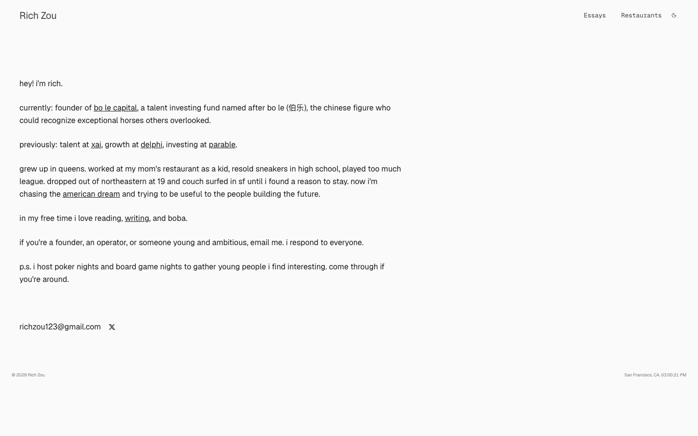

# Rich Zou — personal site (founder of Bo Le Capital)
> 20 y/o Fuzhounese American. From New York, now based in SF.  ·  [richzou.com](https://richzou.com/)

## What it is
The personal site of Rich Zou (@richzou) — a 20-year-old Fuzhounese-American writer/founder ('From New York, now based in SF'), founder of Bo Le Capital (a talent-investing fund named after 伯乐 / Bo Le, the Chinese figure who could recognise exceptional horses others overlooked; previously 'talent at xAI'). It's the author's hub behind the bookmarked essay.

## What it shows
A single-screen, text-only homepage: a lowercase first-person bio ('hey! i'm rich. currently: founder of bo le capital … previously: talent at xai…') with a minimal top nav of just '( Essays )' and '( Restaurants )'. No imagery — pure prose.

## How it works
A Next.js site (Geist + Geist Mono via next/font; Next-style hashed assets) with essay/OG content stored in Supabase (slelguoygbfzlpylpxfs.supabase.co). Zero media (0 img/canvas/video, 4 svg), a single screen (900px), and no third-party analytics scripts.

## How it's designed
Deliberate, quiet minimalism. From getComputedStyle the canvas is near-white rgb(250,250,250) with near-black ink (body rgb(26,26,26)) and soft mid-grey links (rgb(60,60,60)); there is no custom-property palette. Type is Geist (variable 100–900) with Geist Mono — the mono most likely carrying the parenthetical '( Essays ) ( Restaurants )' nav labels — for a clean, technical, understated feel.

## Design data
- **Palette:** A near-white canvas (rgb(250,250,250)) with near-black text (rgb(26,26,26)) and mid-grey links (rgb(60,60,60)) — monochrome, no accent.
- **Palette tokens:** body background: rgb(250, 250, 250) (rendered), body color: rgb(26, 26, 26) (rendered), link color: rgb(60, 60, 60) (rendered)
- **Fonts:** Geist (variable 100–900) for text and Geist Mono for the nav/labels.
- **Fonts loaded:** Geist 100-900 (variable), Geist Mono 100-900 (variable)
- **Tech stack:** Next.js (Geist / next-font), Supabase (storage/content)
- **Media mix:** svg 4
- **Page height:** 900px (single-screen: True)
- **Responsive:** At 390x844 the one-column bio simply rewraps to a slightly taller single screen (~900 → 1,068px); no nav change.
- **Extracted:** 2026-07-05 · Playwright MCP, 1440x900 + 390x844 mobile pass, logged_out: true

## Related sites
[[noahzender.com]] [[axiaisacat.indiehacker.bio]] [[daryl.cv]] [[humanoid-index.com]] [[willmanidis.com]] [[alisawuffles.github.io]]

## Tags
#category/reading #aesthetic/minimal #pattern/personal-site #pattern/text-only #pattern/minimalist #pattern/geist #pattern/mono-labels #pattern/nextjs #pattern/single-screen #pattern/essays #tech/next-js-geist-next-font #tech/supabase-storage-content #color/monochrome #font/geist-100-900-variable #font/geist-mono-100-900-variable
