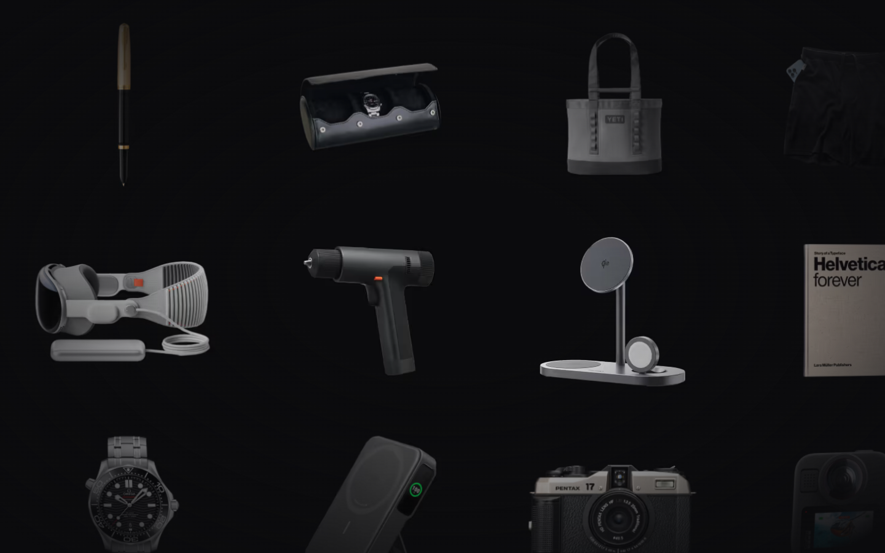

# Roam
> An infinite canvas for browsing well-designed objects.  ·  [roam.neesh.page](https://roam.neesh.page/)

## What it is
Roam, by Neesh, is a spatial gallery — quite literally 'an infinite canvas for browsing well-designed objects' (its own meta description). It's a place to roam through products 'built with craft and care', presented as a draggable field of beautiful product renders rather than a list.

## What it shows
A near-black canvas filled with 60+ rendered product photographs floating in a loose grid: cameras, furniture, watches, gadgets, sneakers and design books. There's no page chrome or headings at all — the objects are the interface — and hovering a tile reveals its name and brand (e.g. 'The Photo Book — Phaidon', 'Bauhaus, Updated Edition — Taschen').

## How it works
The page is a fixed, full-viewport canvas with normal scrolling disabled (body overflow:hidden, scrollHeight equals the viewport); you pan/drag spatially to roam the collection. Items are plain  tiles (no canvas/SVG) with hover labels, so it reads like a calm, gallery-style exploration rather than a feed.

## How it's designed
Maximally minimal and dark: a pure near-black ground (--background #0b0b0d) with white text (--foreground #fff), so all color comes from the product photography itself. Type is the GT America family — gtAmerica for UI with gtAmericaMono defined for accents. It's a Next.js (App Router) build — the hashed /opengraph-image.png and /icon.png are the giveaway — with Seline (cdn.seline.com) for lightweight analytics.

## Design data
- **Palette:** Near-black ground (#0b0b0d / rgb(11,11,13)), white text (#fff); every other color comes from the product imagery.
- **Palette tokens:** --background: #0b0b0d (var), --foreground: #fff (var), body background: rgb(11,11,13) (rendered), body text: rgb(255,255,255) (rendered)
- **Fonts:** GT America (body/UI), GT America Mono (accents)
- **Fonts loaded:** GT America 400
- **Tech stack:** Next.js (App Router), Seline Analytics
- **Media mix:** img 60
- **Page height:** 900px (single-screen: True)
- **Responsive:** At 390x844 it stays a full-screen fixed canvas (scrollHeight = viewport, body overflow:hidden) — fewer tiles are visible and you pan rather than scroll, so the infinite-canvas interaction is preserved on mobile.
- **Extracted:** 2026-06-06 · playwright-mcp @ 1440x900 (+ 390x844 mobile pass), logged_out: true

## Related sites
[[weirdfolders.com]] [[backgrounds.supply]] [[badmarketing.com]] [[davekrugman.com]] [[daytona.io]] [[ditther.com]]

## Tags
#category/uncategorized #aesthetic/experimental #aesthetic/dark #pattern/infinite-canvas #pattern/draggable-canvas #pattern/spatial-gallery #pattern/dark-mode #pattern/product-showcase #pattern/hover-label #pattern/curated-collection #tech/next-js-app-router #tech/seline-analytics #color/dark #font/gt-america
