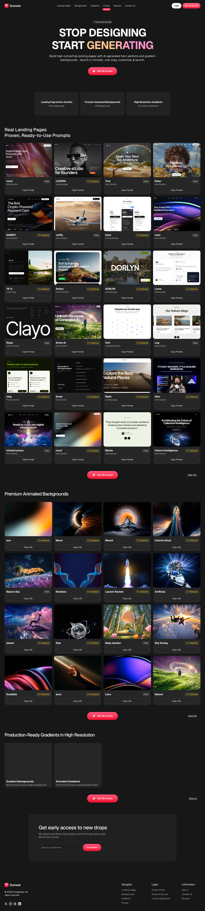

# SceneAI — The Best UI Prompt Library on the Internet
> Stop designing, start generating.  ·  [sceneai.art](https://sceneai.art/)

**Vertical:** #vertical/directory-gallery  ·  **Vibe:** #vibe/experimental #vibe/technical  ·  **Topics:** #topic/design #topic/ai  ·  **Mode:** #mode/dark

## What it is
A paid library of copy-paste AI prompts for building landing pages — the meta pitch is 'Stop designing, start generating. Build high-converting landing pages with AI-generated hero sections, animated backgrounds, and production-ready gradients — copy, customize, and launch in minutes.' The catalog is split into Landing Pages (75 prompts), Premium Animated Backgrounds (16) and High-Resolution Gradients (2 collections), monetized as a '60% OFF' 'Get All Access' subscription. This is the 'barebones one [that] prints millions' the tweet is dunking on.

## What it shows
A dark masonry gallery where every card is a looping <video> preview of a generated hero/landing page — named entries like 'rocol', 'LOVERA', 'Clayo' and 'DORLIN' — each badged FREE or PREMIUM with a 'Copy Prompt' button. The page opens on a huge 'STOP DESIGNING / START GENERATING' wordmark and a 'Get All Access' CTA, then runs three labelled sections ('Real Landing Pages — Proven, Ready-to-Use Prompts', 'Premium Animated Backgrounds', 'High Resolution Gradients'). Top nav: Landing Pages / Backgrounds / Gradients / Pricing.

## How it works
A Tailwind v4 site (the :root is saturated with Tailwind v4 tokens — lab()-encoded --color-* values and the full --tw-* utility set) with Geist as the sole webfont, everything served from its own host and Cloudflare Insights as the only third-party script. It is media-driven: 40 inline <video> loops power the thumbnail previews alongside 38 inline SVGs and only 5 raster images, over a ~6358px desktop page. No SSR framework global was detectable (no __NEXT_DATA__, __NUXT__, Vue or Svelte markers).

## How it's designed
A dark, near-black neutral canvas (--background #171717, rendered rgb(23,23,23)) with pure-white text (#fff), card surfaces at --card #262626 and hairline --border #353233, lit by a single hot-pink→red CTA gradient (--gradient-cta-from #ff6589 → --gradient-cta-to #ff0432, with --ring/accent reusing #ff6589). Geist sans does all the type; the mono stack is system ui-monospace only. The oversized 'STOP DESIGNING / START GENERATING' lockup plus the glowing grid of video thumbnails carry the whole design — note the page ships no semantic <h1>/<h2> at all, so the headings are styled 
/ rather than real heading elements.

## Design data
- **Palette:** Near-black neutral canvas, white text, #262626 cards on #353233 hairlines, one hot-pink→red CTA gradient.
- **Palette tokens:** --background: #171717 (var), --card: #262626 (var), --border: #353233 (var), --gradient-cta-from: #ff6589 (var), --gradient-cta-to: #ff0432 (var), --ring: #ff6589 (var), body.bg: rgb(23, 23, 23) (rendered), body.color: rgb(255, 255, 255) (rendered)
- **Fonts:** Geist (self-hosted) is the only webfont; the mono fallback is the system ui-monospace stack.
- **Fonts loaded:** Geist 100-900
- **Tech stack:** Tailwind CSS v4, Geist (self-hosted), Cloudflare Insights
- **Keywords:** prompt-library, dark-theme, video-preview-grid, masonry-gallery, tailwind, geist, gradient-cta, copy-to-clipboard, ai-design, paywall
- **Media mix:** img 5 · video 40 · svg 38
- **Page height:** 6358px (single-screen: False)
- **Responsive:** At 390x844 the masonry collapses to a single 358px column (grid-template-columns: 358px), the top nav becomes a hamburger, there is no horizontal overflow, and the stacked cards stretch the page to ~18.8k px.
- **Extracted:** 2026-06-06 · Playwright MCP, 1440x900 + 390x844, logged_out: true

## Related sites
- [[motionsites.ai]] — shared: directory-gallery, technical, design, ai, dark
- [[killedbyopenai.com]] — shared: directory-gallery, technical, ai, dark
- [[roam.neesh.page]] — shared: directory-gallery, experimental, design, dark
- [[21st.dev]] — shared: directory-gallery, design, ai
- [[coolsites.ai]] — shared: directory-gallery, design, ai
- [[crustdata.com]] — shared: experimental, technical, ai, dark
