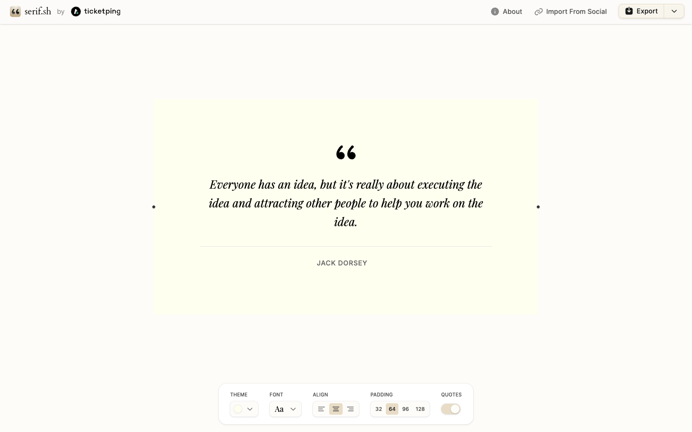

# serif.sh — Beautiful Quote Snapshots
> Create beautiful, shareable images of your favorite quotes. Choose from elegant serif-styled themes.  ·  [serif.sh](https://www.serif.sh/)

## What it is
A small single-purpose tool that turns a quote into a beautiful, shareable image using elegant serif themes (h1: 'serif.sh'). One of the two extra links in the kail_designs transitions tweet.

## What it shows
A quote editor with a live preview: you type a quote and pick a serif theme — the rendered previews use Playfair Display, Old Standard TT and Instrument Serif — then export the snapshot to share. It fits in a single screen.

## How it works
A single full-viewport app (scrollHeight == innerHeight == 900, no scroll) built with SvelteKit; an editor panel drives a live preview of the quote card. Analytics via Google Tag Manager; the footer links to the maker's other product, Ticketping.

## How it's designed
Warm, paper-like editorial: a cream ground (rgb(253,252,249)) with near-black ink (rgb(26,26,26)), Open Runde as the rounded UI sans and a rotating set of serif display faces (Playfair Display / Old Standard TT / Instrument Serif) that style the quote previews themselves. Fourteen inline SVG controls and zero raster images — the serif type is the whole product.

## Design data
- **Palette:** Cream/paper ground (rgb(253,252,249)) with near-black ink (rgb(26,26,26)); a quiet warm-neutral palette that lets the serif type be the hero.
- **Palette tokens:** body background (rendered): rgb(253,252,249) (rendered), body text (rendered): rgb(26,26,26) (rendered)
- **Fonts:** Open Runde (rounded UI sans) + serif theme faces Playfair Display / Old Standard TT / Instrument Serif; Geist, Inter and JetBrains Mono are also present in the payload.
- **Fonts loaded:** Open Runde 400, Open Runde 500, Playfair Display 400, Playfair Display 500, Inter (variable)
- **Tech stack:** SvelteKit, Google Tag Manager, Google Fonts
- **Media mix:** svg 14
- **Page height:** 900px (single-screen: True)
- **Responsive:** At 390x844 it stays a single screen (~844px) with the h1 down to 16px; the editor controls reflow to fit the narrow column.
- **Headings:** serif.sh
- **Links out:** [Ticketping (maker's other product)](https://ticketping.com/)
- **Extracted:** 2026-06-05 · playwright-mcp @ 1440x900 (fullPage) + mobile 390x844

## Related sites
[[12matcha.com]] [[akira.sachi.dev]] [[animations.dev]] [[asekachov.com]] [[axiaisacat.indiehacker.bio]] [[bird.onethreenine.net]]

## Tags
#category/uncategorized #aesthetic/editorial #pattern/single-screen #pattern/quote-to-image #pattern/generator-tool #pattern/serif-typography #pattern/editorial #pattern/sveltekit #pattern/cream #tech/sveltekit #tech/google-tag-manager #tech/google-fonts #color/warm #font/open-runde #font/playfair-display #font/inter-variable
