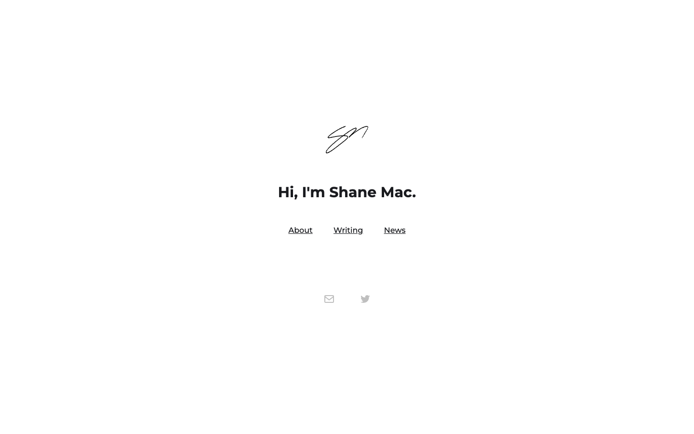

# Shane Mac
> Hi, I'm Shane Mac.  ·  [shanemac.com](https://www.shanemac.com/)

## What it is
The personal landing page of Shane Mac, a founder & CEO who — per the site's own meta description — is 'building XMTP, a decentralized messaging protocol.' It is a single-screen Webflow page that acts as a hub linking out to his About, Writing, and News. Notably it does NOT link the @openclaw agent product the tweet is about, so the showcased product has no resolvable site.

## What it shows
A centered hand-drawn 'SM' signature mark, the H1 'Hi, I'm Shane Mac.', a three-item text nav (About, Writing, News), and a pair of small email and Twitter icons — nothing else.

## How it works
A pure static Webflow page with no JS framework; jQuery (from googleapis) and Google Tag Manager are the only scripts, fonts come from Google Fonts and assets from a Webflow Cloudfront CDN. Everything fits one viewport (scrollHeight 900px == innerHeight), and each nav item routes to a subpage.

## How it's designed
Minimal, white-canvas, document-like. White background (rgb(255,255,255)), near-black ink (rgb(26,27,31)), and Montserrat (plus Montserrat Alternates) loaded across the full 100-900 weight range; the H1 is a 30px bold Montserrat. The only imagery is the signature mark and two social glyphs — there is no accent color at all, and links simply inherit the near-black ink. CSS exposes just two custom props, --white and --black.

## Design data
- **Palette:** White canvas, near-black text and links, no accent color.
- **Palette tokens:** --white: white (var), --black: black (var), body.bg: rgb(255, 255, 255) (rendered), body.color: rgb(26, 27, 31) (rendered), h1.color: rgb(26, 27, 31) (rendered), link.color: rgb(26, 27, 31) (rendered)
- **Fonts:** Montserrat (and Montserrat Alternates) self-loaded via Google Fonts across weights 100-900; H1 in 30px Montserrat.
- **Fonts loaded:** Montserrat 100-900, Montserrat Alternates 300-800
- **Tech stack:** Webflow, Google Tag Manager, Google Fonts, jQuery (googleapis), Cloudfront CDN
- **Media mix:** img 3
- **Page height:** 900px (single-screen: True)
- **Responsive:** At 390x844 it stays a single centered screen (scrollHeight 844px, no horizontal overflow); the text nav remains inline with no hamburger.
- **Headings:** Hi, I'm Shane Mac.
- **Links out:** [About](https://www.shanemac.com/about) · [Writing](https://www.shanemac.com/writing) · [News](https://www.shanemac.com/news)
- **Extracted:** 2026-06-06 · Playwright MCP, 1440x900 + 390x844, logged_out: true

## Related sites
[[axiaisacat.indiehacker.bio]] [[conigma.com]] [[daryl.cv]] [[daviskeene.com]] [[farza.com]] [[gatheros.co]]

## Tags
#category/personal #aesthetic/minimal #pattern/personal-landing #pattern/minimalist #pattern/single-screen #pattern/webflow #pattern/signature-logo #pattern/text-nav #pattern/centered #tech/webflow #tech/google-tag-manager #tech/google-fonts #tech/jquery-googleapis #tech/cloudfront-cdn #color/neutral #font/montserrat-100-900 #font/montserrat-alternates-300-800
