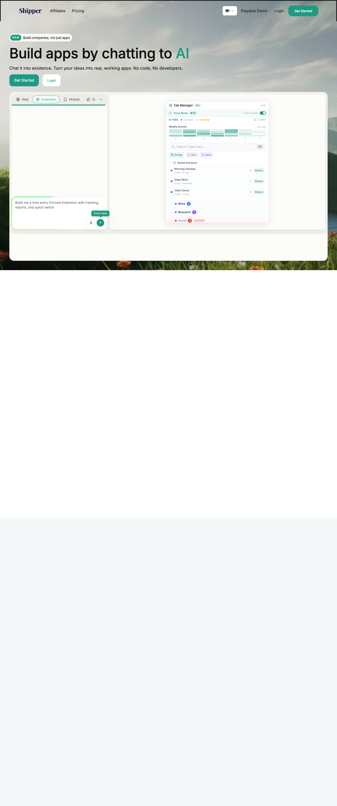

# Shipper.now | Build Complete Apps by Messaging AI
> Build apps by chatting to AI  ·  [shipper.now](https://shipper.now/)

## What it is
The marketing site for Shipper.now, an AI app-builder that turns chat messages into live products — web apps, mobile apps, Chrome extensions, bots, and whole 'companies' — with, per its description, 'No need to code or design, Shipper handles everything for you.' The tweet quotes Shipper touting that Claude Code Opus 4.6 inside it can 'Clone any successful company.'

## What it shows
A long landing page: a hero ('Build apps by chatting to AI / Chat it into existence') set over a sky-and-grass photograph with a live chat-builder mockup assembling a 'Tab Manager' app; a 'From idea to live product, in one chat' grid (Web Apps, Mobile Apps, Chrome Extensions, Companies, Bots & Automations); a playable demo; 'Build Using Agentic AI'; an 'Advisor' feature block ('Watch The Advisor in Action'); testimonials; and a '30+ features. Have your Business/Company built by AI.' close.

## How it works
A WordPress site (custom 'shipper' theme; the :root is saturated with --wp--preset CSS vars) using Inter from Google Fonts and scripts from jsDelivr, with Cloudflare Insights plus Google Tag Manager and a Twitter ads pixel. It is media-heavy — 128 images, 156 SVGs and 8 iframes (embedded demos/videos) over a ~3.4k px desktop page.

## How it's designed
A light, friendly consumer-SaaS look rather than a developer one: a warm off-white canvas (rgb(243,243,238)) with near-black text and a 48px Inter H1, a teal-green primary CTA (rgb(30,154,128)) sitting alongside a purple UI accent family (--purple-ui-2 #6b22c7, the CTA purple #782cdb) and soft-lavender / peach tints. Product-mockup cards and a photographic hero set an approachable tone.

## Design data
- **Palette:** Warm off-white canvas, near-black text, teal-green CTA, with purple UI accents and lavender/peach tints.
- **Palette tokens:** body.bg: rgb(243, 243, 238) (rendered), h1.color: rgb(28, 28, 28) (rendered), button.bg: rgb(30, 154, 128) (rendered), --purple-ui-2: #6b22c7 (var), --bg-purple-ui-for-cta-button: #782cdb (var), --peach: #ff895a (var)
- **Fonts:** Inter (400/500) via Google Fonts.
- **Fonts loaded:** Inter 400, Inter 500
- **Tech stack:** WordPress, Inter (Google Fonts), jsDelivr, Cloudflare, Google Tag Manager, Twitter Ads pixel
- **Media mix:** img 128 · svg 156 · iframe 8
- **Page height:** 3437px (single-screen: False)
- **Responsive:** At 390x844 it reflows to a single column (~4.7k px) with no horizontal overflow, and the top nav collapses to a hamburger.
- **Headings:** Build apps by chatting to AI / Curious? Play with a demo / Here's how to chat it into existence with Shipper / Build Using Agentic AI / Why Shipper? / Watch The Advisor in Action / How The Advisor saves time for you / Why The Advisor Is Loved / Apps so good they'll think you are a senior developer / From idea to live product, in one chat / 30+ features. Have your Business/Company built by AI.
- **Links out:** [Pricing](https://shipper.now/pricing) · [Affiliates](https://shipper.now/affiliates) · [Playable Demo](https://shipper.now/) · [Get Started](https://shipper.now/)
- **Extracted:** 2026-06-06 · Playwright MCP, 1440x900 + 390x844, logged_out: true

## Related sites
[[bigideasdb.com]] [[crustdata.com]] [[davidwinalda.com]] [[daytona.io]] [[linkeddit.com]] [[mercuryos.com]]

## Tags
#category/product #aesthetic/luxury #pattern/ai-app-builder #pattern/no-code #pattern/wordpress #pattern/long-scroll-landing #pattern/product-mockups #pattern/photographic-hero #pattern/teal-cta #pattern/chat-to-app #tech/wordpress #tech/inter-google-fonts #tech/jsdelivr #tech/cloudflare #tech/google-tag-manager #tech/twitter-ads-pixel #color/warm #color/cool #font/inter
