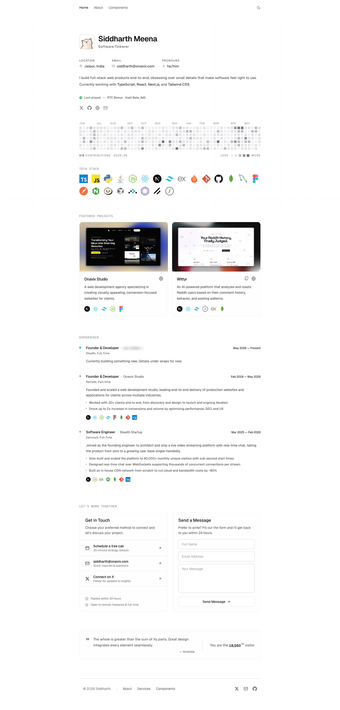

# Siddharth Meena | Full-Stack Developer
> Full-Stack Developer & Software Engineer based in India — React, Next.js, TypeScript, Node.js.  ·  [siddz.com](https://siddz.com/)

**Vertical:** #vertical/portfolio  ·  **Vibe:** #vibe/minimal #vibe/technical  ·  **Topics:** #topic/engineering  ·  **Mode:** #mode/light

## What it is
The personal portfolio of Siddharth Meena (@buildwithsid), a full-stack developer based in India (h1: 'Siddharth Meena'). The tweet introduces it as his updated site and 'my cleanest design yet.'

## What it shows
A single-page scroll broken into Tech Stack, Featured Projects (Onavix, Wittyr), Experience and a 'Let's Work Together' CTA, plus a Spotify 'now playing' track widget and links to X, GitHub and a cal.com booking page.

## How it works
A long single-page scroll (~3,002px) with anchored sections; outbound links go to the live projects (onavix.com, wittyr.com), a Spotify track, GitHub (SiddDevZ) and a cal.com 30-minute call. Assets (Geist + JetBrains Mono) are self-hosted and no analytics host is loaded; the Geist family hints at a Next.js build although no framework global is exposed.

## How it's designed
Light, monospace-forward developer aesthetic: a white ground (rgb(255,255,255)) with near-black text (rgb(17,17,17)), JetBrains Mono as the body face and Geist Sans for headings (h1 rgb(13,13,13)) — even Geist's pixel display variants are loaded. Buttons are ghost/transparent. There are no :root custom properties, consistent with a Tailwind/utility build.

## Design data
- **Palette:** White ground (rgb(255,255,255)) with near-black text (rgb(17,17,17)); a restrained near-monochrome scheme where links carry the only accent.
- **Palette tokens:** body background (rendered): rgb(255,255,255) (rendered), body text (rendered): rgb(17,17,17) (rendered), h1 color (rendered): rgb(13,13,13) (rendered)
- **Fonts:** JetBrains Mono (body) + Geist Sans (headings), with Geist pixel-display variants; all self-hosted (Inter is present but unused).
- **Fonts loaded:** JetBrains Mono 400, GeistSans (variable 100-900)
- **Tech stack:** self-hosted build (Geist fonts → likely Next.js; no framework global exposed), no analytics detected
- **Keywords:** portfolio, light-mode, monospace, single-page-scroll, developer, now-playing, minimalist
- **Media mix:** img 52 · svg 33
- **Page height:** 3002px (single-screen: False)
- **Responsive:** At 390x844 the sections stack single-column and the h1 drops to 24px; scrollHeight grows to ~4,150px (no burger nav).
- **Headings:** Siddharth Meena / Tech Stack / Featured Projects / Experience / Let's Work Together
- **Links out:** [GitHub](https://github.com/SiddDevZ) · [X (Twitter)](https://x.com/buildwithsid) · [Schedule a free call](https://cal.com/siddharth-meena/30min) · [Onavix](https://onavix.com/) · [Wittyr](https://wittyr.com/)
- **Extracted:** 2026-06-05 · playwright-mcp @ 1440x900 (fullPage) + mobile 390x844

## Related sites
- [[spyrosigma.in]] — shared: portfolio, minimal, technical, engineering, light
- [[khairallah.xyz]] — shared: portfolio, minimal, technical, engineering
- [[lab01.dev]] — shared: portfolio, minimal, technical, engineering
- [[arneshbanerjee.github.io]] — shared: portfolio, minimal, engineering, light
- [[axiaisacat.indiehacker.bio]] — shared: portfolio, minimal, engineering, light
- [[daviskeene.com]] — shared: portfolio, minimal, engineering, light
