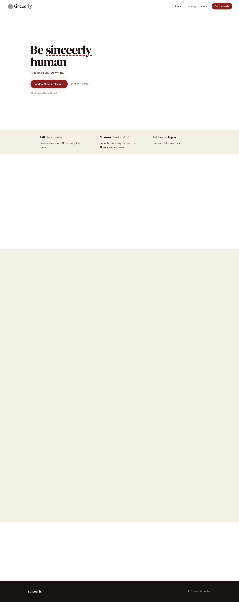

# Sinceerly, make your emails sound human
> Be sinceerly human  ·  [sinceerly.com](https://sinceerly.com/)

## What it is
Sinceerly is a Chrome extension that does the opposite of Grammarly — it "uses AI to undo your AI writing" so emails read as human. The <h1> states the whole brand promise: "Be sinceerly human", with the sub-line "AI to undo your AI writing."

## What it shows
A focused one-product landing: a Gmail-style demo with a Subtle↔Human slider (three levels, one slider), feature beats like "Kill the emdash" (emdashes scream AI), undoing repetitive AI phrases ("No more 'not just…'"), and even "Add some typos" ("Humans make mistkaes"), an original-vs-AI-slop comparison, a how-it-works ("Open Gmail. Click the icon."), and pricing ("Simple. No surprises."). Primary CTA is "Add to Chrome. It's free" (3 free emails, no card).

## How it works
A lightweight hand-built static marketing site — no JS framework detected and no third-party script hosts; only Google Fonts is pulled in for typography. The CTA points to the Chrome Web Store listing, and the footer links the maker (Ben Horwitz) on LinkedIn and X.

## How it's designed
A warm, editorial, anti-tech look that suits the "sound human" pitch: a cream canvas (#F5EFE6, body painted #fff with cream sections) over near-black ink (#1A1210) text, with a deep brick red (#8B2020, lighter #b84040) as the single accent — all declared as CSS custom properties. Typography pairs DM Serif Display for headlines with DM Sans for body, a classic serif/sans editorial combo that reads warm rather than SaaS-y.

## Design data
- **Palette:** Cream paper (#F5EFE6) + near-black ink (#1A1210) with a brick-red accent (#8B2020).
- **Palette tokens:** --cream: #F5EFE6 (var), --cream-dark: #EBE2D5 (var), --ink: #1A1210 (var), --ink-mid: #4A3830 (var), --red: #8B2020 (var), --red-light: #b84040 (var), body_bg (rendered): rgb(255, 255, 255) (rendered)
- **Fonts:** DM Serif Display (headlines) + DM Sans (body).
- **Fonts loaded:** DM Sans 400, DM Sans 500, DM Serif Display 400
- **Tech stack:** Static HTML/CSS (no framework), Google Fonts
- **Media mix:** img 3 · svg 2
- **Page height:** 3618px (single-screen: False)
- **Responsive:** At 390px the page stacks taller (scrollHeight ~4.9k px) and the nav switches to a hamburger menu.
- **Headings:** Be sinceerly human / Three levels.One slider. / Open Gmail.Click the icon. / Simple. No surprises.
- **Links out:** [Add to Chrome](https://chromewebstore.google.com/detail/chhpfaolifjjjdfnfomegafenplbeenb) · [Ben (LinkedIn)](https://www.linkedin.com/in/horwitzben/) · [LMK (X)](https://x.com/horwitzben)
- **Extracted:** 2026-06-06 · Playwright 1440x900 + 390x844, logged_out: true

## Related sites
[[contralabs.com]] [[eko.lumaris.works]] [[joonasvirtanen.com]] [[12matcha.com]] [[21st.dev]] [[animations.dev]]

## Tags
#category/product #aesthetic/editorial #aesthetic/developer-product #pattern/chrome-extension #pattern/editorial #pattern/serif-display #pattern/warm-palette #pattern/single-product-landing #pattern/anti-ai-positioning #tech/static-html-css-no-framework #tech/google-fonts #color/warm #font/dm-sans #font/dm-serif-display
