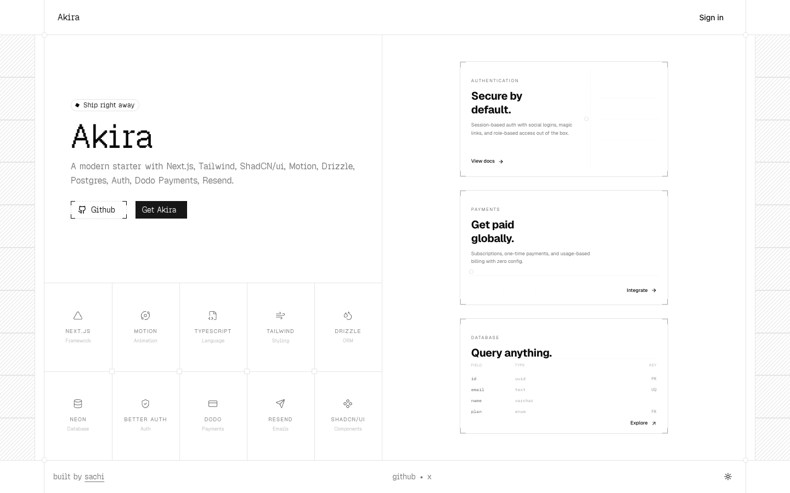

# Akira | Modern Next.js Starter
> A modern starter with Next.js, Tailwind, ShadCN/ui, Motion, Drizzle, Postgres, Auth, Dodo Payments, and Resend.  ·  [akira.sachi.dev](https://akira.sachi.dev/)

**What it is** — The landing page for Akira, a modern open-source Next.js starter kit by Sachi Goyal (h1: 'Akira'; github.com/sachigoyal/akira) — 'A modern starter with Next.js, Tailwind, ShadCN/ui, Motion, Drizzle, Postgres, Auth, Dodo Payments, Resend.' One of the sites in Devster's inspo dump.

**What it shows** — A blueprint-style one-screen marketing page: a left column with a 'Ship right away' pill, the Akira wordmark, Github + 'Get Akira' buttons and a 4x3 grid of stack logos (Next.js, Motion, TypeScript, Tailwind, Drizzle, Neon, Better Auth, Dodo, Resend, shadcn/ui); a right column of feature cards — 'Secure by default.' (auth), 'Get paid globally.' (payments) and 'Query anything.' with a faux database schema table.

**How it works** — A single full-height screen (~900px, scroll-snapped) with hatched 'engineering drawing' margins framing the content; built on shadcn/ui's token system and Motion for animation (no framework global is exposed in the DOM, but the Geist stack and tokens point to a Next.js build). Logos are 33 inline SVGs and there are zero raster images; a light/dark theme toggle sits in the footer.

**How it's designed** — Technical, mono, near-monochrome: a white ground (--background #fff) with near-black ink (--foreground #0a0a0a) and a dark neutral primary (--primary #171717) for the filled button. The whole page leans into a developer-blueprint look — the 'Akira' headline is set in GeistPixelSquare (a pixel/dot display face) and section labels in Geist Mono, with Geist Sans for prose. A shadcn chart palette (--chart-1 #f05100, --chart-2 #009588…) is defined but the visible UI stays grayscale.

**Palette** — White ground (--background #fff) with near-black ink (--foreground #0a0a0a) and a dark neutral primary (--primary #171717); essentially monochrome blueprint, accent colors defined in tokens but unused on screen.
**Fonts** — GeistPixelSquare (pixel display headline) + Geist Mono (labels/code) + Geist Sans (body) — Geist and Geist Mono variable plus GeistPixelSquare 500 actually load.

## Connections
**Aesthetics:** [[aesthetics/developer-product|developer-product]] [[aesthetics/playful|playful]] [[aesthetics/light|light]]
**Patterns:** [[patterns/developer-tool|developer-tool]] `boilerplate` `blueprint` [[patterns/single-screen|single-screen]] [[patterns/monospace|monospace]] [[patterns/pixel-type|pixel-type]] [[patterns/shadcn|shadcn]] [[patterns/light-mode|light-mode]]
**Category:** [[categories/uncategorized|uncategorized]]
**Tech:** `Next.js (Geist stack + shadcn tokens; no framework global exposed)` `shadcn/ui` `Motion` [[tech/no-analytics-detected|no analytics detected]]
**Colors:** [[colors/light|light]] [[colors/monochrome|monochrome]] [[colors/cool|cool]]
**Fonts:** [[fonts/geist-variable-100-900|Geist (variable 100-900)]] [[fonts/geist-mono-variable-100-900|Geist Mono (variable 100-900)]] `GeistPixelSquare`

## Related sites
[[sites/sensory-ui.com|sensory-ui.com]] [[sites/itshover.com|itshover.com]] [[sites/patterncraft.fun|patterncraft.fun]] [[sites/gatheros.co|gatheros.co]] [[sites/killedbyopenai.com|killedbyopenai.com]]
