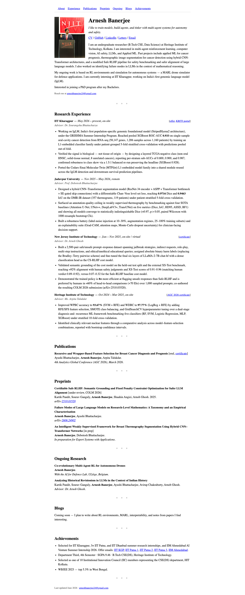

# Arnesh Banerjee — undergraduate ML researcher
> I like to train models, build agents, and tinker with multi-agent systems for autonomy and safety.  ·  [arneshbanerjee.github.io](https://arneshbanerjee.github.io/)

**What it is** — The homepage of Arnesh Banerjee (@Arnesh_24), the tweet's author — an undergraduate researcher (B.Tech CSE, Data Science) at Heritage Institute of Technology, Kolkata, working on multi-agent reinforcement learning, computer vision and AI safety.

**What it shows** — A classic academic CV page: a bio ('I like to train models, build agents, and tinker with multi-agent systems…'), a top anchor nav (About, Experience, Publications, Preprints, Ongoing, Blogs, Achievements) with CV / GitHub / LinkedIn / Letters / Email links, then Research Experience, Publications, Preprints, Ongoing Research, Blogs and Achievements sections.

**How it works** — About as barebones as the web gets — hand-written static HTML with no framework, no CSS custom properties, no webfonts and no analytics scripts at all. A single image, no svg/canvas/video, 3,485px tall, constrained to an 800px reading column.

**How it's designed** — Pure browser-default 'researcher homepage' aesthetic. From the DOM it's a white background with black text rendered in the default serif stack (Times / Times New Roman / Georgia), a 34px/700 serif h1, and unstyled default-blue links (rgb(0,0,238)). Content over chrome — the academic-LaTeX-homepage look, with no design system to speak of.

**Palette** — Black text on white, browser-default-blue links (rgb(0,0,238)) — no custom palette.
**Fonts** — System serif stack only (Times / Times New Roman / Georgia) — no webfont payload; document.fonts is empty.

## Connections
**Aesthetics:** [[aesthetics/minimal|minimal]]
**Patterns:** `academic` `raw-html` `system-serif` [[patterns/minimalist|minimalist]] [[patterns/single-column|single-column]] `cv` [[patterns/no-framework|no-framework]]
**Category:** [[categories/uncategorized|uncategorized]]
**Tech:** `Static HTML/CSS (no framework)`
**Colors:** [[colors/cool|cool]]
**Fonts:** [[fonts/system-fonts|system-fonts]]

## Related sites
[[sites/alisawuffles.github.io|alisawuffles.github.io]] [[sites/daviskeene.com|daviskeene.com]] [[sites/mrdoob.com|mrdoob.com]] [[sites/nicolasbustamante.com|nicolasbustamante.com]] [[sites/amanml.com|amanml.com]]
