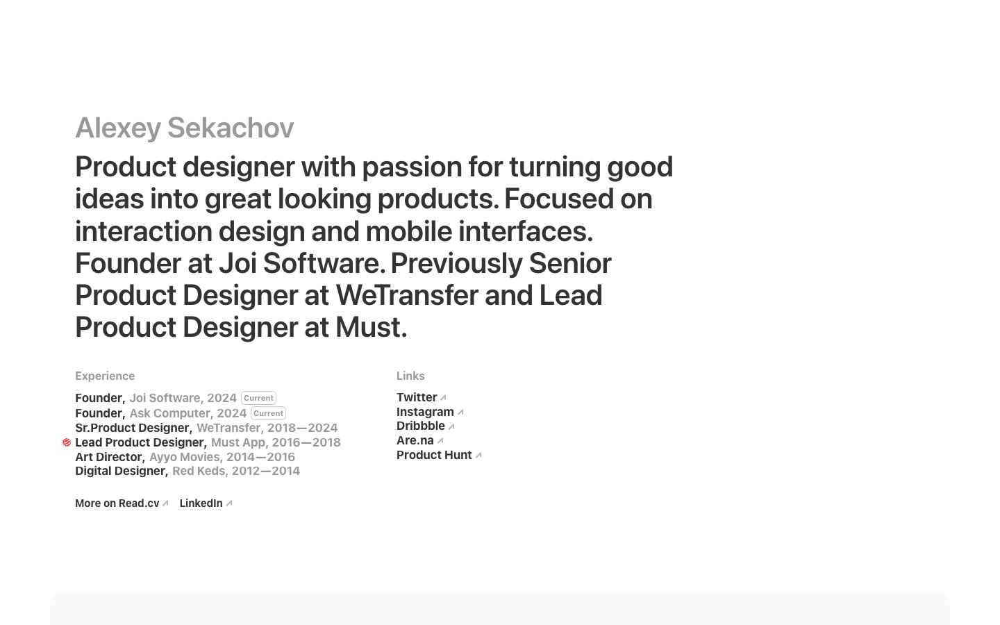

# Alexey Sekachov — a minimal black-on-white product-designer portfolio (Framer)
> Product designer with passion for turning good ideas into great looking products.  ·  [asekachov.com](https://asekachov.com/)

**What it is** — The personal portfolio of Alexey Sekachov, a product designer (Founder at Joi Software and Ask Computer; previously Senior Product Designer at WeTransfer and Lead Product Designer at Must). It is the site the 'Atlas for iPhone' tweet resolves to via the export metadata — the author's own portfolio, where 'Atlas' (the visual-collection app shown in the tweet's video) presumably lives. Its live hero pitch reads 'Product designer with passion for turning good ideas into great looking products. Focused on interaction design and mobile interfaces.'

**What it shows** — A single wide column on white: the name 'Alexey Sekachov' set in grey as a quiet eyebrow over a large bold statement headline, then a two-column block — an 'Experience' list (Founder, Joi Software 2024–Current; Founder, Ask Computer 2024–Current; Sr. Product Designer, WeTransfer 2018–2024; Lead Product Designer, Must App 2016–2018; Art Director, Ayyo Movies 2014–2016; Digital Designer, Red Keds 2012–2014) beside a 'Links' list (Twitter, Instagram, Dribbble, Are.na, Product Hunt), with 'More on Read.cv' and 'LinkedIn' beneath. Below the hero the page runs very long (42k px) with project case-study imagery.

**How it works** — A Framer-published site (framerusercontent.com assets, events.framer.com, Framer's image pipeline) fronted by Cloudflare Insights, with a Facebook pixel (connect.facebook.net). No app-framework global is present (Next / Nuxt / Vue / Svelte / React all absent) — it runs on Framer's own runtime. It is heavily media-driven: 97 , 118 inline <svg>, 3 <iframe> (embedded prototypes/video) and 1 <video> across a 42,037px single-page scroll.

**How it's designed** — Stark editorial minimalism. From getComputedStyle the canvas is pure white (html/body rgb(255,255,255) = #fff) with black text (rgb(0,0,0)); the name is rendered in black at 40% opacity (rgba(0,0,0,0.4)) as an understated eyebrow above the bold hero statement. Type is SF Pro Display — the only loaded faces report as 'SF Pro Display Bold' and 'SF Pro Display Semibold', and the h1 is SF Pro Display Semibold at 42px — giving an Apple-native feel; IBM Plex Mono, Fragment Mono and Inter are declared but report 'unloaded'. No :root custom properties are exposed (Framer inlines its styles), and there is no accent hue at all — structure and typography carry the whole design. (Note: the og:image meta description is stale, still naming 'Haptic' and 'Awwwards' rather than the current Joi Software / Ask Computer roles shown live.)

**Palette** — Pure white canvas (#fff) with black text (#000); the name set in black at 40% opacity — fully monochrome, no accent hue.
**Fonts** — SF Pro Display (Semibold/Bold loaded; the h1 is SF Pro Display Semibold at 42px) for an Apple system-display feel; IBM Plex Mono, Fragment Mono and Inter are declared but unloaded — no other webfont paints.

## Connections
**Aesthetics:** [[aesthetics/portfolio|portfolio]] [[aesthetics/minimal|minimal]] [[aesthetics/editorial|editorial]]
**Patterns:** [[patterns/portfolio|portfolio]] `product-designer` [[patterns/minimalist|minimalist]] [[patterns/monochrome|monochrome]] `black-on-white` [[patterns/editorial|editorial]] [[patterns/framer|framer]] [[patterns/long-scroll|long-scroll]] `system-font` [[patterns/case-studies|case-studies]]
**Category:** [[categories/product|product]]
**Tech:** [[tech/framer|Framer]] [[tech/cloudflare-insights|Cloudflare (Insights)]] [[tech/facebook-pixel|Facebook Pixel]]
**Colors:** [[colors/monochrome|monochrome]]
**Fonts:** `SF Pro Display Semibold` `SF Pro Display Bold`

## Related sites
[[sites/ankit-rai.com|ankit-rai.com]] [[sites/ravalabs.com|ravalabs.com]] [[sites/vanschneider.com|vanschneider.com]] [[sites/christophlocher.com|christophlocher.com]] [[sites/daviskeene.com|daviskeene.com]]
