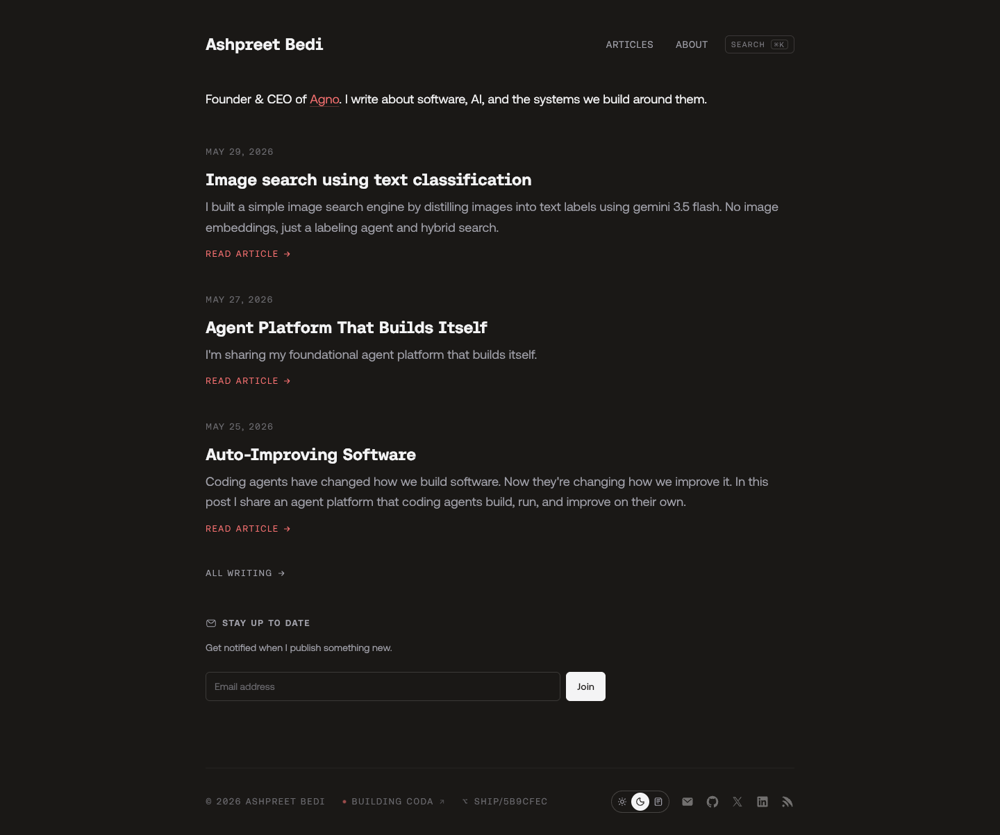

# Ashpreet Bedi
> Founder & CEO of Agno. I write about software, AI, and the systems we build around them.  ·  [ashpreetbedi.com](https://www.ashpreetbedi.com/)

**What it is** — The personal blog / portfolio of Ashpreet Bedi, founder & CEO of Agno, collecting his essays on software, AI, and the systems we build around them. The tweet shares his article 'Systems Engineering: Building Agentic Software That Works'; the site root is what resolves.

**What it shows** — A dark home page with a one-line bio ('Founder & CEO of Agno...'), a reverse-chronological article list — 'Image search using text classification', 'Agent Platform That Builds Itself', 'Auto-Improving Software' — each with a date, dek and 'READ ARTICLE' link, an 'ALL WRITING' link, a 'STAY UP TO DATE' email-subscribe block, and a footer carrying a light/dark toggle, a 'BUILDING CODA' status, and GitHub/X/LinkedIn/RSS icons.

**How it works** — A Tailwind v4 static site (the :root is full of Tailwind's oklch design tokens) with everything self-hosted — no third-party script or stylesheet hosts beyond ashpreetbedi.com. It ships a command-palette search (Cmd+K), uses 13 inline SVG icons and no raster images, and scrolls a modest single column (~1203px on desktop).

**How it's designed** — A warm dark 'paper' aesthetic: the background is --color-paper #1a1816 (rendered rgb(26,24,22)) with off-white --color-ink #f4f4f5 text and a coral-red --color-accent #f87171 on links and 'READ ARTICLE'. Two custom faces do the work — aeonik for sans body and aeonikFono, a monospace, for headings and the uppercase tracked micro-labels — giving it a deliberate developer-journal feel.

**Palette** — Warm near-black 'paper' background, off-white ink, coral-red accent.
**Fonts** — aeonik (sans body) + aeonikFono (monospace headings/labels), both self-hosted.

## Connections
**Aesthetics:** [[aesthetics/dark|dark]] [[aesthetics/developer-product|developer-product]] [[aesthetics/minimal|minimal]]
**Patterns:** [[patterns/dark-theme|dark-theme]] `developer-blog` `monospace-headings` [[patterns/tailwind|tailwind]] `article-list` `command-palette` `newsletter-cta` [[patterns/minimalist|minimalist]]
**Category:** [[categories/personal|personal]]
**Tech:** [[tech/tailwind-css-v4|Tailwind CSS v4]] `aeonik / aeonikFono (self-hosted)` `self-hosted, no third-party analytics detected`
**Colors:** [[colors/dark|dark]] [[colors/warm|warm]]
**Fonts:** `aeonik 100-900` `aeonikFono 100-900`

## Related sites
[[sites/khairallah.xyz|khairallah.xyz]] [[sites/northgarden.com|northgarden.com]] [[sites/ryancarson.com|ryancarson.com]] [[sites/sceneai.art|sceneai.art]] [[sites/affiliatenetwork.com|affiliatenetwork.com]]
